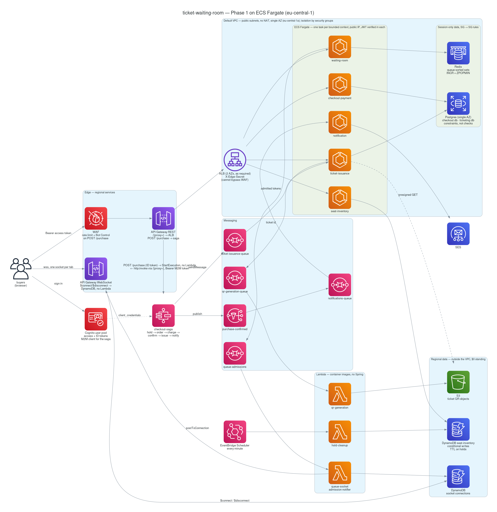

# ticket-waiting-room

A Ticketmaster-style waiting room and high-demand ticket sale, built on AWS to demonstrate
one thing properly: **concurrency correctness under load** — atomic seat locking, a fair
distributed queue, and a saga-based checkout — on real infrastructure, with the proof
measured rather than asserted.

> **200 buyers race 10 seats through the whole stack → exactly 10 win, 190 lose, 0 errors.**
> **50 customers race 10 seats through the full purchase saga → 10 succeed, 40 fail at the
> hold with nothing charged, and in the data stores:**
> `seats SOLD = orders PAID = payments CAPTURED = tickets : 10 = 10 = 10 = 10` — **0 double-sold seats.**
>
> Java 26 · Spring Boot 4.1 · ~25 AWS services · Phase 1 (hand-built on ECS Fargate) complete ·
> total AWS spend for the whole phase under $5.



The picture is the system as it ran on 2026-09-17. The full architecture — topology, the
purchase sequence, the saga state machine, the seat lifecycle, the async edges, identity —
is in [`docs/architecture.md`](docs/architecture.md), and each module has an
`ARCHITECTURE.md` beside its code. Every AWS component was built by hand once, documented
as a runbook in [`docs/`](docs/), verified, and torn down; the runbooks carry the numbers
quoted below, the traps hit, and what each session cost.

## The proof

Every concurrency mechanism was first proven locally against real infrastructure in Docker
(Testcontainers: LocalStack DynamoDB, Redis, Postgres), then again on AWS behind the real
edge, and finally under load through the entire stack with k6
([`docs/runbook-load-test.md`](docs/runbook-load-test.md), [`load-test/`](load-test/)).

**Scenario A — the seat race.** 200 virtual users, released at once, each trying to hold
one of 10 seats through API Gateway → ALB → JWT verification → DynamoDB's conditional write.

| Run | Won / lost / unexpected | Winners p50 / p95 / p99 | Losers p50 / p95 / p99 |
|---|---|---|---|
| first after warm-up | **10 / 190 / 0** | 1.05 s / 1.90 s / 2.26 s | 5.33 s / 8.64 s / 8.84 s |
| hot | **10 / 190 / 0** | 0.58 s / 1.13 s / 1.20 s | 3.02 s / 4.91 s / 5.01 s |

Losers are slow *because* they lose: 200 requests land on one 0.25-vCPU task, the first ten
take their seats, the rest queue for the same round trip to be told no. DynamoDB's own
`ConditionalCheckFailedRequests` metric agreed with the service's count of lost races
(662 vs 660 + two deliberate warm-up losses) — two independent sources, one number.

**Scenario B — the full purchase, contended.** 50 customers, each a real Cognito identity
(the queue allows one place per identity), join the waiting room, are admitted in batches,
and race `POST /purchase` for 10 seats. Each purchase is a Step Functions saga: hold → order
→ charge → confirm → issue ticket → notify.

| Admitted | Won / lost | Step Functions | Accepted (202) p50 / p99 | Winner, 202 → PAID p50 / p95 / p99 |
|---|---|---|---|---|
| 50 | **10 / 40** | 10 `SUCCEEDED` · 40 `FAILED SeatUnavailable` | 125 / 175 ms | **3.0 / 4.1 / 4.25 s** |

The 40 losers reached the hold, lost the conditional write, and the saga stopped: no order
row, no charge, no ticket, no mail. Nothing needed compensating because nothing had been
taken. The invariants, read from DynamoDB and both Postgres databases afterwards:

```
seats SOLD = orders PAID = payments CAPTURED = tickets :  10 = 10 = 10 = 10
seats with two PAID orders   (must be 0): 0
seats with two tickets       (must be 0): 0
CAPTURED on a non-PAID order (must be 0): 0
orders with two live payments(must be 0): 0
RESULT: 0 double-sold seats
```

## The concurrency, mechanism by mechanism

Each guarantee lives in a *data-store primitive*, never in application code, so it holds
against every writer — including ones that do not exist yet.

| Guarantee | Mechanism | Proven locally | Proven on AWS |
|---|---|---|---|
| **A seat is held by exactly one buyer** | DynamoDB `UpdateItem` with `ConditionExpression status = AVAILABLE`; one item, no lock, no read-modify-write window. TTL on the hold plus a scheduled cleanup Lambda that reclaims expired holds with the same guarded write | `SeatHoldConcurrencyIT`: 100 virtual threads on one seat → 1 winner | 30 concurrent holds → 1×201, 29×409 (slice 1, again through the edge in slice 6); 200 → 10 (load test) |
| **First in, first admitted** | Redis sorted set scored by an `INCR` ticket number (wall-clock scores tie and fall back to ordering by token UUID), `ZPOPMIN` admission, one place per identity via `HSETNX` — each operation a single Lua script | `WaitingRoomFairnessIT`: 100 concurrent joins → 100 distinct contiguous places, admission order = join order | same result on ElastiCache over a real network; 50 identities joining 50× each → 50 places |
| **An order is charged once** | Postgres: unique idempotency key on orders and payments, and the partial unique index `ux_payments_one_live_per_order` allowing one PENDING-or-CAPTURED payment per order. The gateway is called *between* two transactions, never inside one | `CheckoutConcurrencyIT`: 50 charges with distinct keys → 1 CAPTURED, gateway invoked once | 50 concurrent charges → 1×200, 49×409, exactly one CAPTURED row (slice 4) |
| **A ticket is issued once, however many times the message arrives** | `UNIQUE (order_id, seat_id)` on `tickets`; the SQS consumer deletes only after the handler returns, so redelivery is ordinary and the constraint absorbs it | `TicketIssuanceIT`: 20 concurrent deliveries → 1 ticket | 21 duplicate deliveries, 20 in two concurrent batches → 1 ticket, `issued_at` unchanged (slice 5) |
| **Checkout never strands a seat, or keeps money for one it could not sell** | Step Functions saga with explicit compensation: a declined payment is HTTP 200, so compensation hangs off a `Choice`, not a `Catch`. After capture the compensation is a full refund, taken only when the seat inventory definitively refuses the confirm. The confirm is idempotent on the winning hold, so a lost response can never look like a refusal. A partial unique index allows one live refund per payment. Seven distinct failure states | contract tests pin the saga's field names and its 404-only refund route to the records; 100 concurrent confirms of one hold → 1 write, 99 replays; 50 concurrent refunds → 1 SUCCEEDED, gateway asked once | happy path SOLD; declined → seat AVAILABLE, order FAILED, nothing enqueued (slice 4); 40 concurrent losers → all `SeatUnavailable` (load test); the refund path is proven locally and **not yet run on AWS** |
| **A QR is rendered once per ticket, by construction** | S3 key derived from the ticket id, pure renderer — a redelivery rewrites identical bytes, no guard needed | `QrGenerationIT` | slice 5 |

The full argument for each is in the module's `ARCHITECTURE.md`; the key design decisions
to preserve are listed in [`CLAUDE.md`](CLAUDE.md).

## Why each service exists

Every AWS service earns its place by solving a concrete problem; none is here for coverage.

| Service | The problem it solves here | Runbook |
|---|---|---|
| **DynamoDB** | seat state under extreme contention: one item, conditional writes, TTL | [seat-inventory](docs/runbook-seat-inventory.md) |
| **ElastiCache (Redis)** | queue order needs a totally ordered atomic counter: sorted sets, `INCR`, `ZPOPMIN`, Lua | [waiting-room-redis](docs/runbook-waiting-room-redis.md) |
| **RDS Postgres** | orders, payments, tickets need invariants that span rows and involve money — declared as constraints | [checkout-rds](docs/runbook-checkout-rds.md), [ticket-issuance](docs/runbook-ticket-issuance.md) |
| **Step Functions** | the checkout saga with visible, retried, compensated steps | [checkout-saga](docs/runbook-checkout-saga.md) |
| **SQS** | decouples payment from ticket issuance; at-least-once, DLQs, redrive | [ticket-issuance](docs/runbook-ticket-issuance.md) |
| **SNS** | one purchase event, two independent subscribers (email, the notification queue) | [notifications](docs/runbook-notifications.md) |
| **EventBridge Scheduler** | reclaiming expired holds: TTL alone is lazy | [hold-cleanup](docs/runbook-hold-cleanup.md) |
| **Lambda** | three container-image functions: hold cleanup, QR rendering, the WebSocket admission notifier — no Spring, no HTTP stacks, cold start measured | [hold-cleanup](docs/runbook-hold-cleanup.md), [qr-generation](docs/runbook-qr-generation.md), [websocket-queue](docs/runbook-websocket-queue.md) |
| **ECS Fargate + ECR** | one task per bounded context, 0.25 vCPU, Spot | [ecs-fargate](docs/runbook-ecs-fargate.md), [ecr-packaging](docs/runbook-ecr-packaging.md) |
| **API Gateway REST + ALB** | one stable edge; the purchase route starts the saga directly, no Lambda | [alb-apigateway](docs/runbook-alb-apigateway.md) |
| **API Gateway WebSocket** | live admission push; `$connect`/`$disconnect` are service integrations straight onto DynamoDB, because a Lambda there buys only a cold start on the one path a door-open hits hardest | [websocket-queue](docs/runbook-websocket-queue.md) |
| **Cognito** | buyers must be identities: a per-account limit is unenforceable without one. Every service verifies the JWT itself (`token_use = access`, so an ID token is never an API credential); the saga uses an M2M client | [cognito-auth](docs/runbook-cognito-auth.md) |
| **WAF** | anti-scalping on `POST /purchase`: rate limit per IP, Bot Control — a functional requirement of the domain | [waf](docs/runbook-waf.md) |
| **S3** | QR objects served by presigned URL, never proxied through a small task | [qr-generation](docs/runbook-qr-generation.md) |
| **CloudWatch + X-Ray** | metrics and traces over OTLP to an ADOT sidecar; one purchase is one trace across API Gateway, the saga's `http:invoke` calls, SQS and the consumers; a dashboard of queue depth, seats remaining, hold contention and conversion | [observability](docs/runbook-observability.md) |
| **Secrets Manager, IAM, SES** | RDS-managed credentials read by the execution role; one least-privilege role per service; sandbox mail | throughout |

## What it cost

The rule was *nothing runs while I am not working on it*: every session ends with a
teardown checklist and a tag sweep, and the demo is re-creatable rather than standing.

- **Standing cost while idle: ≈ $0.07/month** — ECR past the free tier, with one image per
  repository (≈ $0.16 while the superseded images from before the load-test rebuild remain).
  DynamoDB, SQS, SNS, Lambda, Step Functions, Cognito, task definitions, log groups at 1-day
  retention: $0. The final account sweep found nothing billing by the hour
  ([`docs/runbook-teardown-sweep.md`](docs/runbook-teardown-sweep.md)).
- **A full-stack session** (ALB, RDS `db.t4g.micro`, ElastiCache `cache.t4g.micro`, five
  Fargate Spot tasks, the collector sidecars): **≈ $0.10–0.15 per hour**. The load-test
  session was 37 minutes and ≈ $0.09; the Cognito session ≈ $0.15; the observability
  bring-up ≈ $0.05.
- **The expensive things to forget**: an ALB (~$27/month), a WAF web ACL with Bot Control
  (~$17/month). Both are session-only and the runbooks say so in the first paragraph.
- Whole of Phase 1: **under $5** against a $10/month budget alert (September
  was $0.96 including tax).

Prices were read from the pricing pages or the Price List API at the time of each slice
and are recorded in the runbooks' *What It Cost* sections.

## Repository map

| Path | What |
|---|---|
| `waiting-room-service`, `seat-inventory-service`, `checkout-payment-service`, `ticket-issuance-service`, `notification-service` | one Spring Boot 4.1 service per bounded context; Flyway-owned schemas; Lua scripts beside the queue code |
| `hold-cleanup-lambda`, `qr-generation-lambda`, `queue-socket-lambda` | plain Java Lambdas as container images on JDK 26, HTTP stacks stripped for the 10 s INIT budget |
| `common` | shared contracts (events, the DynamoDB attribute names, the QR key) and the SQS consumer loop, framework-free because the Lambdas share it |
| `security-starter` | the OAuth2 resource-server auto-configuration every HTTP service uses; a service declares only its path rules |
| `observability-starter` | actuator health, OTLP export, what X-Ray needs that Boot does not know, consumer spans across SQS |
| `docs/` | `architecture.md`, `phase1-plan.md`, one runbook per AWS slice with decisions, console steps, results, traps, teardown |
| `load-test/` | the k6 scenarios, the test-user and token scripts, the invariant check |
| `scripts/teardown-sweep.sh` | the read-only account sweep run after every session; exits 1 if anything bills by the hour |

## Building and running

```bash
./gradlew build                                   # every module, 167 tests, Testcontainers ITs included
./gradlew :seat-inventory-service:bootRun         # a service locally: no AWS needed for the waiting room
                                                  # (logging publisher) or the notification service (logging sender)
./gradlew :hold-cleanup-lambda:build              # stages a Lambda's deployment package for its Dockerfile
```

Requirements: a JDK to launch Gradle (the JDK 26 toolchain is auto-provisioned), Docker for
the integration tests. The AWS side is entirely in the runbooks; there is nothing to `apply`
in Phase 1 by design.

## Deliberate simplifications, and the phases after this one

Phase 1 optimised for learning depth and near-zero cost, and says so where it cut a corner:

- **The default VPC, public subnets, no NAT Gateway, one AZ.** Tasks carry public IPs; RDS
  is publicly accessible behind a two-source security group; isolation is security-group
  to security-group. The largest simplification, and the first thing Phase 2 changes.
- **The ALB is internet-facing and trusts a shared header** (`X-Edge-Secret`) so that
  traffic cannot bypass WAF; an NLB behind a VPC link makes that structural.
- **Fargate Spot, 0.25 vCPU, one task per service** — the load test's tail latency is that
  task's queue, not the writes. Two tasks per service is the obvious next data point.
- **SES sandbox**, so confirmation mail reaches only verified addresses; a duplicate
  delivery sends a duplicate mail, recorded as a conscious omission.
- **No frontend.** The optional CloudFront + S3 page was left out: the proof is the API.

## Known gaps

Not simplifications but holes, listed so a reader does not have to find them:

- **Purchase does not check admission.** The waiting room orders and admits fairly, but
  `POST /events/{id}/purchase` starts the saga for any valid ID token, admitted or not —
  the load test's buyers wait their turn because the script makes them, not because the
  edge does. The fix is a first saga state that asks the waiting room, with the ops token,
  whether this `sub` holds an unexpired pass (Redis already answers that — it is what
  `position.lua` reads for `GET /events/{id}/queue`), and fails the execution before `HoldSeat` if not.
- **The client names the price.** `amountCents` comes from the purchase body, because there
  is no event catalog to read it from. Seat inventory should own the price per seat and
  return it with the hold, and the saga should charge what the hold says.

**Phase 2** rebuilds the same architecture in Terraform, starting with the network, and adds
GitHub Actions with OIDC. What Phase 1 taught that Terraform needs (the stack split, the
values every rebuild minted, the defaults that failed silently, and the decisions to make
first) is in [`docs/phase1-retro.md`](docs/phase1-retro.md). **Phase 3** re-platforms it
onto EKS, where the OTLP sidecar becomes a DaemonSet and nothing in a service changes. The plan, with every checkbox and
what each session found, is [`docs/phase1-plan.md`](docs/phase1-plan.md).
