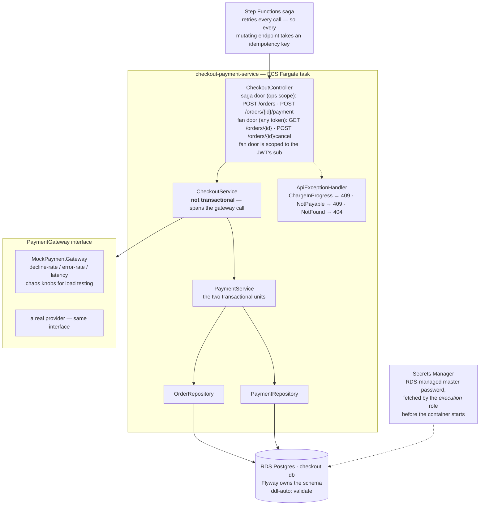
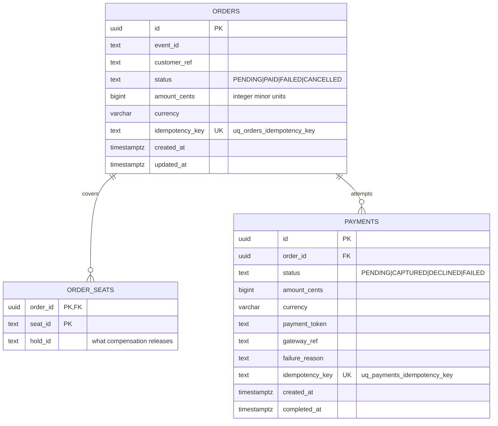
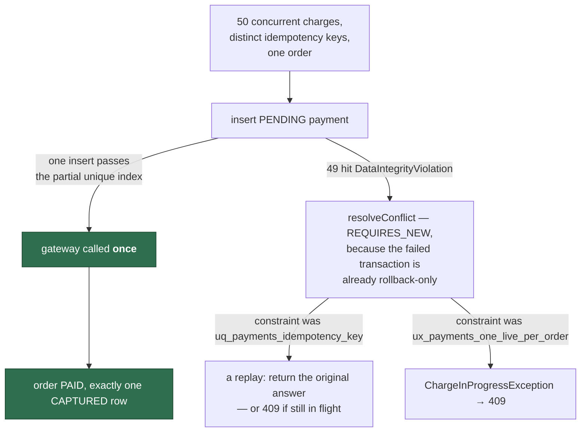
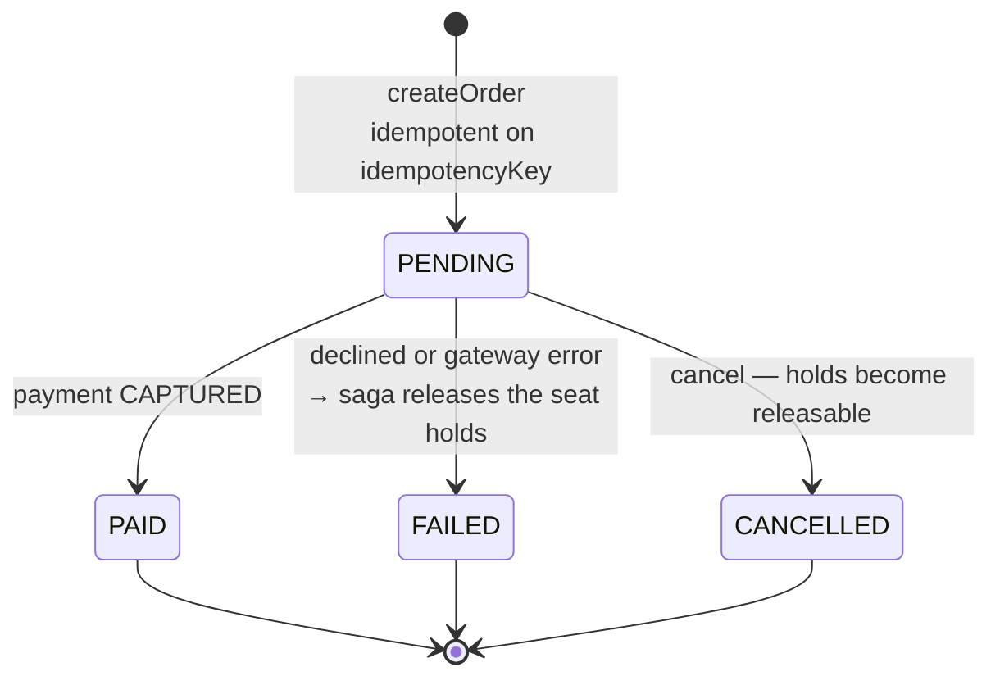

# checkout-payment-service

Orders and payments — the data that needs real ACID transactions. Two things are being
demonstrated here and both are about *where the boundary sits*: the invariants live in the
database as constraints, and the payment gateway is called with no transaction held.

System context: [`docs/architecture.md`](../docs/architecture.md) ·
AWS setup: [`docs/runbook-checkout-rds.md`](../docs/runbook-checkout-rds.md) ·
Saga: [`docs/runbook-checkout-saga.md`](../docs/runbook-checkout-saga.md)

## Components



## Schema, and the invariants declared in it



The invariant that justifies Postgres for this data is not in that table listing — it is
an index:

```sql
CREATE UNIQUE INDEX ux_payments_one_live_per_order
    ON payments (order_id)
    WHERE status IN ('PENDING', 'CAPTURED');
```

"At most one row per group matching a predicate" is exactly what a partial unique index
is for, and exactly what a key-value store cannot declare — there the rule would have to
be reimplemented, correctly, in every writer. `DECLINED` and `FAILED` sit outside the
predicate on purpose, leaving room for a retry-with-another-card flow.

## Transaction boundaries around the gateway

This is the diagram to read if you read one. The gateway call sits in the **gap between**
two committed transactions, never inside one.

```mermaid
sequenceDiagram
    participant S as Saga
    participant CS as CheckoutService<br/>(no transaction)
    participant PS as PaymentService
    participant DB as Postgres
    participant GW as Gateway

    S->>CS: charge(orderId, idempotencyKey, token)

    rect rgb(52, 78, 65)
        Note over PS,DB: transaction 1 — beginAttempt
        CS->>PS: beginAttempt
        PS->>DB: findByIdempotencyKey
        Note right of PS: checked BEFORE the order's status:<br/>a replayed charge must return its original<br/>answer even once the order is terminal
        PS->>DB: order must be PENDING
        PS->>DB: saveAndFlush payment PENDING
        Note right of DB: must pass ux_payments_one_live_per_order —<br/>only one caller can hold a live attempt
        DB-->>PS: committed
    end

    Note over CS,GW: nothing held here. A DB transaction across this call<br/>would trade the provider's latency for this<br/>service's connection pool.
    CS->>GW: charge
    GW-->>CS: CAPTURED / DECLINED / error

    rect rgb(52, 78, 65)
        Note over PS,DB: transaction 2 — completeAttempt
        CS->>PS: completeAttempt(result)
        PS->>DB: payment CAPTURED + order PAID<br/>(or DECLINED/FAILED + order FAILED)
        Note right of DB: committed together — no window in which<br/>money has moved and the order does not know
    end

    PS-->>S: ChargeOutcome
```



**The crash window is deliberate and recoverable.** A crash between the two leaves a
PENDING payment row — a charge that may have moved money, with a row to prove it — rather
than a charge nobody has any record of.

## What the dashboard reads

`CheckoutMetrics`, from `CheckoutService` where the outcome is decided:
`checkout.charges{outcome}` with `captured`, `declined`, `failed`, `replayed` (a settled key
answered again, or a conflict resolved to the original attempt), `in_flight` (the partial
unique index refusing a rival while the winner's row is PENDING) and `not_payable` (an
attempt that arrived after the winner had settled the order). Under the concurrency test
the last two together are N−1 of every N — which is which depends on how late each loser
was. `checkout.orders{created|replayed}` shows saga retries; `checkout.gateway.latency`
times the gateway call alone, the network the transaction is deliberately not held across,
which is the number that climbs in a provider outage while the pool stays healthy.
`captured` over the waiting room's `admissions` is the conversion rate, computed on the
dashboard.

## Concurrent charges on one order



The database decides which of the two constraints was hit; `resolveConflict` only reports
what that means. No application-level guard is involved anywhere on this path.

## Order lifecycle



## Proven

`CheckoutConcurrencyIT` (Testcontainers Postgres), and against the real RDS instance:
**30 concurrent charges with distinct keys on one order → 1×200, 29×409, exactly one
CAPTURED row**; a replay of a settled key returned the original `gatewayRef`; the decline
path left `FAILED`/`DECLINED`. Re-checked in SQL against the live instance: 0 orders with
more than one live payment, 0 CAPTURED payments whose order is not PAID (2026-08-27).
