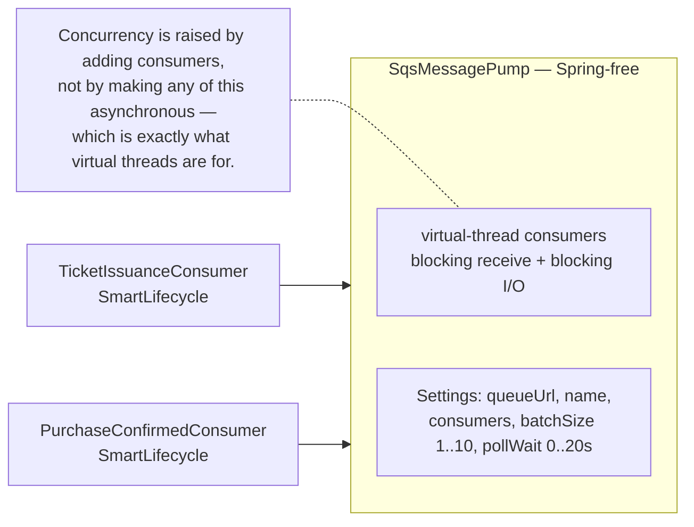
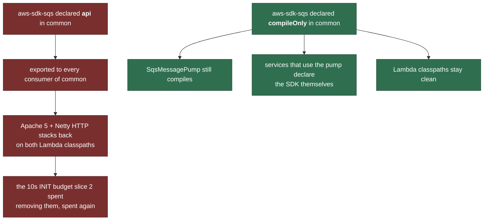

# common

Shared contracts, and one shared mechanism. The rule for what belongs here is narrow:
something goes in `common` when **more than one deployable must agree on it and a
disagreement would not be a compile error**.

System context: [`docs/architecture.md`](../docs/architecture.md)

## Who shares what

```mermaid
flowchart TB
    subgraph c["common — java-library, no framework"]
        STS["SeatTableSchema<br/>DynamoDB attribute names + key format"]
        TQO["TicketQrObjects<br/>S3 key + verification URL"]
        TIM["TicketIssuanceMessage"]
        PCE["PurchaseConfirmedEvent"]
        SHE["SeatHoldExpiredEvent"]
        QAM["QueueAdmissionMessage<br/>SQS body + attribute names"]
        TS["TicketingScopes<br/>the OAuth2 scope Cognito mints and four services check"]
        PUMP["SqsMessagePump<br/>the long-poll consumer loop"]
        EXC["exceptions<br/>SeatUnavailable · HoldNotFound · OrderNotFound<br/>OrderNotPayable · ChargeInProgress · TicketNotFound<br/>UnknownQueueToken · NotYours"]
    end

    SI["seat-inventory-service"]
    HC["hold-cleanup-lambda"]
    TI["ticket-issuance-service"]
    QR["qr-generation-lambda"]
    NS["notification-service"]
    CP["checkout-payment-service"]
    WR["waiting-room-service"]
    QS["queue-socket-lambda"]
    ASL["docs/checkout-saga.asl.json<br/><i>no compiler checks this one</i>"]

    STS --- SI & HC
    TQO --- TI & QR
    TIM --- TI & ASL
    PCE --- NS & ASL
    SHE --- HC
    QAM --- WR & QS
    TS --- SS["security-starter<br/>adds the SCOPE_ prefix"] & COG["Cognito resource server<br/><i>no compiler checks this one either</i>"]
    PUMP --- TI & NS
    EXC --- SI & CP & TI & NS
```



## The failure mode each contract prevents

| Contract | If the two sides drift | Symptom |
|---|---|---|
| `SeatTableSchema` | DynamoDB accepts any attribute name | a `ConditionExpression` that **silently never matches** |
| `TicketQrObjects` | writer and reader use different keys | download endpoint reports `PENDING` forever while the object sits in the bucket |
| `TicketIssuanceMessage` | ASL renames a field | field deserialises to `null` forever — pinned by `TicketIssuanceContractTest` |
| `PurchaseConfirmedEvent` | ASL renames a field | an email addressed to nobody about seat `null` |
| `QueueAdmissionMessage` | sender and notifier disagree on an attribute name | the notifier rejects every admission into the DLQ, and the queue looks broken while Redis is fine |
| `TicketingScopes` | the Cognito resource server and `security-starter` disagree on the scope name | every saga step and every operator call answers 403, while the pool, the token and the code each look correct on their own |

None of these is a compile error, and none is a runtime error. That is the whole argument
for naming them once.

## `SqsMessagePump` — shared because the semantics must be identical

Two deployables consume queues, and both must have the same at-least-once behaviour.



## The `compileOnly` SQS dependency



Verify a Lambda module has not quietly regrown them:

```bash
./gradlew :qr-generation-lambda:dependencies --configuration compileClasspath
```
