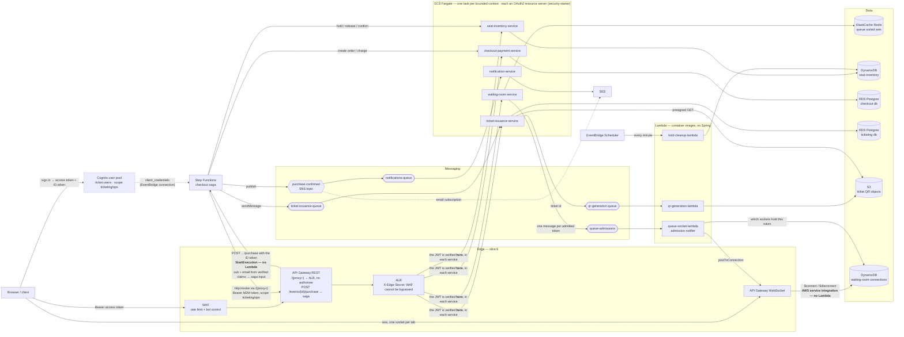
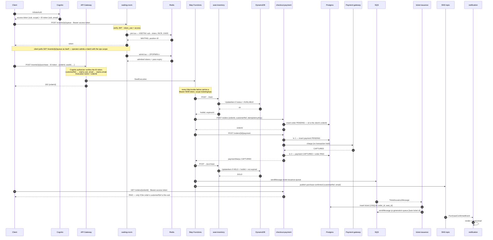
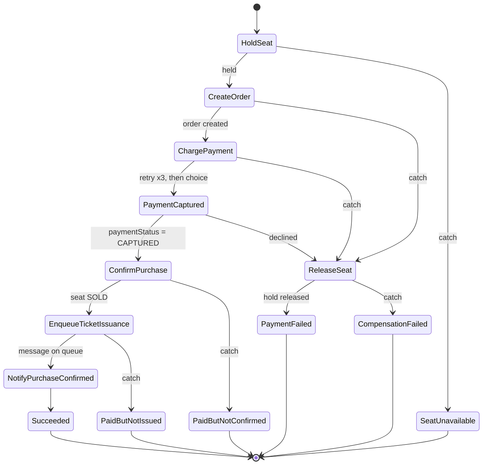
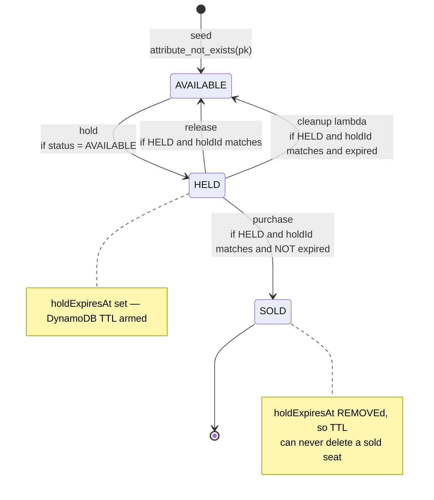
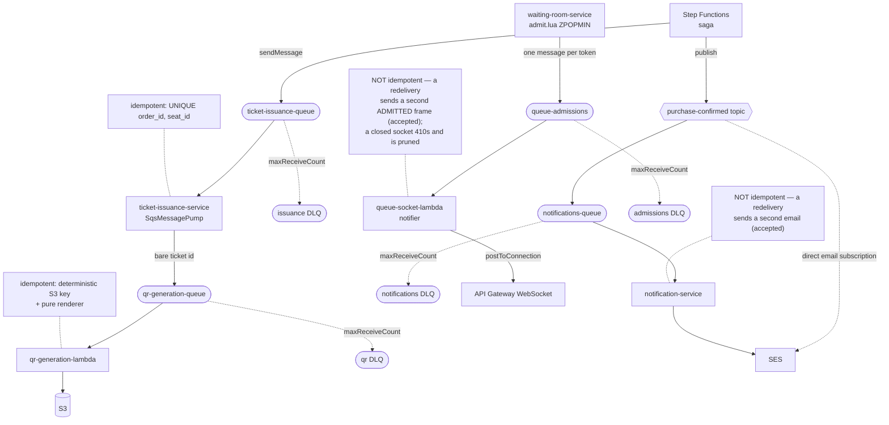
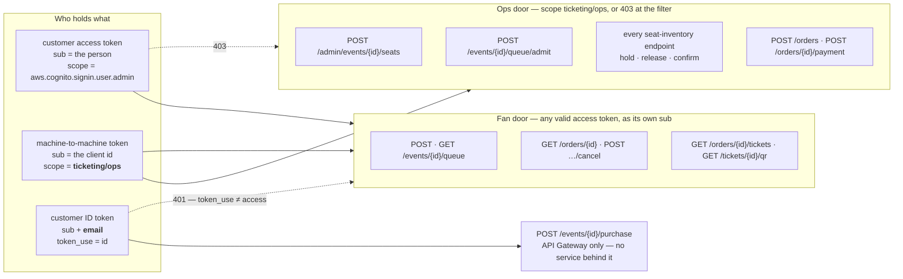
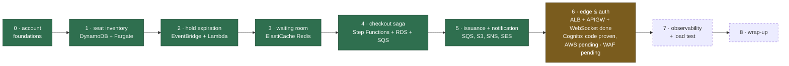

# Architecture Diagrams

The system-level picture. Every diagram here is drawn from the code as it actually
stands, not from the plan — where a box is planned rather than built it is marked and
named with the slice that will build it (`phase1-plan.md`).

Per-module diagrams, with the internals each service is actually responsible for:

| Module | Diagram | What it shows |
|---|---|---|
| `waiting-room-service` | [ARCHITECTURE.md](../waiting-room-service/ARCHITECTURE.md) | Redis keys, the three Lua scripts, the FIFO proof |
| `seat-inventory-service` | [ARCHITECTURE.md](../seat-inventory-service/ARCHITECTURE.md) | The DynamoDB item, every conditional write, the race |
| `checkout-payment-service` | [ARCHITECTURE.md](../checkout-payment-service/ARCHITECTURE.md) | Order/payment schema, transaction boundaries around the gateway |
| `ticket-issuance-service` | [ARCHITECTURE.md](../ticket-issuance-service/ARCHITECTURE.md) | SQS pump, duplicate-delivery path, QR handoff |
| `notification-service` | [ARCHITECTURE.md](../notification-service/ARCHITECTURE.md) | SNS fan-out, sender split, the duplicate-email tradeoff |
| `hold-cleanup-lambda` | [ARCHITECTURE.md](../hold-cleanup-lambda/ARCHITECTURE.md) | Scan → guarded reclaim, why TTL is not enough |
| `qr-generation-lambda` | [ARCHITECTURE.md](../qr-generation-lambda/ARCHITECTURE.md) | Bare-id message, deterministic key, partial batch failure |
| `queue-socket-lambda` | [ARCHITECTURE.md](../queue-socket-lambda/ARCHITECTURE.md) | The admission notifier, the GSI lookup, why the connect routes have no code |
| `security-starter` | [ARCHITECTURE.md](../security-starter/ARCHITECTURE.md) | The one filter chain every HTTP service runs; what a service declares, what it never has to |
| `common` | [ARCHITECTURE.md](../common/ARCHITECTURE.md) | Who shares which contract, and what breaks when one drifts |

---

## 1. System topology

Solid boxes exist and have run on AWS. Dashed boxes are built in code and runbook but have
not yet run there (Cognito, the purchase entry point — `runbook-cognito-auth.md`), or
belong to a later slice (WAF).

**Why each store is where it is** — the split is the argument the project exists to make:

| Store | Holds | Chosen because |
|---|---|---|
| DynamoDB | seat state, holds | one item, extreme contention. A conditional write settles the race with no lock and no read-modify-write window |
| Redis sorted set | queue order | FIFO fairness needs a totally-ordered atomic ticket number, which `INCR` + `ZPOPMIN` give in one round trip |
| Postgres `checkout` | orders, payments | invariants that span rows and involve money — declared as constraints, not application checks |
| Postgres `ticketing` | tickets | separate bounded context, separate Flyway history, deliberately no FK to orders |
| S3 | QR images | large immutable blobs served by presigned URL, never proxied through a 0.25-vCPU task |
| Cognito user pool | identities, one scope | the only issuer. Every service verifies its JWTs itself, so nothing is trusted for *where* it came from — see §6 |

---

## 2. The purchase, end to end

One seat, happy path. Note where the boundaries are: the saga owns the orchestration,
each service owns exactly one store, and everything after the capture is asynchronous.
Every call from the client carries its access token, and every call from the saga carries
a machine-to-machine token; each service verifies the one it receives.

---

## 3. The checkout saga

Straight from `checkout-saga.asl.json`. The shape worth reading is the **right-hand
side**: there are five distinct failure states, because what compensation means changes
the instant money moves.

Three details that are easy to get wrong and are deliberate here:

- **A declined card is HTTP 200.** Compensation therefore hangs off the `PaymentCaptured`
  **Choice**, not off a `Catch`. `Catch` handles transport failures only — a `Catch`-based
  design would leave every decline running happily into ticket issuance.
- **After the capture there is no release path.** `PaidButNotConfirmed` and
  `PaidButNotIssued` both stop rather than compensate, because the compensating action
  for money that already moved is a refund, and releasing the seat would sell it twice.
- **`CompensationFailed` is not a dead end in practice.** The hold's TTL and
  `hold-cleanup-lambda` are the backstop that returns the seat regardless.

---

## 4. Seat lifecycle

The one item every concurrency claim in this project is about. Every arrow is a single
DynamoDB `UpdateItem` guarded by a `ConditionExpression`, so concurrent attempts are
serialized by DynamoDB per item and exactly one wins.

---

## 5. Asynchronous edges

Everything downstream of the capture, plus the one edge that runs the other way — the
admission push, which starts at the waiting room rather than the saga. Every hop is
at-least-once, and each one names what makes redelivery harmless; the point being that not
one of them is a `findBy...`-then-write check.

The asymmetry in that third note is the honest one: a duplicate ticket or a duplicate
charge is a defect, a duplicate confirmation email is an annoyance. The fix — a
`notifications_sent` table with a unique key — is deferred rather than faked with an
in-memory guard that would last exactly as long as one task.

The fourth is cheaper still, because an `ADMITTED` frame carries no state transition, only
news of one: a client that receives it twice learns the same thing twice. What makes the
whole edge safe to be best-effort is that it is not the only channel — the admission is
already durable in Redis, and `GET /events/{eventId}/queue` still reports it. The
socket removes the need to poll; it is not what makes the answer true. That is also why the
publish is deliberately *not* allowed to fail an admission: `ZPOPMIN` has already happened,
so a retry driven by a failed announcement would pop a second batch of people.

---

## 6. Identity and authorization

Every HTTP service verifies the caller's JWT itself — signature, issuer, expiry, and that
it is an *access* token — through the one filter chain `security-starter` installs. Nothing
is trusted because of where it came from. What a valid token may then do is decided by two
claims, and only two:

Three consequences worth holding onto:

- **There is no admin role.** Seeding, admitting and the saga's own steps are opened by one
  scope that only the `ticket-ops` client can mint. A customer's token is valid, signed by
  the same pool, and refused before any handler runs — the refusal is the filter's, and
  every one of them is a test through the real chain.
- **"Not yours" is 404, never 403.** A 403 confirms the id is real, which is all anyone
  needs to walk the id space and learn who bought what. For the QR the check runs before
  the presigned URL is minted: the point is the credential, not the status code.
- **The customer cannot lie about who is buying.** `customerRef` and `email` enter the
  saga from the ID token's verified claims at API Gateway; the body may carry them and
  they are not read. From there every row — order, ticket, confirmation — carries a value
  the customer never typed.

**One place per person** belongs here too, because it is an authorization property with a
concurrency proof: `join.lua` claims the customer's token with `HSETNX` in the same round
trip that enqueues it. Two hundred concurrent joins from one `sub` yield one place. Without
it the queue's FIFO guarantee is about tokens, not people.

**The trust boundary, stated.** The ALB is internet-facing (Phase 1 forbids a NAT Gateway)
and `X-Edge-Secret` on its listener rules is no longer what protects identity — the
services are. The secret's remaining job is to keep traffic from bypassing API Gateway, and
therefore WAF. Making that structural (an NLB behind a VPC link) is a Phase 2 cost decision,
not a security one.

---

## 7. Build status by slice

