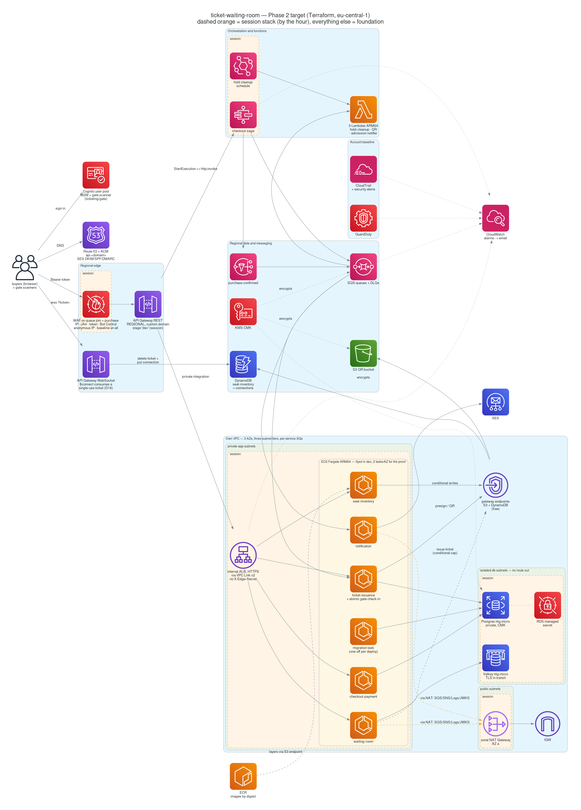
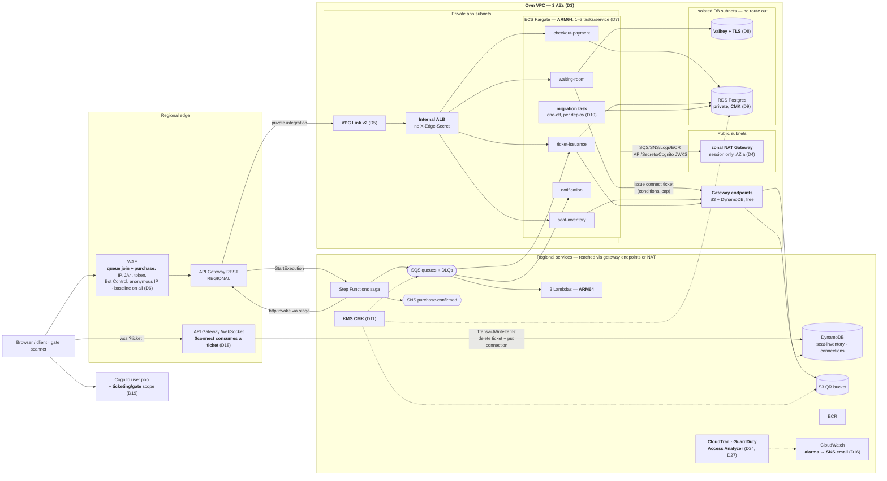
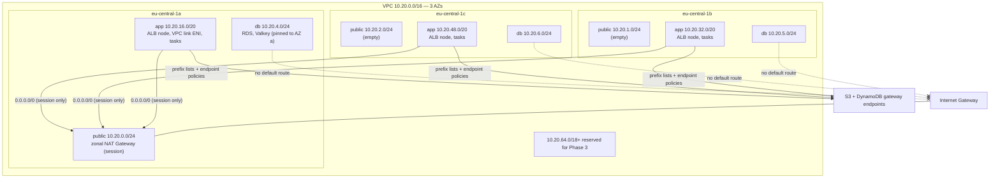
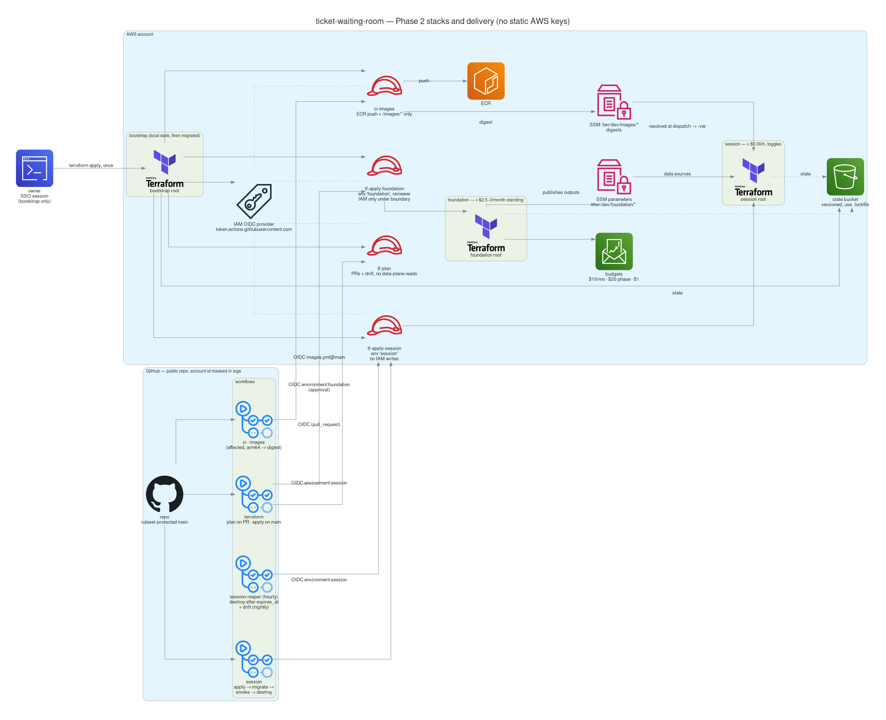
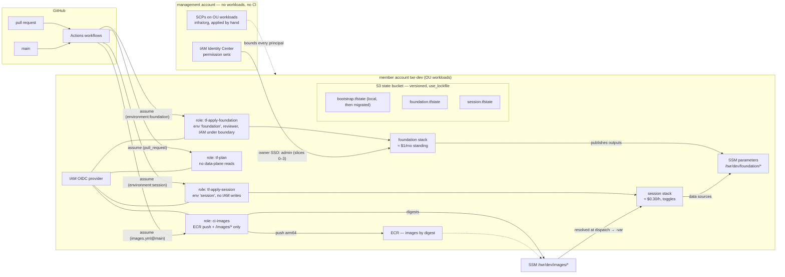

# Phase 2 Plan — Terraform, Production-Shaped, Low-Cost

**Status: all decisions settled (2026-11-11) except D20, deferred. Account structure done by hand
(2026-11-13, D12): Phase 2 runs in the member account `twr-dev`. Nothing built yet. Next: slice 0.** Every
decision carries an id (**D1**–**D27**; the index is at the top of §3). Changing a settled
decision means editing its entry and dating the change. When a slice is done, tick its boxes
the same way `phase1-plan.md` does.

Phase 2 starts from `phase1-retro.md` and does not repeat it. The retro holds the evidence
(the stack split, the minted values, the defaults that failed silently). This plan holds
the decisions and the order of work.

Goal of this phase: the same logical system as Phase 1, rebuilt **as code**, and raised
to the shape a serious team would run in production: private networking, no shared
secrets at the edge, migrations as a deploy step, alarms, CI/CD with no static keys.
Rebuildable from a cold account by `apply`, and provably torn down by `destroy`.

## Budget Ground Rules

- **Phase 2 total: ≤ $20.** Steady state $10–20/month is acceptable while working, but
  anything billed by the hour lives in the `session` stack and exists only while a
  session is running.
- **Standing cost target: ≈ $2–2.5/month**: the KMS key, alarms beyond the free tier, GuardDuty, ECR and pennies of S3. SSM standard parameters, CloudTrail's
  first trail and Access Analyzer are free.
- **Layered guardrails, all as code** (D17): the hourly *session reaper* (the real brake),
  Infracost on PRs, Cost Anomaly Detection, and budgets: $10 monthly and $20 for the phase,
  which are the record, not the brake.
- **The plan fits $20 only with discipline**: about 40 session-hours, most of them partial
  stacks through the toggles (§6). Re-check §6 against Cost Explorer at the end of every slice.
- **Prices are re-checked from the Price List API in slice 0** (the habit from Phase 1);
  the figures below are estimates for eu-central-1.

---

## 1. Target Topology

*Official AWS icons, generated from [`diagrams/phase2-architecture.py`](diagrams/phase2-architecture.py).
The Mermaid below is the source of truth. Regenerate with
`docker run --rm -v "$PWD:/out" gtramontina/diagrams:0.23.4 docs/diagrams/phase2-architecture.py`.*



What changes from Phase 1 is drawn in **bold** labels. Everything else is carried over
unchanged (see *Carried Over Unchanged* below).



### Network detail (D3, D4)



Security groups are per service and SG-to-SG only (D3). The VPC link SG feeds the ALB SG,
which feeds only the four HTTP services. Only `waiting-room` reaches the cache, and only
`checkout`, `issuance` and the migration task reach the database. No CIDR rule references a
human IP anywhere (the retro's un-Terraformable `$MYIP` disappears; D9).

---

## 2. Stacks, State and Delivery

*Icons: [`diagrams/phase2-delivery.py`](diagrams/phase2-delivery.py).*





### Repository layout (D1, D2)

```
infra/
  org/                management account only, applied by hand: SSO permission sets + assignments, SCPs on OU `workloads`, management-account $1 budget, own state bucket (D12)
  bootstrap/          local state → migrated: state bucket, OIDC provider + sub customisation, tf-plan / tf-apply-foundation / tf-apply-session roles, boundary
  modules/            own modules (one concern each; see D1)
    network/          wraps terraform-aws-modules/vpc + gateway endpoints + SGs
    kms/  dynamodb/  messaging/  identity/  iam/  ecr/  lambda-function/
    websocket-api/  rest-api/  waf/  alb/  ecs-service/  rds/  cache/
    saga/  observability/  budgets/  audit/ (CloudTrail, GuardDuty, alerts)
      each: main.tf  variables.tf  outputs.tf  versions.tf  README.md (terraform-docs)
            tests/*.tftest.hcl   plan-only module tests with mock_provider (D2)
  live/
    foundation/       applied once, $0–1/mo
    session/          apply at start, destroy at end; per-proof toggles
  scripts/            bash, shebang: session.sh (up|down, the staged order, D23), migrate.sh, smoke.sh, invariants.sh (runs the reconciliation task, D16)
docs/adr/             MADR records for the eight significant decisions (D26)
.github/workflows/    ci.yml, images.yml, terraform.yml, session.yml, session-reaper.yml, drift.yml
.github/dependabot.yml  terraform, github-actions, gradle, docker; weekly, grouped (D2)
```

### What lives where (retro §1, unchanged rule: *references a session value → session*)

| `foundation` (standing ≈ $2.5–3/mo) | `session` (by the hour, toggled) |
|---|---|
| VPC, subnets (EKS-tagged), route tables, IGW, gateway endpoints + policies, per-service SGs, flow logs → S3 | NAT Gateway + its EIP, the private route to it |
| KMS CMK + alias (key policy with every producer's grant) | Internal ALB (HTTP listener, reachable only from the VPC link SG), listener rules, target groups |
| DynamoDB `twr-dev-seat-inventory`, `twr-dev-connections` (PITR, deletion protection) | VPC Link v2, the `/{proxy+}` private integration, deployment + `dev` stage (D5) |
| S3 QR bucket, ECR repos (immutable, lifecycle, scan on push) | RDS instance (+ managed secret on the CMK), per-service DB secrets (write-only, fresh per session), Valkey cluster |
| SQS/DLQs/redrive, SNS + subscriptions | ECS services + task definitions + autoscaling (scheduled + target tracking), migration task definitions |
| Cognito pool (deletion protection), domain, resource server, clients incl. the gate scanner | EventBridge connection, `checkout-saga` state machine |
| IAM roles + policies + permissions boundary, Access Analyzer | WAF web ACL + association + logging |
| 3 Lambdas + ESMs, WebSocket API (connect-ticket template, route throttling) + stage | `hold-seat-schedule` |
| REST API + resources/methods (id and invoke URL stable for the life of foundation) | Session alarms: saga, ALB 5xx, unhealthy/missing tasks (D16) |
| SES address identities (sandbox) | `expires_at` SSM parameter read by the reaper (D15) |
| Log groups, dashboard, foundation alarms, `ops-alarms` topic, budgets, anomaly monitor | |
| CloudTrail trail + bucket, GuardDuty detector, EventBridge security alerts | |

Toggles in `session`: `enable_nat`, `enable_alb`, `enable_db`, `enable_cache`, `enable_waf`,
`enable_saga`, `services = [...]`, `desired_count`, `task_size` per service, `loadtest_allow_cidr` (runtime only, D6),
`capacity = "FARGATE_SPOT" | "FARGATE"`, `waf_baseline_mode = "count" | "block"`.

---

## 3. Decisions (settled 2026-11-11; D20 deferred)

Each entry gives the decision, the reason and the cost. **Architect review 2026-11-11:** every
entry was reviewed against current industry practice before it was settled. The *Review* lines
record what that review changed and why, and stay as the reasoning.

| ID | Decision | Built in slice |
|---|---|---|
| D1 | Hybrid modules: community VPC, own modules for the domain | 0–1 |
| D2 | Terraform ≥ 1.11, gates, `terraform test`, Dependabot, SSM between stacks | 0 |
| D3 | Own VPC, 3 AZs, `/20` app subnets, per-service SGs, endpoint policies, flow logs | 1 |
| D4 | Zonal NAT for sessions; regional NAT as the documented production mode | 2 |
| D5 | REST API → internal ALB via VPC Link v2; integration in `session` | 2 |
| D6 | WAF on queue join **and** purchase; stacked keys; baseline; logging | 2, 5 |
| D7 | Fargate ARM64, Spot in dev, readiness checks, scheduled + target-tracking scaling | 2, 5 |
| D8 | ElastiCache, Valkey engine, TLS | 3 |
| D9 | Private RDS, one database role per service | 3 |
| D10 | Migrations as a one-off ECS task | 3 |
| D11 | One CMK, with a written rule for which stores use it | 1 |
| D12 | IAM as code; one execution role per service; humans read, pipelines write; workload in a member account | 0–1 |
| D13 | Secrets: write-only, rotated per session; third-party keys set out of band | 3 |
| D14 | Four OIDC roles, protected `main`, nothing identifying in public logs | 0, 4 |
| D15 | Workflows: affected images, digests in SSM, reaper with `expires_at`, drift | 4 |
| D16 | Alarms that need a human, `treat_missing_data` pinned, invariants every session | 1, 5 |
| D17 | Cost guards, fastest first; Infracost | 0, 4 |
| D18 | WebSocket connect tickets: authentication and the per-token cap | 6 |
| D19 | Ticket verification and an atomic check-in at the gate | 6 |
| D20 | Custom domain — **deferred**; gaps accepted and listed | — |
| D21 | Phase 3 seams: IAM trust as input, `TargetGroupBinding`, EKS subnet tags | 1, 7 |
| D22 | Lambdas outside the VPC | 1 |
| D23 | Terraform deploys the services, in stages | 3–4 |
| D24 | CloudTrail, security alerts, data protection | 0–1 |
| D25 | Naming: `twr-<env>-…`, computed unique names | 0 |
| D26 | ADRs for the eight significant decisions | 0–7 |
| D27 | GuardDuty on; Config, Security Hub, Control Tower, mesh, multi-region out | 0 |

### Tooling and structure

**D1. Module strategy: hybrid.** *Settled 2026-11-11.*
- **What goes where.** The network plumbing comes from the community
  `terraform-aws-modules/vpc` module. Everything that carries domain meaning is in our own
  modules: the seat table, saga, WAF, ECS services, WebSocket integrations and IAM.
- **Why.** Most serious teams work this way: community modules for commodity infrastructure,
  own modules where the defaults *are* the design. Nearly all of the retro's §3
  pinned-defaults list is in the domain resources, so those stay visible in our code. Phase 3
  adds `terraform-aws-modules/eks` on the same logic.
- *Review: why only the VPC module.* The community `alb`, `ecs`, `rds` and `sqs` modules exist
  and are widely used. They are not used here because each hides tens of inputs behind its own
  defaults, which is exactly what retro §3 says to pin by hand. The VPC module is the one where
  the community defaults are already right and the code is pure boilerplate.
- **Module conventions** (what reviewers in any Terraform shop look for):
  - Files: `main.tf`, `variables.tf`, `outputs.tf`, `versions.tf`, `README.md`.
  - `versions.tf` declares `required_providers` and **never a `provider` block**. Providers are
    configured only in the roots, so a module stays reusable, and Phase 3 can reuse it from the
    EKS stack.
  - Every variable has a `description`, a `type` and, where a wrong value would be silent, a
    `validation` block. Example: TTL attribute names, or a visibility timeout below six times
    the function timeout.
  - Roots in `live/*` are **thin compositions**: wiring between modules, no resources of their
    own beyond SSM outputs.
  - At most one level of nesting: `network` wraps the community `vpc`, and no module wraps a
    module that wraps a module.
  - The README is generated by **`terraform-docs`** and checked in CI, so input and output
    tables cannot drift.
- **Pinning.** Community modules are pinned to an **exact** version (`version = "6.x.y"`), not
  a range. A module upgrade is a reviewed PR with its own plan, never a side effect of `init`.

**D2. Toolchain, gates and module tests.** *Settled 2026-11-11.*
- **Terraform, not OpenTofu.** Most teams and job postings still use Terraform. The BSL licence
  only restricts building a competing product, not using it. OpenTofu gets a sentence in the
  retro.
- **Versions, pinned twice.**
  - `.terraform-version` sets the binary for tfenv/mise and `hashicorp/setup-terraform` in CI.
  - `required_version = "~> 1.11"` in every root and module enforces it. 1.11 is the minimum for
    write-only arguments (D13); use the latest 1.x at slice 0.
  - The AWS provider is `~> 6.x`, with `.terraform.lock.hcl` committed for all three CI
    platforms (`terraform providers lock -platform=linux_amd64 -platform=linux_arm64
    -platform=darwin_arm64`). A lock file missing the runner's platform is a classic first-CI
    failure.
  - tflint, trivy and terraform-docs are pinned to exact versions in the workflow.
- **Tags.**
  - `default_tags { project, phase, stack, env }` on the provider.
  - ECS services set `propagate_tags = "SERVICE"`, because tasks launched by a service do not
    inherit provider tags. That is one of the gaps behind the retro §5 sweep missing 15
    resources.
- **Gates: local hooks are fast, CI is the authority.** Hooks can be bypassed and run on
  someone's laptop; the merge rule cannot.

  | Check | `.githooks/pre-commit` (seconds) | CI, required to merge |
  |---|---|---|
  | gitleaks (existing, extended to `infra/`) | ✓ | ✓ |
  | `terraform fmt -check` | ✓ | ✓ |
  | `terraform validate`, `tflint` (AWS ruleset) | | ✓ |
  | `trivy config` (IaC misconfiguration; tfsec's successor) | | ✓ |
  | `terraform test` (below), terraform-docs check | | ✓ |
  | `plan` posted to the PR | | ✓ |

  Stay on the existing plain `.githooks` script rather than adding the `pre-commit` Python
  framework: one hook mechanism per repo.
- **Module tests.** `terraform test` with `mock_provider`, plan-only, needing no AWS and no
  money. It covers the modules whose pinned defaults are the design, and asserts things like
  `ttl.enabled`, `raw_message_delivery`, `function_response_types` and the KMS producer grants
  (D11). That turns the retro's §3 table into checks that run on every PR. A mocked plan cannot
  show that AWS *accepts* a value; the session `apply → smoke` run (D15) covers that.
- **Dependency updates: Dependabot.** It is configured for `terraform` (providers and the
  community module), `github-actions`, `gradle` and `docker` (the `eclipse-temurin` base
  images). It runs weekly and groups minor and patch updates into one PR per ecosystem. Pinning
  without an update bot means versions are pinned and then forgotten.
- **Cross-stack values: SSM parameters** under `/<prefix>/<env>/foundation/*` (`/twr/dev/…`, D25), read by `session`
  with data sources.
  - Why not `terraform_remote_state`: the stacks stay decoupled, nobody needs read access to
    another stack's whole state (which contains secrets), and the Phase 3 EKS stack reads the
    same parameters.
  - Accepted trade-off: a parameter is not versioned with the state that wrote it. Foundation
    owns the writes, so there is one writer.
- **State layout.** One state file per root, keyed `<env>/<stack>.tfstate`, in the bootstrap
  bucket. Versioned, SSE, public access blocked, `use_lockfile = true`.
- **Not chosen, with the reason:**
  - **Terragrunt.** It solves keeping many environments and accounts DRY; this project has one
    of each, and it would put a second tool between the reader and the HCL.
  - **HCP Terraform / Spacelift.** Good managed runners and policy, but GitHub Actions with
    OIDC and an S3 backend does the same job here at $0, and it is what most teams on GitHub
    self-host anyway.
  - **Terraform Stacks.** Still tied to HCP.
  - **Policy-as-code (OPA/Sentinel).** trivy plus the IAM permissions boundary (D14) cover
    the policies this account needs.

### Network and edge

**D3. Own VPC across 3 AZs, three subnet tiers, sized for Phase 3.** *Settled 2026-11-11.*
- **Base.** CIDR `10.20.0.0/16`. Subnets in **all three** eu-central-1 AZs: public, app and
  isolated db tiers.
- *Review: three AZs, not two.*
  - Subnets cost nothing. Two AZs is only the *minimum* the ALB and RDS subnet group accept;
    three is what production VPCs use.
  - It means "Multi-AZ RDS" and "per-AZ NAT" stay switches rather than a re-subnetting.
  - The single-instance stores (RDS, Valkey) still live in one AZ (D8, D9).
  - The extra cross-AZ traffic at test volume is cents. Still, the cache AZ is pinned
    (`preferred_cache_cluster_azs`, retro §3) next to the NAT AZ.
- *Review: subnet sizing.* `/24` app subnets were the first draft's mistake.
  - Fargate takes one IP per task, but **Phase 3's EKS VPC CNI takes one IP per pod**, and
    small private subnets are the most common reason an EKS migration needs a new VPC.
  - The industry pattern is large private subnets, small public ones and small data ones.

  | Tier | AZ a | AZ b | AZ c | Holds |
  |---|---|---|---|---|
  | public `/24` | `10.20.0.0` | `10.20.1.0` | `10.20.2.0` | NAT Gateway only (no ALB: it is internal, D5) |
  | db `/24` | `10.20.4.0` | `10.20.5.0` | `10.20.6.0` | RDS, Valkey; **no route out** |
  | app `/20` | `10.20.16.0` | `10.20.32.0` | `10.20.48.0` | ALB nodes, VPC link ENIs, tasks, Phase 3 nodes and pods |
  | reserved | `10.20.64.0/18` and up | | | Phase 3 (e.g. a dedicated pod range), never allocated by Phase 2 |

  `10.20/16` avoids the default `10.0/16` and the common home/VPN ranges, so a later VPN or
  peering does not collide.
- **Gateway endpoints** (free) live in foundation for S3 and DynamoDB, so ECR layer pulls, QR
  writes and every seat write skip the NAT.
  - *Review:* attach **endpoint policies**. The S3 policy allows the project buckets plus ECR's
    regional layer bucket (`prod-eu-central-1-starport-layer-bucket`); without that bucket every
    image pull breaks, which is the classic way this goes wrong. The DynamoDB policy allows the
    project tables.
  - This is the standard data-exfiltration control: a compromised task cannot copy data into
    someone else's bucket through our endpoint.
- *Review: security groups per service, not one shared "tasks" SG.*
  - With one SG for all tasks, `notification-service` could reach Postgres. Per-service SGs
    make the network say what the IAM roles say:

  ```
  vpclink-sg → alb-sg → {waiting-room, seat-inventory, checkout, issuance}-sg
  waiting-room-sg → cache-sg        checkout-sg, issuance-sg, migrate-sg → db-sg
  notification-sg → (egress only)
  ```

  - The VPC's **default SG is emptied** (`manage_default_security_group`, no rules), which is a
    trivy finding otherwise.
  - Network ACLs stay at the default allow-all. Industry practice keeps filtering in SGs, which
    are stateful and referenceable, and reserves NACLs for coarse subnet-level denies this VPC
    does not need.
- **VPC Flow Logs to S3** (not CloudWatch: vended-log ingestion to S3 is the cheap path), with a
  7-day lifecycle. They are part of every production baseline, and they are how slice 2 proves
  the claim that ECR and DynamoDB traffic skips the NAT. With no traffic outside sessions, the
  cost is about $0.
- *Not chosen: IPv6 / dual-stack.* An egress-only internet gateway is free and would remove the
  NAT for IPv6 destinations. But the task bootstrap path (ECR auth, CloudWatch Logs, Secrets
  Manager, SSM, Cognito JWKS) does not have IPv6 endpoints for every service, so IPv4 egress and
  the NAT stay. Dual-stack would add a second addressing plan for no cost saving. Revisit when
  every dependency is dual-stack.
- *Cost:* about $0 standing.

**D4. Egress: one zonal NAT Gateway, session-only, in AZ a.** *Settled 2026-11-11.*
- **What actually needs it.** Nothing in a task starts without egress:
  - ECR auth and manifests (layers go via the S3 endpoint);
  - CloudWatch Logs (the `awslogs` driver), Secrets Manager and SSM (task startup);
  - SQS, SNS and SES;
  - Cognito's JWKS;
  - the collector's OTLP export to X-Ray and CloudWatch;
  - ECS Exec (`ssmmessages`).

  So for a session the choice is *which* egress, not whether.
- *Review: a new option exists.* AWS shipped **regional NAT Gateway** (Nov 2025): one gateway
  that follows workloads across AZs, needs no public subnet and no per-AZ route tables, and is
  AWS's recommendation for most new VPCs. It is the right **production** answer here: HA egress
  without managing three NATs. It is **not the right session answer**, for two reasons:
  - it bills for each AZ it has expanded into, which is about 3× a single zonal NAT once tasks
    spread over three AZs;
  - expansion into a newly used AZ can take up to an hour, which is longer than a session.
- **Decision:**
  - a *zonal* NAT in AZ a for sessions, with the other AZs routing to it across AZs. The
    accepted trade-off: an AZ-a outage takes egress down;
  - `nat_mode = "zonal" | "regional"` as a variable, so the production shape is one switch,
    and documented;
  - confirm Terraform provider support for regional mode in the slice 0 checks.
- *Not chosen:*
  - interface endpoints (about $8/month each, 8–10 needed: more than NAT at this scale, retro
    §6.1);
  - fck-nat on `t4g.nano` (about $0.005/h). Common in cost-driven startups, but it is an
    instance to patch, and a serious team picks the managed gateway unless NAT data charges
    dominate the bill. Here the gateway endpoints remove the heavy traffic first.
- *Cost:* about $0.057/h including the EIP, plus $0.052/GB.

**D5. REST API → internal ALB through VPC Link v2.** *Settled 2026-11-11.*
- **The change.** AWS shipped REST API private integration with ALB in Nov 2025. The ALB
  becomes **internal**, its SG admits only the VPC link's SG, and `X-Edge-Secret` is deleted
  instead of moved to a secret store. This is the strongest of the three edge options: the
  backend is unreachable except through the stage that carries WAF.
- *Review: keep REST, and keep it `REGIONAL`.*
  - The REST API stays because it does three things nothing simpler does together: WAF
    attachment, the `StartExecution` service integration with no Lambda, and request mapping.
    The **CloudFront + VPC origin → internal ALB** pattern is the other industry answer for "WAF
    in front of a private ALB", but it cannot start the saga. It becomes relevant when a
    frontend arrives (CloudFront is in the not-built list).
  - The endpoint type is pinned to `REGIONAL`. Edge-optimised puts an AWS-owned CloudFront
    distribution in front that we cannot attach our WAF to, and adds nothing for a
    single-region API.
- *Review: the resources and the stack split, now settled by evidence.*
  - The private integration is `aws_api_gateway_integration` with `connection_type =
    "VPC_LINK"`, `connection_id` = a **v2** link (`aws_apigatewayv2_vpc_link`, the same
    resource HTTP APIs use), and the ALB as the integration target. The classic
    `aws_api_gateway_vpc_link` is v1 and NLB-only, and using it by mistake is the common trap.
  - AWS re:Post reports that a **stage variable is rejected as the ALB ARN**. So the integration
    holds the real ARN, which is a session value. By the retro's rule, the `/{proxy+}`
    integration, the deployment and the stage go in `session`. The REST API and its
    resources/methods stay in foundation, so the API id and the invoke URL never change.
  - Spike in slice 2: confirm the provider argument name for the target (the CLI calls it
    `--integration-target`; AWS's Serverless Land pattern deploys it with Terraform) and
    eu-central-1 availability.
- *Review: the saga's calls hairpin through the public stage.*
  - Step Functions calls the services through `/{proxy+}` with its M2M token, so they pass the
    WAF too. That is acceptable and even good: one path, one WAF, one JWT check.
  - It does mean the D6 baseline rules (count mode first) must be reviewed **against the saga's
    own requests** before switching to block. A false positive there turns every purchase into
    a compensation.
  - The private alternative is EventBridge connections to a VPC Lattice resource configuration,
    which keeps the saga's traffic inside the VPC. It adds Lattice charges and a second path to
    reason about. Documented, not built.
- *Review: HTTP between the VPC link and the ALB.*
  - The hop is inside the private VPC, and the ALB's SG admits only the VPC link's SG. Plain
    HTTP there is standard outside regulated workloads.
  - TLS would need a certificate. A public ACM certificate needs a domain, which is deferred
    (D20), and a private CA costs about $400/month.
  - HTTPS end to end is the first change if D20 comes back.
- *Fallback, if the spike fails.* An internet-facing ALB *plus* the edge header in SSM
  SecureString. To be honest about it, restricting the ALB's SG to API Gateway's address ranges
  is **not** a security control: those ranges are shared with every AWS customer's API Gateway.
  The secret header is what protects that design, which is why the private ALB is worth the
  spike.
- *Cost:* ALB as before, minus its public IPv4 addresses (about $0.01/h saved). No separate
  VPC link charge has been found; re-check this when re-pricing in slice 0.

**D6. WAF: protect the queue entry as well as the purchase, and stop trusting the IP alone.** *Settled 2026-11-11.*
- **Carried over.** Phase 1's rules: a rate limit of 100/min per IP plus Bot Control (common
  level), scoped to `POST /events/{id}/purchase` and proven enforced (`runbook-waf.md` §7). WAF
  here is a domain requirement, not generic hardening.
- *Review: the scope is one door short.* Scalpers do not flood the purchase endpoint first;
  they flood the **queue** (`POST /events/{id}/queue`). A thousand bot accounts holding a
  thousand queue positions is how the fair FIFO this project proves gets defeated without
  breaking any invariant. So the buyer-facing rules are scoped to **both** entry points: queue
  join and purchase. The rest of `/{proxy+}` gets only the baseline below.
- *Review: per-IP alone is the weakest key.* A per-IP rate rule is both too strict and too
  loose. Mobile carriers' CGNAT and a venue's Wi-Fi put hundreds of real buyers behind one IP,
  while a scalper rents a residential-proxy pool and never repeats an IP. Current practice
  stacks keys, each catching a different shape:

  | Rule (buyer entry points only) | Key | Catches |
  |---|---|---|
  | flood guard | IP, a generous limit | a single host hammering |
  | **fleet guard** | **JA4 TLS fingerprint** (WAF native since Mar 2025) | one bot toolkit rotating through many IPs |
  | credential guard | `Authorization` header | one token used faster than a human can |
  | Bot Control, common | managed | HTTP libraries, known automation |
  | `AWSManagedRulesAnonymousIpList` | managed | requests from hosting providers and VPNs, where bot fleets run |

  - The real *per-account* limit (tickets per buyer) stays in the application, where the
    account is known. WAF cannot read a JWT's claims.
  - **Spike in slice 2:** confirm WAF computes JA4 for an ACL attached to a REST API stage. The
    announcement is written around CloudFront and ALB. If it does not, the fleet guard waits for
    CloudFront (not built) and the other four still stand.
  - The anonymous-IP rule must **never** cover the paths the saga calls. Step Functions comes
    from AWS addresses, which is exactly what that list blocks. The scope-down is the guarantee.
- **Baseline on the whole stage.** A real edge always carries the AWS managed baseline:
  `AWSManagedRulesCommonRuleSet`, `KnownBadInputsRuleSet` and `AmazonIpReputationList`.
  - Start them in **count** mode for one session and review the sampled requests, including the
    saga's own requests (D5). The common rule set's body-size rules are known to flag JSON APIs.
  - Then set them to block, or add scoped exclusions.
- *Review: API Gateway throttling as the free backstop.* Method-level throttling (rate and burst)
  on the two entry points caps what reaches the backend even if a WAF rule is misconfigured.
  It is free and needs no code. WAF decides *who*; throttling bounds *how much*.
- *Review: WAF logging.* Logs go to S3 (the bucket must be named `aws-waf-logs-*`), with the
  `Authorization` header **redacted** in the logging configuration and a 7-day lifecycle. Without
  logs, a block cannot be explained after the fact, and every serious edge keeps them. The
  sampled requests in the console are a 3-hour window, not a record.
- *Review: the load test and the bot rules cannot be the same run, and the plan should say so.*
  k6 from one machine looks like what Bot Control and the flood guard exist to stop. Phase 1
  hit this, and the retro asked for "a run with Bot Control enforced". The honest design is two
  proofs:
  1. a **WAF proof**: targeted requests show each rule blocking with its own label;
  2. the **concurrency proof**: the load test, with an **IP-set allow rule** evaluated before
     the buyer rules. The runner's address is passed in at apply time as a variable, never
     committed (CLAUDE.md *Secrets*), and the rule is removed in the same session.

  Claiming one run proves both would be wrong about one of them.
- *Future, documented: Challenge/CAPTCHA at the queue.* Real ticketing platforms put an
  interactive challenge at queue entry: Bot Control's *targeted* level plus WAF's
  Challenge/CAPTCHA actions, backed by the JavaScript integration SDK's token. All of that
  needs a browser frontend, which does not exist yet. Write it down as the first edge change
  when a frontend lands.
- *Cost:* web ACL $5 plus about 9 rules × $1 plus Bot Control $10, ≈ **$24/month prorated
  hourly**, plus $1 per million requests Bot Control analyses (kept low by the scope-down).
  The ACL exists only during sessions, so this is ≈ $0.033/h.

### Compute and data

**D7. ECS Fargate on ARM64, Spot in dev, scaled ahead of the door opening.** *Settled 2026-11-11.*
- **Architecture.** ARM64 (Graviton) costs about 20% less per task-hour and is the default
  for new JVM services; `eclipse-temurin` publishes arm64 images. The Lambdas move to `arm64`
  too.
- **Capacity: Spot on Graviton is supported** (since Sep 2024), and the two discounts stack.
  - Dev sessions run **FARGATE_SPOT** only.
  - The proof run and the documented production setting use the standard mixed strategy:
    `FARGATE` with `base = 1` (one task that never gets interrupted) and `FARGATE_SPOT`
    carrying the weight above it.
  - A Spot interruption is a SIGTERM with two minutes' notice. Graceful shutdown (Boot's
    default since 3.4) plus delete-after-handler on the queues makes that safe by
    construction. Slice 5 should see one happen.
- **Deployments.**
  - `deployment_circuit_breaker { enable = true, rollback = true }`, with
    `wait_for_steady_state = true` (retro §3).
  - `minimum_healthy_percent = 100`, `maximum_percent = 200`.
  - *Review:* set the target group `deregistration_delay` to **30 s**. The default is 300 s,
    which makes every deploy and every scale-in wait five minutes, and every session pays for
    those minutes.
  - The shutdown order is: the ALB drains the target (`deregistration_delay`), then ECS sends
    SIGTERM and waits `stopTimeout` before SIGKILL. So the container's **`stopTimeout` (set to
    45 s) must exceed Boot's `spring.lifecycle.timeout-per-shutdown-phase` (30 s)**, or ECS kills
    in-flight requests mid-shutdown. The ECS default of 30 s equals Boot's default, which is the
    silent version of that race.
- *Review: health checks that mean something.*
  - The ALB checks `/actuator/health/readiness`, not plain `/actuator/health`.
  - That needs `management.endpoint.health.probes.enabled=true`, because Boot only enables the
    probe groups by itself on Kubernetes. It is a one-line change in `observability-starter`.
    `security-starter` already permits `GET /actuator/health/**` anonymously, so the readiness
    path needs no security change (checked against `TicketingSecurityAutoConfiguration`).
  - A task that is draining or still warming its JWKS cache then stops receiving traffic,
    instead of failing requests while "healthy". This is also the exact contract Phase 3's
    Kubernetes probes use, so it is written once.
  - `health_check_grace_period_seconds` comes from the measured startup, not a guess.
- *Review: task size per service.*
  - 0.25 vCPU / 0.5 GB was Phase 1's measured weak point: a JWKS warm-up of 2.7–13.6 s, and the
    losers' p99 queued behind one task.
  - Feature slices keep 0.25 / 0.5. The proof runs **0.5 vCPU / 1 GB × 2 tasks across AZs**, so
    the numbers show the system rather than CPU starvation.
- *Review: scale ahead, then track.* An on-sale is a **scheduled** spike. Fargate needs about a
  minute to place a task and the JVM needs more to warm, so reactive scaling alone arrives after
  the door has already opened. Ticketing platforms pre-scale for a known on-sale time. Use both:
  - **scheduled scaling**: an `aws_appautoscaling_scheduled_action` raises `min_capacity` a few
    minutes before the event's sale time;
  - **target tracking** for what the schedule did not predict: ALB `RequestCountPerTarget` for
    the HTTP services, and **backlog per task** (queue depth ÷ running tasks, a metric-math
    target as AWS recommends) for the SQS consumers.
  - `max_capacity` = 4.
  - The waiting room is the design's real load control. Admission rate bounds what reaches
    seat-inventory and checkout, so those scale for the admitted rate, not the crowd.
- *Review: faster JVM start with the JDK's AOT cache.* JDK 25+ (Project Leyden, JEP 514/515)
  can record a training run into an AOT cache that the container loads at start-up, and Boot 4
  supports it. Building the cache in the Dockerfile is the modern answer to "scale-out is too
  slow", and it costs nothing at runtime.
  - Spike in slice 5: measure start-up with and without it.
  - Adopt it only if the gain is real on 0.5 vCPU. The Lambdas' INIT (retro §9) is the same
    lever, worth the same measurement.
- *Review: container hardening.* These are the trivy defaults, and a reviewer checks them first:
  - a non-root user (already done: `USER app`);
  - `readonlyRootFilesystem = true`, with a small writable `/tmp` volume for Tomcat;
  - `linuxParameters { capabilities { drop = ["ALL"] } }`;
  - no privileged mode.
- *Review: logging.* Keep the `awslogs` driver, with `mode = "non-blocking"` and a
  `max-buffer-size` pinned explicitly. In blocking mode, a CloudWatch hiccup stalls the
  application's own threads, which during a door-open looks like a concurrency bug that is not
  one.
- **Access.** **ECS Exec** is enabled for operator access (D9).
- *Not chosen:*
  - **Service Connect / a mesh.** There are no east-west calls; the saga goes through the edge.
  - **Container Insights.** Billed per metric, and it duplicates the services' own meters plus
    ECS's free service metrics.
  - **EC2 capacity providers.** Fargate is the point of Phase 2; nodes arrive with EKS.

**D8. ElastiCache with the Redis-compatible Valkey engine on `cache.t4g.micro`, TLS in
transit.** *Settled 2026-11-11.*
- **Redis is not dropped; only the engine changes.** Valkey is the Linux Foundation fork of
  Redis OSS 7.2.4, created after Redis's 2024 licence change, with the same wire protocol,
  commands and data structures.
- **Nothing in the queue design changes.** The `INCR`-scored sorted set, `ZPOPMIN` admission and
  the `join`/`position`/`admit` Lua scripts run as they are. Spring Data Redis / Lettuce connect
  with no dependency change. The docs keep calling the mechanism a *Redis sorted set*.
- **Why Valkey.** It is the engine AWS now leads with on ElastiCache: priced about 20% below
  Redis OSS nodes, actively developed, and BSD-licensed. Redis OSS on ElastiCache stays on the
  7.x line.
- Going back is one line (`engine = "redis"`).
- **TLS in transit** is a small config change in `waiting-room-service`
  (`spring.data.redis.ssl.enabled`).
- **Resource:** `aws_elasticache_replication_group` with one node. Retro §2 asks for a
  deliberate choice; this is the shape that supports TLS and RBAC users.
- *Review: authentication.* Phase 2 runs **TLS plus SG isolation**: only `waiting-room-sg`
  reaches `cache-sg` (D3). An RBAC user with a password (a fifth secret) or IAM authentication
  is the production setting, because a queue token is a bearer value. It is documented as the
  next step, not built. This is stated rather than implied by the word "RBAC".
- *Alternative:* ElastiCache Serverless Valkey. No node to size, but a standing minimum; not
  worth it here.
- *Cost:* about $0.014/h.

**D9. RDS Postgres private, one database user per service.** *Settled 2026-11-11.*
- **Instance.** `publicly_accessible = false`, isolated subnets, `gp3`, `storage_encrypted` with
  the CMK (D11), `manage_master_user_password = true`, `skip_final_snapshot = true` (settled in
  the retro).
- **Settings.** `multi_az` is a variable, default `false`; the production value is documented.
  Postgres major version pinned and `auto_minor_version_upgrade = true`.
- **Human access.** `psql` goes through **ECS Exec into a task**, or a `run-task` with `psql`.
  This replaces the `$MYIP` SG rule.
- *Review:* Phase 1 had **both services log in as the RDS master user**, and the `ticketing`
  database was created by hand (`CREATE DATABASE ticketing`, `runbook-ticket-issuance.md`). A
  shared superuser across two bounded contexts undermines the "separate bounded context, no FK"
  claim: `checkout-payment-service` could read or drop the tickets table. Phase 2 changes this:
  - The master user becomes **migration-only** (D10). It owns the schema, so DDL is never
    available to a running service.
  - Each service gets its **own login role** with **DML only on its own database**:
    `checkout_app` and `ticketing_app`.
    - After Flyway: `GRANT SELECT, INSERT, UPDATE, DELETE ON ALL TABLES` and `USAGE` on
      sequences, plus `ALTER DEFAULT PRIVILEGES`, so the next migration's tables are covered too.
      Without the grants the service cannot read its own tables.
    - **`REVOKE CONNECT ON DATABASE … FROM PUBLIC`** on both databases. Postgres grants
      `CONNECT` to everyone by default, so without it `checkout_app` could open the `ticketing`
      database, and the separation would exist only on paper.
  - Credentials are handled per D13.
- *Not chosen:* RDS Proxy (a 2-vCPU minimum charge, and only two small pools to protect) and IAM
  database authentication (a 15-minute token behind a Hikari pool is real code for no gain at
  this scale). Both are documented as the next step if the task count grows.
- *Cost:* about $0.018/h.

**D10. Migrations as a deploy step.** *Settled 2026-11-11.*
- **Code work this implies (slice 3, before the RDS session):**
  - **`migrate` profile** in `checkout-payment-service` and `ticket-issuance-service`. It turns
    the web server off and Flyway on. A runner creates the database and the service role if
    missing, runs Flyway, and exits 0 or 1.
  - **Role creation** runs as the master user. It is idempotent and reads the service's password
    from its secret.
  - **Normal startup** uses the service's own role, with `spring.flyway.enabled=false` (in the
    task definition, not the default `application.yml`), so local `bootRun` keeps migrating as it
    does today.
  - **Proof test:** a Testcontainers test running the `migrate` profile twice against a fresh
    Postgres. The second run is a no-op. Then the app role:
    - can read and write its own tables;
    - is **refused DDL** (`DROP TABLE` fails);
    - is **refused `CONNECT`** to the other database.
- **Mechanism.** A one-off ECS task per database (`checkout`, `ticketing`). It uses the *same
  image* with a `migrate` Spring profile: Flyway on, web server off, exit code 0 or 1.
- **Order.** CI runs it with `aws ecs run-task --wait` **before** updating the service. Normal
  startup has Flyway disabled.
- **Why.** This settles retro §6.6. Services can scale to N tasks without racing migrations, and
  a failed migration stops the deploy instead of crash-looping tasks.
- *Review:* the migration task is the one place that runs as the master user. It creates the
  database and the service role idempotently (`CREATE DATABASE` cannot run inside Flyway's
  transaction, so this is a small pre-Flyway step in the `migrate` profile), then runs Flyway.
  That removes the last hand-run SQL from a rebuild. Keep `spring.flyway.validate-on-migrate`
  on, so an edited migration fails loudly.
- *Cost:* seconds of Fargate.

### Security

**D11. One customer-managed KMS key, with a written rule for what uses it.** *Settled 2026-11-11.*
- *Review: the first draft listed services; it needs a rule.* A reviewer's question is "why
  this store and not that one", so the criterion is stated once:
  **a store holding customer data or credentials uses the CMK; everything else uses
  AWS-owned encryption, and says why.**

  | Store | Key | Why |
  |---|---|---|
  | RDS (orders, payments, buyer email) | CMK | personal and payment data |
  | S3 QR bucket | CMK | a QR **is** a ticket, a bearer credential |
  | SQS queues, SNS topic | CMK | `purchase-confirmed` carries the buyer's email |
  | Secrets Manager (per-service DB secrets, RDS master secret) | CMK | credentials; the key policy becomes a second gate on who can decrypt them |
  | DynamoDB seat and connection tables | AWS-owned | no personal data beyond a pseudonymous `sub`; a CMK would put a key-state dependency on the hottest conditional-write path for no confidentiality gain |
  | CloudWatch Logs | AWS-owned | instead, the rule is **no personal data in logs**: emails are never logged, which is an application rule that is already true and stays true |
  | Terraform state bucket | SSE-S3 + bucket policy | access, not the key, is the control. Only `tf-plan`, the two `tf-apply-*` roles and the owner's SSO role can read it; a second key would cost $1/month to restate that policy |

- **One key, not one per service.** Separate keys earn their $1/month each when different teams
  own different data or when one must be disabled independently. Here one team owns all of it,
  and per-principal statements in the key policy give the same separation. The production split
  would be per bounded context; documented, not built.
- **Key policy shape.** This is the part that goes wrong silently, the same way retro §3 did.
  - Keep the standard *"enable IAM policies"* root statement. Without it, a typo in the key
    policy can make the key unmanageable, which is the classic KMS lockout.
  - Grant use through IAM policies conditioned on `kms:ViaService` (retro §4).
  - Service principals get explicit key-policy statements with `aws:SourceArn`:
    - **SNS → SQS** needs one for `sns.amazonaws.com`, otherwise the message is dropped with no
      error at the publisher;
    - the **Step Functions** role and **EventBridge** need the producer grant
      (`kms:GenerateDataKey` + `kms:Decrypt`), not only `sqs:SendMessage`.
  - One `terraform test` (D2) asserts each producer's grant.
- **Pinned settings.**
  - `enable_key_rotation = true` (annual, automatic).
  - `deletion_window_in_days = 7`.
  - S3 `bucket_key_enabled = true` (Phase 1 had it). It cuts KMS requests by about 99%.
  - SQS `kms_data_key_reuse_period_seconds = 300`, so a load test does not become a KMS
    request bill.
- *Cost:* $1/month standing (rotation adds nothing within the phase), plus pennies of requests.

**D12. IAM as code, least privilege, nothing implied** (retro §4). *Settled 2026-11-11.*
- **Carried.** Every role declared; confused-deputy conditions written out;
  `AWSLambdaBasicExecutionRole` replaced by a policy scoped to the function's own log group;
  the identity-vs-service-role rule as a comment in `modules/iam`; IAM Access Analyzer (the free
  external-access analyzer), whose findings fail slice 1.
- *Review: how policies are written.*
  - Policies come from `aws_iam_policy_document` data sources, never `jsonencode` or heredoc
    JSON, so Terraform validates the structure and diffs are readable.
  - A role's own policy is **inline** (`aws_iam_role_policy`), so its lifecycle is bound to the
    role. A customer-managed policy is used only when two roles genuinely share it.
  - `Resource = "*"` only where the API offers nothing narrower. Each such case gets a comment
    and, where possible, a condition:
    - `ecr:GetAuthorizationToken` and `xray:PutTraceSegments`;
    - `cloudwatch:PutMetricData`, conditioned on `cloudwatch:namespace`.
- *Review: one execution role per service, not a shared one.* The execution role is what fetches
  a task's secrets. A shared one would let checkout's task definition pull ticketing's database
  password. Each execution role is scoped to its own secret ARNs, its own log group and the ECR
  repository it runs.
- *Review: ECS Exec is audited.* `execute_command_configuration` logs every session to CloudWatch
  Logs. A shell into a production task that leaves no record is the kind of access an auditor
  flags first.
- *Review: humans read, pipelines write.*
  - **Foundation** is applied only by `tf-apply-foundation` from CI (D14), **from the end of
    slice 4**, when that pipeline exists. Before then, slices 0–3 apply from the owner's machine
    under the admin permission set. That is the honest bootstrap order: the rule cannot predate
    the pipeline that enforces it.
  - The owner's day-to-day SSO role has read access plus ECS Exec.
  - Admin is a separate SSO permission set used for bootstrap and break-glass.
  - The documented exception: **session** applies may run locally under SSO during development,
    because a 5-minute CI round trip per iteration is not worth it for resources destroyed the
    same evening.
- *Review: the account itself.* Real teams never run workloads in an Organizations
  *management* account, and they separate dev and prod into different accounts.
  *Changed 2026-11-13: the check found a management account (Identity Center had created the
  organization), so the workload moved out before anything was built.*

  | Account | Holds | Applied by |
  |---|---|---|
  | management | Organizations, IAM Identity Center, billing, SCPs, `infra/org/` state. **No workloads, no OIDC roles, no CI access** | the owner, by hand, admin permission set |
  | `twr-dev` (OU `workloads`) | everything in `bootstrap`, `foundation` and `session` | the owner (slices 0–3), then CI (D14) |

  - **Done by hand (2026-11-13):** `twr-dev` created with its own owner email and the default
    `OrganizationAccountAccessRole`; OU `workloads`; centralised **root access management**
    (root credentials management + privileged root actions), so `twr-dev` has **no root
    credentials** at all and a root-only task runs as a short root session from the
    management account; the owner's SSO user assigned `AdministratorAccess` on `twr-dev`;
    local CLI profile `twr-dev` (the account id lives only in `~/.aws/config`).
  - **`infra/org/`**, a small root applied from the management account, makes the rest code:
    - the **SSO permission sets** and their assignments: day-to-day read + ECS Exec, and the
      admin set for bootstrap and break-glass (the console-made assignment is imported);
    - **SCPs on `workloads`** (free; they bind every principal in `twr-dev`, the pipeline roles
      included):
      - deny every region except `eu-central-1` and `us-east-1` (`NotAction` exempts global
        services: IAM, STS, Organizations, Budgets, Cost Explorer, Support);
      - deny `cloudtrail:StopLogging`/`DeleteTrail`/`UpdateTrail` and GuardDuty
        detector deletion or disabling, except for the admin SSO role (`aws:PrincipalArn`
        pattern), so a leaked pipeline credential cannot blind the audit trail;
      - deny `organizations:LeaveOrganization`;
      - deny any action by a member account's root user (defence in depth beside removed root
        credentials), **except sessions started with `sts:AssumeRoot`** (`aws:AssumedRoot`).
        *Found 2026-11-13:* the unconditional deny also blocked the centralised root
        sessions, i.e. the only break-glass path;
    - a **$1 budget filtered to the management account's own spend**: nothing should ever bill
      there, so any spend is an action (D16's rule holds, unlike the retired zero-spend budget
      in `twr-dev`, D17);
    - its own small state bucket in the management account (the bootstrap pattern: local
      state, then migrated). It never shares the `twr-dev` bucket, so neither account trusts the
      other for state.
  - **Wrong-account guard.** Each root's provider sets
    `allowed_account_ids = [var.account_id]`, supplied at run time (locally from
    `aws configure get sso_account_id --profile twr-dev`, in CI from a masked variable), never
    a literal. An `AWS_PROFILE` left on the management account then fails at `plan`.
  - **Phase 1 leftovers stay in the management account** until slice 1 destroys them; they are
    not moved or imported.
  - Multi-account Control Tower stays out of scope (D27).

**D13. Secrets: no credential is ever a Terraform value.** *Settled 2026-11-11.*
- **Where each kind lives.** Secrets Manager holds credentials that rotate or integrate with a
  service (RDS). SSM SecureString (free) holds static configuration secrets. Nothing goes in a
  task definition's `environment`; only `secrets` with `valueFrom` (retro §3).
- **RDS master.** The RDS-managed secret is created and deleted with the instance and encrypted
  with the CMK (`master_user_secret_kms_key_id`). RDS rotates it by itself (7 days by default).
  It is used only by the migration task (D9, D10).
- **Per-service database passwords** (`checkout_app`, `ticketing_app`):
  - generated as an **`ephemeral "random_password"`** and written with **write-only arguments**
    (`secret_string_wo` plus `secret_string_wo_version`, Terraform ≥ 1.11). The value never
    reaches state or plan;
  - *review:* write-only values are sent only when `secret_string_wo_version` changes, so
    **bumping the version is how a password rotates**. Since the secrets live in `session`, each
    new session gets fresh credentials; rotation by construction;
  - the migration task reads the secret and runs `CREATE ROLE … / ALTER ROLE … PASSWORD`
    idempotently on every run, so the role always matches the secret, even after a rotation;
  - services receive it through `valueFrom` with the JSON key
    (`<secret-arn>:password::`). A rotation reaches a service at its next deployment.
  - *Review:* the migration task changes the role's password **immediately**, while running
    tasks keep the old one until redeployed. New connections from those tasks would then fail.
    So a rotation is always **bump version → migrate → redeploy** within one `session.sh` run
    (D23), never a lone `apply`.
- **Cognito M2M secret.** It flows from `aws_cognito_user_pool_client` into the EventBridge
  connection and is never seen by a human. It is the **one secret that lands in state**,
  because the provider returns it as an attribute; that is accepted and is why the state bucket
  is locked down (D11). The connection stores it in its own `events!connection/…` secret.
- *Review: third-party keys are set out of band.* When a real payment gateway replaces
  `MockPaymentGateway`, Terraform creates the secret **container only**, with no version. The
  owner sets the value once with `aws secretsmanager put-secret-value`. A provider API key then
  never exists in git, in a `.tfvars`, in state or in a CI log. This is the standard pattern for
  any secret Terraform did not mint, and it is why CLAUDE.md lists Secrets Manager for payment
  keys.
- **Edge.** There is no edge secret: D5 removed `X-Edge-Secret`.
- *Cost:* 4 secrets (RDS master, two service passwords, the EventBridge connection's) ×
  $0.40/month prorated hourly, all session-only. About a cent per session.

### Delivery

**D14. GitHub Actions + OIDC: four roles, a protected `main`, and nothing private in public logs.** *Settled 2026-11-11.*
*Context found in review: the repository is **public**, and `main` has **no branch protection
or ruleset**.* Both facts change this entry.
- **No static AWS keys anywhere**, which matches the SSO-only account. The OIDC provider and the
  roles are created in `bootstrap/`, because CI needs them before it can apply anything.
- *Review: the trust chain starts at `main`, not at IAM.* "Only `main` may apply" means nothing
  while `main` can be force-pushed or committed to directly. Before the first OIDC role exists,
  a **ruleset on `main`** requires:
  - a pull request;
  - passing status checks (`ci`, `terraform` gates);
  - linear history;
  - no force-push and no deletion.

  The owner keeps an explicit bypass for emergencies, which is visible in the ruleset rather
  than implied.
  - *Changed 2026-11-13: the owner keeps direct pushes to `main` while slice 0 is scaffolding.*
    Until `bootstrap/` is applied, `main` carries no AWS trust, so nothing is lost. The ruleset
    is created **before `bootstrap/` is applied**, not later: from then on a push to `main` can
    reach AWS. The owner's bypass then keeps direct pushes possible for the owner alone,
    recorded in the ruleset's bypass log, while CI tokens and anyone else need a PR.
- *Review: four roles, split by what each can damage.* (The first draft had two. A review pass
  added `ci-images`: nothing else could push an image or record its digest.)

  | Role | Assumable from (`sub`) | Can | Cannot |
  |---|---|---|---|
  | `ci-images` | `images.yml@refs/heads/main` (via `job_workflow_ref`) | push to the project's ECR repositories; `ssm:PutParameter` on `/twr/dev/images/*` only | anything else |
  | `tf-plan` | `repo:<owner>/<repo>:pull_request`, and `drift.yml@refs/heads/main` | read AWS config, read state, write **only** the `.tflock` objects (`use_lockfile` takes a lock even for `plan`, the classic first-CI failure) | read data planes: denied `s3:GetObject` outside the state bucket, `secretsmanager:GetSecretValue`, `ssm:GetParameter*` on SecureStrings, `dynamodb:GetItem/Query/Scan` |
  | `tf-apply-foundation` | `repo:<owner>/<repo>:environment:foundation` (required reviewer) | everything in foundation, **IAM included, only under the permissions boundary** | create a role without the boundary, edit the boundary, touch `bootstrap` |
  | `tf-apply-session` | `repo:<owner>/<repo>:environment:session` (no reviewer) | create and destroy session resources; `iam:PassRole` on the project's roles; `iam:CreateServiceLinkedRole` for ECS, ELB, RDS, ElastiCache and Application Auto Scaling | **any IAM write** |

  - The split works because **every IAM role lives in foundation** (D12). The workflows that run
    often and unattended (session, reaper) therefore hold a role that cannot escalate
    privileges, and the only role that can is behind a human approval.
  - *The permissions boundary* (on `tf-apply-foundation`): it may call `iam:CreateRole` /
    `iam:PutRolePolicy` only with `iam:PermissionsBoundary` equal to the project boundary
    policy. Every role `modules/iam` creates carries it, and the boundary denies IAM
    administration and anything outside the project's services.
- *Review: `plan` is not read-only from a security standpoint.* `terraform plan` runs provider
  code and data sources; an `external` or `http` data source in a PR executes arbitrary code with
  the plan role's credentials. That is the reason `tf-plan` is denied every data plane above.
  - GitHub issues no OIDC token to workflows from **forks**, and no secrets either, so a
    stranger's PR gets no plan.
  - Plans run only for branches in this repository.
- *Review: pin the trust to the workflow file, not just the repository.* GitHub lets a repository
  customise its OIDC `sub` claim to include `job_workflow_ref`. With that, the foundation role
  trusts only `.github/workflows/terraform.yml@refs/heads/main`, not any workflow someone adds
  in a PR that later merges. This is set once in bootstrap
  (`PUT /repos/{owner}/{repo}/actions/oidc/customization/sub`), and the trust policies match the
  full string. Never a wildcard on the repository.
  - *Found 2026-11-13:* GitHub issues the **immutable** subject for this repository:
    `repo:<owner>@<owner-id>/<repo>@<repo-id>:…`. The numeric ids make a deleted-and-recreated
    repository with the same name unable to assume the roles. The trust policies use that
    prefix, and the first OIDC run (slice 4) prints its claims before any apply relies on it.
- *Review: Actions supply-chain baseline.*
  - **Third-party actions are pinned to a full commit SHA**, with the version as a comment. A
    moved tag on a popular action leaking secrets from every workflow that used it (March 2025)
    is why this is standard now. Dependabot (D2) updates the SHAs.
  - `permissions:` is set per workflow: `contents: read`, `id-token: write` only on jobs that
    assume a role, `pull-requests: write` only on the plan-comment job, and `issues: write` only
    on `drift.yml`. The default
    `GITHUB_TOKEN` is read-only in the repository settings.
- *Review: public logs and the identifier rule (CLAUDE.md *Secrets and Identifiers*).*
  - On a public repository, **Actions logs are public**, and Terraform output is full of ARNs
    carrying the account id, ALB DNS names and API ids. The rule that keeps these out of git
    applies to a public log just as much.
  - Every job that assumes a role first runs `aws sts get-caller-identity` and registers the
    account id with `::add-mask::`, so every later occurrence prints as `***`. API and ALB
    hostnames are masked the same way as soon as a step learns them.
  - The **PR comment** carries only the change summary: resource addresses and actions, taken
    from `terraform show -json`. Addresses never contain an identifier; a full plan does.
  - Full plans stay on the runner. They are **not** uploaded as artifacts, which anyone can
    download on a public repository.
  - **`workflow_dispatch` inputs print in the public log.** So nothing identifying is ever an
    input. In particular, the load-test allow-list address (D6) is applied only from the owner's
    machine, never through `session.yml`.
- **Concurrency.** `session.yml` and `session-reaper.yml` share one `concurrency` group, so the
  reaper can never destroy a session while it is being applied. `use_lockfile` would refuse the
  second run anyway, but failing fast at the queue is clearer than a lock error.

**D15. Workflows.** *Settled 2026-11-11.*

| Workflow | Trigger | Does |
|---|---|---|
| `ci.yml` | PR, push | `./gradlew build` with `gradle/actions/setup-gradle` caching (tests including Testcontainers) |
| `images.yml` | push to `main` | build each **affected** image on a native arm64 runner, push to ECR, record its digest (below) |
| `terraform.yml` | PR / `main` | gates (D2) + `terraform test`, plan summary on the PR (D14), `apply foundation` on `main` behind the `foundation` environment |
| `session.yml` | manual, toggles as inputs | runs `infra/scripts/session.sh up` (D23) → `smoke.sh` → invariants (D16) → optional `session.sh down` |
| `session-reaper.yml` | **hourly** cron | destroy the session if it is older than its allowed age (below) |
| `drift.yml` | nightly cron | `plan -detailed-exitcode` on foundation; exit 2 opens an issue |

- The ephemeral `apply → smoke → destroy` run *is* Phase 2's version of slice 5's cold rebuild
  (retro §9): "re-creatable, not standing" becomes a test.
- *Review: "touching a module" is the wrong filter.* A change to `common`, either starter,
  `gradle/` or the root build changes every service image. The filter for each image is its
  module **plus every module it depends on plus the build files**, written once as a matrix map.
  Missing one is how a stale image runs green, which the retro already met once (`6a55391`).
- *Review: where the digests live, and how a rollback works.* "Output digests" was not a design.
  - `images.yml` (as `ci-images`, D14) writes each digest to SSM `/<prefix>/<env>/images/<service>` (digest only;
    the registry host is built at run time from the caller's account, so no identifier is
    stored).
  - `session.yml` resolves those parameters **at dispatch** into explicit `-var` digests, and
    prints them in the job summary. Terraform takes digests only as variables and never reads
    SSM for them, so the plan shows exactly what will run.
  - Every service also has an optional digest **input**: a rollback is re-running `session.yml`
    with the previous digest, which the earlier run's summary recorded.
  - Phase 3 moves this to true GitOps, with digests committed and Argo CD reconciling. For now
    SSM is the pointer, and git is not, because a bot commit to a protected `main` needs a
    GitHub App with bypass rights for no gain this phase.
- *Review: the reaper must not kill a working session.* A blind nightly destroy also destroys the
  session you are debugging at 23:00.
  - `session.sh up` writes `/<prefix>/<env>/session/expires_at` (default: start + 4 h,
    overridable by an input).
  - The hourly reaper destroys only after that time.
  - A session that should live longer is extended by re-dispatching with a new expiry, never by
    disabling the reaper.
- *Review: drift detection.* The nightly plan on foundation catches a console edit, or an AWS-side
  default change, the day it happens rather than at the next session. Drift is how the retro's
  §4 hand-made leftovers accumulated.
- **Builds and scans.**
  - Native arm64 runners (`ubuntu-24.04-arm`) instead of QEMU, several times faster for a JVM
    build.
  - ECR **basic scan on push** (free), and a `buildx` SBOM attached to each image.
  - Lambda images go through the same `images.yml`. Because the Lambdas are in foundation, a new
    Lambda digest is deployed by the approved foundation apply (D23).
- *Cost.* Public repositories get standard GitHub-hosted runners, arm64 included, at no charge.
  If the repository goes private, the 2,000 free minutes a month cover this, and the arm64
  runner pricing should be re-checked then.

**D23. Terraform deploys the services, in stages.** *(new)* *Settled 2026-11-11.* A deploy is `terraform apply` of
`session` with digest variables, so Terraform owns the task definitions.
- *Why here, honestly.*
  - The more common pattern in large long-lived fleets is CI registering a task definition and
    calling `ecs update-service` (or ecspresso, or CodeDeploy), with Terraform ignoring
    `task_definition`. It keeps a deploy small and fast.
  - This project is different on both counts: the session stack is **created from nothing** at
    almost every deploy, and the retro's main lesson is values drifting between two places. One
    tool owning the task definition wins here.
  - In Phase 3, Argo CD takes over deploys, which is where the split becomes the right answer.
- *Review: ordering cannot live inside one apply.* The refund path needs seat-inventory's
  idempotent confirm deployed first (`runbook-checkout-saga.md`), and migrations must run after
  the database exists but before checkout and issuance start. Terraform's graph cannot run a
  migration task without `local-exec`, which is an anti-pattern: invisible in the plan,
  unretried, and running on whichever machine applies. So **`infra/scripts/session.sh up`**
  applies in stages, driven by the existing `services` toggle. It is one script, run by the
  owner in slices 2–3 and by `session.yml` from slice 4, so the order lives in exactly one place
  and the workflow stays a thin wrapper:
  1. `apply` with data, edge and `services = ["seat-inventory"]` (waits for steady state);
  2. `infra/scripts/migrate.sh`: `aws ecs run-task --wait` for each database, failing the
     workflow on a non-zero exit;
  3. `apply` with every service.

  The order is code, not memory, and each stage is visible in the plan.
- *Review: what a circuit-breaker rollback leaves behind.* When ECS rolls a failed deployment
  back, the service points at the previous task-definition revision while Terraform state still
  holds the new one. The apply fails (`wait_for_steady_state`), and the next plan shows the
  difference. The documented response is to re-run with the previous digest (D15), not to
  `refresh` the drift away.
- **Lambdas.** They are foundation resources, so their new digests ship through the approved
  foundation apply. Lambda code changes rarely, and the approval is acceptable.

### Operations

**D16. Alarms as code: symptoms that need a human, each linked to its runbook.** *Settled 2026-11-11.*
- *Review: the first draft was a list of metrics. An alarm design needs a rule.* An alarm exists
  only if a human has to **do** something when it fires. Every alarm's `alarm_description` names
  the runbook section that says what. An alarm with no action is a dashboard widget, and the
  dashboard already exists (`docs/dashboard-ticket-waiting-room.json`).
- **The alarms, by what they mean.**

  | Alarm | Fires when | Means | Stack |
  |---|---|---|---|
  | Every **DLQ** (5, incl. the SNS subscription's) | `ApproximateNumberOfMessagesVisible > 0` | a message gave up; a human must replay it or explain it | foundation |
  | Oldest message on the main queues (4) | `ApproximateAgeOfOldestMessage` > 3× the visibility timeout | a stuck consumer, long before anything reaches a DLQ | foundation |
  | Lambda errors (3 functions, one metric-math alarm) | `Errors + Throttles > 0` over 5 min | the notifier dropped a burst, or QR / cleanup failing | foundation |
  | **Saga needs a human** | `ExecutionsFailed > 0` | one of the four Fail states (`RefundFailed`, `PaidButNotConfirmed`, `PaidButNotIssued`, `CompensationFailed`) | session |
  | ALB target 5xx | `HTTPCode_Target_5XX_Count` > 1% of requests | a service failing | session |
  | Unhealthy / missing tasks | `UnHealthyHostCount > 0` or `RunningTaskCount < desired` for 5 min | a crash loop, or a Spot interruption that never came back | session |
  | Admission publish failure | metric filter on the swallowed error | a buyer was admitted but never told, so the queue position is lost | foundation |

  - The alarms on session resources live in **session**. They reference the ALB, the services
    and the state machine, so the retro's rule puts them there, and they cost nothing when no
    session is up.
- *Review: pin the settings that make alarms silently useless* (the retro §3 treatment):
  - **`treat_missing_data`** is explicit on every alarm. SQS stops publishing metrics for an
    idle queue, so with the default (`missing`) a DLQ alarm sits in `INSUFFICIENT_DATA`, which
    is neither green nor red. DLQ, age and error alarms use `notBreaching`; the health and
    task-count alarms use `breaching`, because a service that publishes nothing is not healthy.
  - `ok_actions` as well as `alarm_actions`, so the inbox shows recoveries too.
  - Thresholds as variables, and every evaluation period written out.
- *Review: the alarm topic and the CMK (D11).* `ops-alarms` is an SNS topic, so the D11 rule
  encrypts it. **CloudWatch, Budgets and Cost Anomaly Detection can only publish to an encrypted
  topic if the key policy names them** (`cloudwatch.amazonaws.com`, `budgets.amazonaws.com`,
  `costalerts.amazonaws.com`). With the AWS-managed `aws/sns` key, they *cannot* be granted, and
  the alarm "fires" with nothing delivered. This is the most common way an alarm setup is
  silently dead. One `terraform test` asserts the three statements, and slice 5 proves delivery
  by forcing an alarm.
- **The email subscription** needs a one-time click to confirm; Terraform cannot do it. It lives
  in foundation, so it is confirmed once, and slice 1's checklist includes the click.
- *Review: the project's own invariant becomes a check, not a script someone remembers.*
  The reconciliation in `load-test/scripts/invariants.sh` (SOLD = PAID = CAPTURED = tickets,
  0 double-sold) runs as the **last step of every session, before the destroy**, and fails the
  run on a mismatch.
  - *Review: it cannot run where it runs today.* The script calls `psql` against the RDS host
    from the operator's machine, as the master user, against the hard-coded table
    `seat-inventory`. In Phase 2 the database is private (D9), the table is `twr-dev-…` (D25),
    and the master user is migration-only.
  - So it becomes a **one-off ECS task**, the same pattern as the migration (D10): it runs inside
    the VPC, reads the table name from the environment, connects with a read-only role, and
    returns its result as an exit code.
  - `load-test/README.md` and the runbook are updated in the same change. In production this is a scheduled reconciliation job: the standard way payment
  systems catch money taken without a ticket. Here every session ends with the proof the whole
  project exists to give.
- **Also as code.**
  - The existing dashboard JSON becomes `aws_cloudwatch_dashboard` via `templatefile()`. With
    deterministic names (D25), it lives in foundation and fills whenever a session runs.
  - The Logs Insights queries the runbooks use become `aws_cloudwatch_query_definition`s (free).
  - The collector gets `detailed_metrics: true` for server-side p99 (retro §7).
- *Cost:* foundation alarms are 16 metrics (5 DLQ + 4 age + 6 Lambda + 1 filter): 6 beyond the
  free 10, so about **$0.60/month standing**. The session alarms (about 14 metrics) are prorated
  hourly, so they cost cents.
- *Not chosen:*
  - **CloudWatch Synthetics canaries.** Billed per run; `smoke.sh` in CI is the synthetic check
    for a stack that exists only during sessions.
  - **Composite alarms.** Worth it once alarms cascade into each other; eight alarms do not.

**D17. Cost guardrails as code, with honest expectations of each.** *Settled 2026-11-11.*
- **The layers, fastest first.** A *budget* is the slowest guard, not the first one.

  | Guard | Reacts in | Catches |
  |---|---|---|
  | `session-reaper` (D15) | ≤ 1 h after `expires_at` | a forgotten session, which is the realistic way to overspend |
  | **Infracost** on PRs | before merge | a change that makes a stack more expensive (below) |
  | Cost Anomaly Detection | about a day | spend in a shape it has not seen, e.g. a NAT Gateway appearing at 3 am |
  | Budgets | 8–24 h (billing data lags) | totals: $10 monthly (actual 80% / 100%, and **forecasted** 100%), $20 Phase 2 cumulative (a custom period from Phase 2's start) |
  | `teardown-sweep.sh` after every destroy | immediately, by hand | anything Terraform did not create; its TAGS tier must print nothing |

  - The honest point: budgets fire after the money is spent. They are the record, not the
    brake.
  - *Review: the $1 zero-spend budget is retired.* With about $2.5–3/month standing, it would
    fire every month. That makes it an alarm with no action, which D16's rule forbids. Two
    budgets remain, which also keeps Budgets free. (A $1 budget **does** fit the management
    account, where nothing should bill; it lives in `infra/org/`, D12.)
  - *Changed 2026-11-13: budgets email the owner directly* as an email subscriber, and also
    notify `ops-alarms`. The slowest guard must not depend on a topic, its CMK grant and a
    confirmed subscription all working at once.
- *Review: Infracost on infrastructure PRs.* The free CLI prices the plan and posts the
  difference as a PR comment.
  - Infracost assumes resources run all month, which for `session` is exactly **the price of
    forgetting it**. That is the number to see before merging, and it keeps CLAUDE.md's "every
    service must earn its place" honest.
  - It needs a free API key, stored as a GitHub Actions secret, never in a file.
  - The comment shows prices and resource addresses only, so no identifiers (D14).
- **Cost allocation.** `project`, `stack` and `env` are activated as cost-allocation tags
  (`aws_ce_cost_allocation_tag`) in slice 0. Activation applies only **forward** and takes up
  to 24 h, which is why it is done before the first session, not after it. Cost Explorer can
  then answer "what did sessions cost versus standing" by `stack`.
- *Cost:* $0. Two budgets, anomaly detection, cost-allocation tags and Infracost's
  CLI are all free. Cost Explorer API calls are $0.01 each (retro §8), so workflows never call it.

**D24. Data protection and the audit trail.** *(new)* *Settled 2026-11-11.*
- **Audit trail first: CloudTrail.** *Review: the first draft had no audit log at all,* and an
  account without one is the first finding of any review. Phase 1 already needed it, to find
  which `RunTask` started a task (`runbook-checkout-rds.md`).
  - One multi-region trail, management events only, delivered to an S3 bucket.
  - Log-file validation on.
  - A 90-day lifecycle, and the bucket in foundation.
  - The first copy of management events is free, so the cost is S3 storage, pennies.
- **Three account-level alerts** go to `ops-alarms` through EventBridge rules on CloudTrail
  events. They are free, and they are the CIS benchmark classics, for the events that mean
  something is badly wrong:
  - **root user sign-in**;
  - **KMS key disabled or scheduled for deletion**: the CMK going away makes RDS, S3, SQS and
    SNS unreadable (D11);
  - **an IAM change made outside Terraform**: any caller other than `tf-apply-foundation`
    creating or changing a role or policy, excluding service-linked roles that AWS creates. It
    is drift detection (D15) for the one resource type where drift is a security event.
  - *Review: the region trap.* IAM, root sign-in and other global-service events are delivered
    in **us-east-1**, not eu-central-1. An EventBridge rule in eu-central-1 matches nothing and
    never errors. So the IAM and root rules live in us-east-1, through a second, aliased
    provider in foundation. They forward to eu-central-1's default event bus, where one rule
    targets `ops-alarms`. The KMS rule stays regional.
- **DynamoDB, the source of truth for what is sold.**
  - Point-in-time recovery, with `recovery_period_in_days = 7`.
  - `deletion_protection_enabled = true` behind a variable.
  - Use AWS-side protection rather than Terraform's `prevent_destroy`. AWS-side protection also
    stops the console, and `lifecycle` cannot be driven by a variable. Ending the phase is
    documented as: flip the variable → apply → destroy.
- **Cognito user pool.** `deletion_protection = "ACTIVE"`. In production, users and their
  passwords are the one store that cannot be rebuilt from code or a seed. Here the test users
  come back from `create-test-users.sh`, but the switch is set the production way.
- **ECR.** `image_tag_mutability = "IMMUTABLE"`. Deploys go by digest anyway (D15), and
  immutability guarantees a tag can never be repointed under a running task. The lifecycle
  policy keeps the last 3 images per repository.
- **RDS: production values documented, dev values deliberate.** The instance is rebuilt each
  session from Flyway (settled in the retro), so dev sets `backup_retention_period = 0`, which
  is a faster create with no backup storage. That carries a trivy suppression, with the reason
  in a comment. The documented production values are 7-day backups with PITR,
  `deletion_protection = true` and a final snapshot. They are one variable each, so the
  difference is visible in code rather than in a sentence.
- **S3.**
  - The state bucket is versioned (D2).
  - The QR bucket is **not** versioned: an object is re-rendered byte-for-byte from the ticket
    id (CLAUDE.md, *QR generation is idempotent by construction*), so versions would store
    duplicates.
  - All buckets block public access and have `BucketOwnerEnforced` object ownership.
  - The WAF, flow-log and CloudTrail buckets have lifecycle expiry.
- *Not chosen:* **AWS Backup.** It is the right tool when backup plans must be centrally governed
  and audited across many stores and accounts. Here, PITR on the one standing table does the job
  at a fraction of the moving parts.

### Open functional work, seams and records (retro §7)

**D18. WebSocket: authenticate `$connect` with a single-use connect ticket, which also caps the
fan-out.** *Settled 2026-11-11.*
- *Review: the cap was the smaller half of the problem.* Today `$connect` is a mapping template
  that writes whatever `eventId` and `token` the query string carries (`runbook-websocket-queue.md`:
  "authenticating a token is an authorizer's job"). So it is **unauthenticated**: anyone can
  open sockets, under anyone's queue token, in a loop. WebSocket APIs accept neither a Cognito
  nor a JWT authorizer (only IAM or a Lambda REQUEST authorizer), and WAF cannot attach to them.
  Whatever closes this gap has to be designed, not configured.
- **Design: the connect-ticket pattern**, the standard answer for WebSocket auth in browsers,
  which cannot set an `Authorization` header on a socket.
  1. **Issue.** The buyer, already authenticated by JWT, asks `waiting-room-service` for a
     connect ticket for their queue token. The service first checks the caller's `sub` owns
     that token. It then writes one DynamoDB **`TransactWriteItems`** into the connections
     table (single-table, prefixed values of its partition key `connectionId`):
     - an update to `cap#<token>`, `ADD issued 1` with the condition `issued < :k`, and a
       10-minute TTL;
     - a put of `ticket#<random>`, holding `{ticketEventId, ticketToken, expiresAt = now + 60 s}`.
     - *Review: the attribute names are deliberate.* The notifier's GSI is keyed on `eventId`
       and `token`. A ticket item carrying those two attributes would be **indexed as a
       connection**, and the notifier would try to push to `ticket#…`. Using different names
       keeps ticket and cap items out of the sparse index. A test asserts the GSI query returns
       only real connections.
     - `expiresAt` is epoch **seconds**: the retro's milliseconds trap (`runbook-websocket-queue.md`)
       applies here too.

     Both happen or neither does, and the cap is a **conditional write**.
  2. **Consume.** The browser opens `wss://…?ticket=<id>&eventId=…&token=…`. The `$connect`
     integration becomes one `TransactWriteItems`, still **no Lambda**:
     - delete `ticket#<id>` with the condition `attribute_exists(connectionId) AND
       ticketToken = :token AND ticketEventId = :eventId AND expiresAt > :now`, where `:now` is
       `$context.requestTimeEpoch / 1000`;
     - put the connection row exactly as today.

     A failed condition cancels the transaction, which fails the handshake.
- **Why this one.**
  - It is the project's thesis applied again. A ticket is single-use **by conditional delete**,
    so two sockets racing on one ticket produce exactly one connection. The same race-test style
    as the seat hold proves it.
  - `$connect` stays a service integration. CLAUDE.md's rule ("a Lambda only when something has
    to *decide*") holds: the decision moved to the issuance side, which is Java, testable and
    authenticated already.
  - A Java Lambda authorizer would put a 2.8 s cold start (retro §9) on every handshake at
    door-open, which is the one moment that cannot afford it.
  - A JWT in a query string ends up in access logs. A 60-second single-use ticket in a log is
    worthless by the time anyone reads it.
- **What the cap honestly bounds.** It limits *new sockets per token per 10 minutes* to `k`
  (default 5: tabs plus reconnects), so live sockets per token are bounded by `k` per window.
  An exact live-socket count would need `$disconnect` to decrement a counter it cannot find by
  key, which takes a Lambda again. That precision is not worth the Lambda, and the reason is
  written down.
- **Route throttling** on `$connect` (`route_settings` rate and burst) bounds how fast *anyone*
  can open sockets: free, and the WebSocket stand-in for a WAF rate rule.
- **Spike first in slice 6.** `TransactWriteItems` through an API Gateway service integration,
  and the exact error mapping so a cancelled transaction surfaces as a refused handshake, not
  an open socket.
- *Fallback:* a Lambda REQUEST authorizer on `$connect` that validates the same ticket. Its
  result is cached by the ticket, so a retried handshake does not pay twice.
- **Code work.**
  - A `POST /events/{eventId}/queue/socket-ticket` endpoint in `waiting-room-service`. Its
    first DynamoDB use, so it needs a table policy scoped to the `cap#*` / `ticket#*` keys
    (`dynamodb:LeadingKeys`).
  - The `$connect` template change.
  - A race test: N threads presenting one ticket → exactly one connection.
  - Update `QueueSocketIT` and the module's `ARCHITECTURE.md` in the same change.

**D19. The QR's target: ticket verification and an atomic check-in at the gate.** *Settled 2026-11-11.*
- *Review: the question was framed too narrowly.* "Who may `GET /tickets/{id}`" has a real-world
  answer: the people who scan tickets are **gate staff**, and the operation that matters is
  **admitting someone through the gate exactly once**. A screenshot of a QR shared with a friend
  is the double-sold seat's physical twin: two people, one seat, two gates scanning at the same
  second.
- **Design.**
  - **`GET /tickets/{ticketId}`**, the exact URL every QR already encodes
    (`TicketQrObjects.verificationUrl` → `<base>/tickets/<id>`), returns validity, event, seat
    and check-in state. It needs a new scope **`ticketing/gate`**, held by a new Cognito M2M
    client for scanners. The owner's own view stays `GET /tickets/{id}/qr` (`sub` ownership,
    unchanged).
  - **`POST /tickets/{ticketId}/check-in`** is
    `UPDATE tickets SET checked_in_at = now(), checked_in_by = :gate WHERE id = :id AND
    checked_in_at IS NULL`. One row updated means admitted; zero means "already used at
    <time>, <gate>". The decision is the database's, not a read-then-write in Java, which is the
    same rule CLAUDE.md applies to issuance.
  - A Flyway migration adds the two columns.
  - **Concurrency proof:** N gate threads check in one ticket → exactly one admitted, N−1 told
    when and where. A test that races real threads, per CLAUDE.md.
- **The QR URL needs a stable host.** Today the QR encodes `TICKET_VERIFY_BASE_URL`, which is
  the `{api-id}.execute-api…` URL. That is stable for as long as foundation exists, because the
  REST API lives there (D5). It breaks only if foundation is rebuilt. A custom domain would make
  it permanent; it is deferred (D20), with this gap accepted.
- *Future, documented: offline and anti-screenshot QR.* Production ticketing signs the QR
  (verifiable at a gate with no network) and rotates it every few seconds from a per-ticket
  secret, so a screenshot expires. That needs an asymmetric KMS key and a client app.
  Online check-in plus the atomic `UPDATE` already defeats the screenshot *at the gate*, which
  is the part this project exists to show.

**D20. Custom domain (Route 53 + ACM + SES DKIM).** *Deferred 2026-11-11 by the owner, to keep
budget margin under $20. Earlier the same day it had been settled as opted in.*
- **What it would solve, and what happens instead.** These are accepted gaps, written down so
  they read as decisions, not oversights:

  | Problem | With a domain | Phase 2 without one (accepted) |
  |---|---|---|
  | Email deliverability | SES domain identity with DKIM/SPF/DMARC, so mail reaches the inbox | SES address identities and the sandbox. Mail reaches only verified addresses and may land in spam. The proofs only need verified addresses |
  | TLS from the VPC link to the ALB | free public ACM certificate on the internal ALB | **plain HTTP inside the private VPC.** The ALB admits only the VPC link's SG (D5). Common outside regulated workloads; a private CA (~$400/month) is not worth it |
  | QR URL | `https://api.<domain>/tickets/<id>`, stable forever, no API id visible | `{api-id}.execute-api…/dev/tickets/<id>`. It is **stable for the life of foundation**, because the REST API lives there (D5) and survives every session; it changes only if foundation itself is rebuilt |

- **Cost avoided:** about $3–5 for registration plus $0.50/month for the hosted zone. That takes
  the phase estimate from ≈ $18–20 down to ≈ **$15–17** (§6).
- **What would bring it back:** a frontend (CloudFront needs a certificate and a name), real
  users receiving email, or Phase 3. The design notes stay valid:
  - register by hand, then let Terraform own the hosted zone via
    `aws_route53domains_registered_domain`, with no import;
  - domain first, before any ticket is issued, so no QR carries the old URL;
  - SES production access is a one-time request.
- *Consequence for the identifier rule (CLAUDE.md):* QR codes generated in sessions embed the API
  id. They are runtime artefacts in S3, never committed, so the rule is not affected. Screenshots
  of QR codes in docs must blur or replace the host with `<rest-api-id>`.

**D21. Phase 3 seam: make the modules compute-agnostic now.** *Settled 2026-11-11.*
- **Carried.** ECS services and task definitions live in `modules/ecs-service` and own nothing
  else. EKS gets its **own root stack** (`live/eks`), applied only for EKS sessions. A 10–15
  minute control plane at $0.10/h does not belong in every session.
- *Review: the seams that make "replace one module" actually true.* Phase 3 should swap
  `ecs-service` for a Kubernetes deployment and keep everything else. Four choices now make that
  real:
  - **IAM: permissions separate from trust.** `modules/iam` builds each service's permission
    policy once and takes the **trust policy as an input**: `ecs-tasks.amazonaws.com` now, EKS
    Pod Identity (`pods.eks.amazonaws.com`) later. The same least-privilege policy serves both
    platforms; only the trust changes.
  - **ALB: Terraform keeps it.** The AWS Load Balancer Controller's **`TargetGroupBinding`**
    registers pods into an *existing* target group. The ALB, listeners, rules and target groups
    stay in this module unchanged. Only what registers targets changes, from ECS to the
    controller.
  - **Subnet tags now.** The network module tags app subnets
    `kubernetes.io/role/internal-elb = 1` (free) and they are already `/20` (D3). EKS then finds
    them without a network change.
  - **Configuration through environment variables only**, with secrets via `valueFrom` (D13).
    In Phase 3 the External Secrets Operator writes the same variable names, so the services do
    not change. The collector sidecar becomes a DaemonSet (retro).
- *Review: per-service security groups have a Kubernetes twin.* Security Groups for Pods keep
  D3's SG-to-SG rules meaningful on EKS. The alternative is network policies, which would
  rewrite them. Decide in Phase 3, but D3's per-service SG design is what makes either one
  possible.

**D25. Naming: short, deterministic, and never hand-copied.** *(new)* *Settled 2026-11-11.*
- **The convention.** Every name is built in one `locals` per root:
  `${var.prefix}-${var.env}-<name>`, with the region as a variable. Only `dev` exists, but a
  second environment becomes a new `live/<env>/` directory, not a rename across forty resources.
- *Review: use a short prefix.* AWS name limits bite here. ALB and target-group names are
  **≤ 32 characters**, and `ticket-waiting-room-dev-seat-inventory` is already 38. So
  `prefix = "twr"` (`twr-dev-seat-inventory-tg`), while the `project` *tag* keeps the full
  `ticket-waiting-room` for cost allocation and the sweep. A `validation` block on every
  name-bearing variable rejects anything over the limit at plan time, not at apply.
- *Review: globally unique names, computed, never committed.* S3 bucket names are global, so they
  carry the account id. It is taken from `data.aws_caller_identity` at plan time, never
  written in a file (CLAUDE.md *Secrets and Identifiers*).
- *Review: services read names, never hard-code them.* Table, queue, topic and bucket names
  reach the services only through task-definition environment variables set from module
  outputs. `seat-inventory-service`'s `application.yml` keeps `seat-inventory` only as the local
  default.
- *Review: the new names avoid the Phase 1 collision.* With the prefix, nothing collides with
  the hand-built `seat-inventory` table or queues, so foundation can be applied **before** the
  Phase 1 resources are destroyed. The retro's destroy-don't-import (§4 *Carried Over*) still
  holds; it just stops being a blocking first step.
- **Deterministic names** are also what let the dashboard and the session alarms (D16) be
  written without looking anything up.

**D22. Lambdas stay outside the VPC.** *(review: no change).* *Settled 2026-11-11.* The reasoning holds:
- none of the three needs a private resource;
- in the VPC they would add the ENI attach to an already-measured 2.8 s INIT;
- they would also break whenever the session-only NAT is down.

The rule in `modules/lambda-function`: a Lambda joins the VPC only to reach RDS or Valkey.

**D26. Architecture decision records, for the significant decisions only.** *(new)* *Settled 2026-11-11.*
- *Review: one ADR per D-entry would be ceremony.* Twenty-seven ADRs written in one week is a
  log nobody reads. Industry practice is an ADR for a decision that is **expensive to reverse
  or likely to be questioned later**. That gives eight here:

  | ADR | Decision |
  |---|---|
  | 0001 | Hybrid modules (D1) |
  | 0002 | Two stacks, foundation and session (retro §1, D2) |
  | 0003 | Private ALB behind REST + VPC Link v2 (D5) |
  | 0004 | One database role per service, migrations as a deploy step (D9, D10) |
  | 0005 | Four CI roles, with IAM writes only behind approval (D14) |
  | 0006 | Terraform deploys the services, in stages (D23) |
  | 0007 | WebSocket connect tickets (D18) |
  | 0008 | Phase 3 seams (D21) |

- **Format:** MADR (context, decision, consequences, alternatives considered) in `docs/adr/`.
- The other decisions stay in this plan, which is itself the decision log for the phase.
- The ADRs are written as each slice **builds** the decision, not now, so each one records what
  was actually built.

**D27. Explicitly not added, with the reason, plus one correction.** *(new)* *Settled 2026-11-11.*
- *Review: GuardDuty was excluded for a weak reason, and that is reversed.*
  - "Paid after its trial" is true, but GuardDuty bills by volume: CloudTrail events, flow logs
    and DNS queries. An account this size typically costs well under $1/month.
  - This account now has a **public repository with OIDC roles**: a visible target with a
    credential path. Threat detection is the baseline for exactly that.
  - **Enable GuardDuty in slice 0** (foundational detection only, no paid protection plans),
    read its own usage-cost estimate at the end of the 30-day trial, and keep it if the
    estimate is under $1/month.
  - Findings of severity Medium and above go to `ops-alarms` (EventBridge, free).
- **Still not added:**
  - **AWS Config.** It bills per configuration item recorded, and this project creates and
    destroys an entire stack per session. Config's cost scales with exactly what this project
    does most. trivy (before apply), drift detection (D15) and the IAM-change alert (D24) cover
    its job here.
  - **Security Hub CSPM.** It bills per check and aggregates findings from services this account
    mostly does not run. It is worth it with Config and several accounts.
  - **Control Tower / multi-account landing zone.** It is the production shape; this is one
    workload in one member account. The part that matters is already in place (D12): no
    workloads in the management account, root credentials removed, guardrail SCPs from
    `infra/org/`. Control Tower would add a log-archive and an audit account, and AWS Config
    in each, which is exactly the Config cost ruled out below.
  - **A service mesh / Service Connect.** There are no east-west calls (D7).
  - **CodeDeploy blue/green.** Rolling deploys with a circuit breaker are the ECS default.
    Progressive delivery arrives with Argo Rollouts in Phase 3.
  - **Multi-region.** The concurrency guarantees are single-region by design: one seat table,
    one queue. Global tables would turn the conditional write into last-writer-wins across
    regions, which is the opposite of the project's thesis.

---

## 4. Carried Over Unchanged (retro *What Phase 1 Settled*)

Concurrency mechanisms and their proofs; `$connect`/`$disconnect` as DynamoDB service
integrations; the saga's Choice-routed decline and refund-only compensation after capture;
Lambdas as `eclipse-temurin` + RIC images with the HTTP stacks stripped; OTLP to a collector
sidecar; RDS without final snapshot; **destroy the Phase 1 resources, do not import them**.

---

## 5. Slices

Working rhythm per slice: **(a) write the module + `plan` → (b) apply in a session →
(c) prove it → (d) second `plan` shows no changes → (e) destroy session, run
`teardown-sweep.sh` → (f) tick boxes, note findings here.**

### 0. Bootstrap and guardrails — $0
- [x] Re-price every session component from the Price List API; correct §6 — 2026-11-13: only RDS moved ($0.018 → $0.019/h)
- [x] Confirm provider support for regional NAT mode (D4) — AWS provider 6.73: `aws_nat_gateway.availability_mode`; also `aws_api_gateway_integration.integration_target` for REST → ALB over VPC Link v2 (D5)
- [x] Account check: it was the management account → member account `twr-dev` in OU `workloads`, root access management on, SSO assignment, CLI profile — by hand, 2026-11-13 (D12)
- [x] `infra/org/` (management account, own state bucket): SSO permission sets (day-to-day read + ECS Exec; admin for bootstrap and break-glass) with the console assignment imported; SCPs on `workloads`; management-account $1 budget; check a privileged root action still works with the root-deny SCP attached (D12) — applied 2026-11-13; the root check failed first and the SCP now exempts `aws:AssumedRoot`; CLI profile `twr-dev-readonly`
- [x] `infra/` layout and module conventions (D1), `.terraform-version`, multi-platform provider lock, `.tflint.hcl`, `allowed_account_ids` from a run-time variable in every root (D12) — Terraform 1.17.2, AWS provider `~> 6.73`, `infra/scripts/tf-env.sh` + `tf-init.sh`, `infra/README.md`
- [x] `.githooks/pre-commit` extended with `terraform fmt -check`; `.github/dependabot.yml` (D2) — weekly, grouped, 7-day cooldown
- [x] Minimal `ci.yml`: Gradle build + a `terraform` job (`fmt -check`, `validate`, `tflint`, no AWS credentials), so the ruleset has checks to require; slice 4 grows it (D14) — green on GitHub 2026-11-13 (`gradle`, `terraform`)
- [x] **Ruleset on `main`** (PR, required checks from the minimal `ci.yml`, linear history, no force-push, owner bypass) — **before `bootstrap/` is applied**; direct pushes until then (D14, changed 2026-11-13) — 2026-11-13 by `gh api`, with: default `GITHUB_TOKEN` read-only, OIDC `sub` customised, environments `foundation` (reviewer) and `session`
- [x] `bootstrap/`: state bucket (versioned, SSE, public access blocked, `use_lockfile`), OIDC provider with `job_workflow_ref` in `sub`, the four roles, the permissions boundary; repo default `GITHUB_TOKEN` read-only (D14) — applied 2026-11-14 (20 resources), state migrated to the bucket, second plan clean; the read-only permission set is refused the state (403)
- [x] *(applied 2026-11-14; email subscription confirmed and a test message published 2026-11-14)* Foundation skeleton, applied locally: `kms` (key policy with the CloudWatch, Budgets and anomaly grants, D11) and `ops-alarms` topic on the CMK, email subscription **confirmed by click** — slice 0's GuardDuty and CloudTrail alerts need a target (D16)
- [x] `modules/budgets` (actual + forecasted alerts, Phase 2 custom period, owner email as a **direct** subscriber as well as `ops-alarms`), Cost Anomaly Detection; `project`/`stack`/`env` cost-allocation tags activated **before the first session** (D17) — applied 2026-11-14 (`CUSTOM` time unit accepted for the phase budget); the tags moved to `infra/org/cost_tags.tf` because activation is a payer-account setting: flip `activate_cost_allocation_tags` ≈ 24 h after the first tagged resources
- [x] GuardDuty on (foundational only), Medium+ findings → `ops-alarms`; read the trial's cost estimate at day 30 (D27) — applied 2026-11-14; **read the usage estimate on 2026-12-14**
- [x] CloudTrail trail (multi-region, management events, log validation) + EventBridge alerts: root sign-in and IAM change in **us-east-1** (aliased provider, forwarded to eu-central-1), KMS disable/deletion regional (D24) — applied 2026-11-14, trail logging, 2 rules in us-east-1; second foundation plan clean
- [x] `docs/adr/` with the MADR template (D26) — `0000-template.md` + index of the eight
- **Learn:** state, locking, OIDC trust conditions (`sub` claim scoping)

### 1. Foundation — ≈ $2.5–3/month standing
- [ ] `network` (no NAT, flow logs → S3), `kms` producer grants for the stores below (key from slice 0, D11), `dynamodb` (TTL on, epoch seconds, PITR, deletion protection), `s3`, `ecr` (+ lifecycle, scan on push) — *`network` applied 2026-11-14 (94 resources, $0; second plan clean); the rest open*
- [ ] `messaging`: queues, DLQs, `redrive_allow_policy`, derived visibility timeouts, `raw_message_delivery`
- [ ] `identity` (Cognito, deletion protection, scanner client + `ticketing/gate` scope), `iam` (permissions separate from trust, every role, confused-deputy conditions, boundary attached), Access Analyzer
- [ ] SES address identities; `qr-generation` verify base URL from the REST API's invoke URL (a reference, never typed)
- [ ] `terraform test` for messaging, dynamodb, lambda-function, kms grants (D2)
- [ ] `lambda-function` ×3 (arm64, log groups with retention, `ReportBatchItemFailures`, ESM `enabled = true`)
- [ ] `websocket-api` (`integration_response_key = "/200/"`), `rest-api` resources + deployment `triggers`
- [ ] `observability`: log groups, dashboard from `templatefile()`, saved Logs Insights queries, foundation alarms with `treat_missing_data` pinned, on the `ops-alarms` topic from slice 0 (D16)
- [ ] Data protection: DynamoDB PITR + deletion protection, Cognito deletion protection, ECR immutable tags (D24)
- [ ] Verify: QR + hold-cleanup by direct invoke; second plan clean; sweep TAGS tier lists only Terraform-tagged resources; Access Analyzer shows no findings
- [ ] **Destroy the Phase 1 resources in the management account** (`--profile default`; then `teardown-sweep.sh` there too) — checklist reviewed with the owner first (nothing wanted: images rebuilt by CI, users by `create-test-users.sh`). No longer blocking, since the `twr-dev-` names do not collide (D25)
- **Learn:** module boundaries, SSM as stack interface

### 2. Session edge + seat inventory — ≈ $0.13/h
- [ ] **Spike D5** (VPC Link v2 for REST → internal ALB, provider argument for the target) and **D6** (is JA4 computed for a REST-stage ACL?)
- [ ] NAT, internal ALB, VPC link + private integration, REST stage, method throttling, WAF (buyer rules on queue join + purchase, baseline in count mode, logging to S3, D6)
- [ ] `ecs-service` module with autoscaling; seat-inventory on ARM64 / Spot
- [ ] Saga requests reviewed in the WAF baseline's sampled requests before switching to block (D5)
- [ ] Verify: `k6/seat-race.js` through the edge → exactly one winner per seat; flow logs show DynamoDB and ECR layer traffic **not** via the NAT; WAF baseline sampled requests reviewed → block
- **Learn:** private integration, SG chains, why ECR pulls go via the S3 endpoint

### 3. Data + saga — ≈ $0.20/h
- [ ] RDS (private, CMK), Valkey (TLS), `migrate` profile + migration task creating databases and per-service roles (D9, D10, D13)
- [ ] EventBridge connection + state machine from `templatefile()`
- [ ] `infra/scripts/session.sh up`: all five services, in the D23 order, each on its own DML-only DB role
- [ ] Verify: purchase happy path; **the refund path on AWS for the first time** (`runbook-checkout-saga.md`, *The Refund Path*)
- **Learn:** migrations as a deploy step, ECS Exec as the bastion

### 4. CI/CD — $0
- [ ] Infracost comment on infra PRs (API key as an Actions secret) (D17)
- [ ] `ci.yml`, `images.yml` (affected-image matrix, native arm64, digests → SSM, SBOM), `terraform.yml` (gates, `terraform test`, plan **summary** comment, gated apply)
- [ ] Every action pinned to a SHA; per-workflow `permissions`; account id masked in every job — check one public log by eye (D14)
- [ ] `session.yml` wrapping `session.sh` (D23) green from a cold session stack; a rollback by digest input exercised
- [ ] **From here on, foundation is applied only from CI** (D12); local applies stop
- [ ] `session-reaper.yml` hourly with `expires_at`; `drift.yml` nightly
- **Learn:** OIDC subject scoping, environment approvals, digest promotion

### 5. Observability + the proof — ≈ $0.30/h
- [ ] Alarms **delivered to the inbox** (not just in ALARM state) for a forced DLQ message, a forced saga failure and a stopped consumer (D16)
- [ ] Reconciliation as a one-off ECS task (private RDS, `twr-dev-` names, read-only role), wired as the last step before destroy; `load-test/README.md` updated (D16)
- [ ] Collector `detailed_metrics` → server-side p99 on the dashboard
- [ ] **WAF proof:** each buyer rule blocks targeted requests under its own label; Bot Control enforced (D6)
- [ ] **Concurrency proof:** load test with the runner allow-listed for the run (D6), 0.5 vCPU / 1 GB, `FARGATE` base 1 + Spot, scheduled scale-up before start, target tracking observed, readiness-gated ALB
- [ ] Spike: JDK AOT cache start-up, with and without, on 0.5 vCPU (D7)
- [ ] Verify: `invariants.sh` → SOLD = PAID = CAPTURED = tickets, **0 double-sold**
- **Learn:** what the second task and the second AZ do to the losers' p99

### 6. Open functional work — session-sized
- [ ] D18 spike: `TransactWriteItems` via the `$connect` service integration, refused handshake on a cancelled transaction; then the socket-ticket endpoint + race test + route throttling
- [ ] D19 verification endpoint, `ticketing/gate` scope + scanner client, atomic check-in + race test
- [ ] Step Functions X-Ray segment (retro §7)

### 7. Phase 3 seam + retro — $0
- [ ] Confirm `ecs-service` owns nothing else; IAM trust as an input; app subnets carry the EKS tags; sketch `live/eks` (D21)
- [ ] ADRs 0001–0008 complete (D26)
- [ ] `docs/phase2-retro.md`; `architecture.md` §1 + PNG updated to the built state; CLAUDE.md *Build Commands*

---

## 6. Cost Estimate (eu-central-1, re-priced 2026-11-13 from the Price List API)

| Component | Hourly while up | Notes |
|---|---|---|
| NAT Gateway + EIP | ≈ $0.057 | + $0.052/GB processed; S3/DynamoDB bypass it |
| Internal ALB | ≈ $0.03 | incl. a few LCUs |
| RDS `db.t4g.micro` | ≈ $0.019 | single AZ |
| Valkey `cache.t4g.micro` | ≈ $0.014 | |
| Fargate ARM, 0.25 vCPU / 0.5 GB | ≈ $0.011 per task (Spot ≈ $0.004) | feature slices, 5 tasks |
| Fargate ARM, 0.5 vCPU / 1 GB | ≈ $0.022 per task | proof run only, 10 tasks + autoscaling |
| WAF: ACL, ~9 rules, Bot Control | ≈ $0.033 | ≈ $24/month prorated, + $1/M Bot Control requests |
| Secrets Manager (4 secrets, incl. the EventBridge connection's) | < $0.003 | |
| **Full session** | **≈ $0.25–0.35** (proof run ≈ $0.45) | slices 1–3 run lighter through toggles |

*Re-priced 2026-11-13* (Price List API, EU (Frankfurt)): NAT $0.052/h + public IPv4 $0.005/h;
ALB $0.027/h + $0.008/LCU-h; RDS `db.t4g.micro` PostgreSQL Single-AZ $0.019/h (was $0.018);
Valkey `cache.t4g.micro` $0.0144/h; Fargate ARM $0.03725/vCPU-h + $0.00409/GB-h; WAF $5/ACL +
$1/rule + $10 Bot Control per month, prorated hourly; Secrets Manager $0.40/secret-month; KMS
$1/key-month; REST API $3.70/M requests. **No line item for a VPC link**: it is free, as D5
assumed. A regional NAT Gateway is listed at the same $0.052/h; whether that is per gateway or
per active AZ is read from the NAT pricing page before it is ever built. The totals below are
unchanged.

| Bucket | Estimate |
|---|---|
| ~40 session-hours across slices 2–6, averaging ≈ $0.22/h because most sessions are partial stacks (slice 2: edge + one service; slice 6: no WAF) | $9–11 |
| ≈ 5 of those hours as full proof runs (≈ $0.45/h) | +$1–1.5 |
| Standing ~2 months (KMS $1, alarms ≈ $0.60, GuardDuty < $1 after trial, ECR ~$0.2, S3 pennies) | $4–5 |
| **Phase 2 total** | **≈ $15–17** (budget: $20) |

**Honest reading:** with the domain deferred (D20), there is about $3–5 of margin. If §6 drifts
high anyway, the levers, in order:
1. shorter sessions (the reaper's default `expires_at` from 4 h to 2 h);
2. WAF only in the slices that prove it (2 and 5); it is a third of a full session's hourly cost;
3. the proof run on Spot with `base = 0`.

The budgets (D17) are set at $20, so the first alert comes at $16 (80%), with time to pull
those levers.

## 7. Explicitly Excluded From Phase 2

- Multi-AZ RDS, per-AZ NAT, multi-node Valkey — documented as the production values, not built
- Interface VPC endpoints (cost more than NAT at this scale)
- CodeDeploy blue/green (ECS rolling + circuit breaker is the standard default; revisit in Phase 3 with Argo Rollouts)
- CloudFront + frontend (no frontend exists yet)
- Custom domain, Route 53, ACM, SES DKIM — deferred, gaps accepted (D20)
- Multiple environments (`dev`/`prod`): one environment, toggled; the layout and naming (D25) leave room for `live/<env>/`
- AWS Config, Security Hub, Control Tower, a service mesh, multi-region — reasons in D27
- RDS Proxy, IAM database authentication — reasons in D9
- Signed / rotating QR codes, WAF Challenge/CAPTCHA at the queue — both need a client app or frontend (D19, D6)
- A Lambda authorizer on `$connect` — only as D18's fallback
