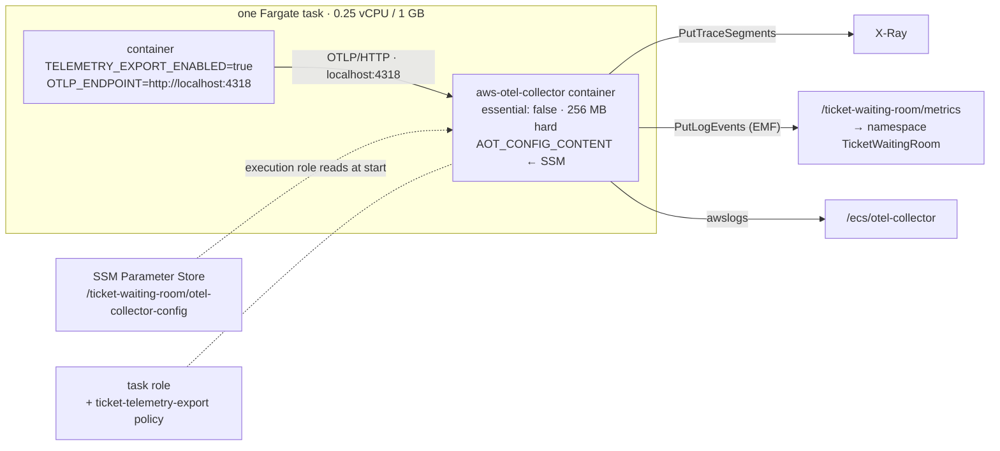

# Runbook — Observability: ADOT Sidecar, X-Ray, CloudWatch

Slice 7, the AWS half. The code half — `observability-starter`, one `XxxMetrics` per
service, the JWT warm-up — landed in `4262e76`, the `service` metric tag in `5e3c555`, and
the five images built from `5e3c555` are in ECR under that tag. This runbook makes the telemetry those images emit *land somewhere*: an ADOT
collector beside every service, the permissions it needs, and the log groups it writes.
Sections for X-Ray on the edge and the dashboard follow once the sidecar has run.

Prerequisites: `runbook-ecs-fargate.md` (cluster, execution role, the task-role pattern),
`runbook-ecr-packaging.md` (the images), and every service's own runbook for the task
definition it currently has. Standing cost of everything here: **$0** — task definition
revisions, IAM, SSM parameters and log groups are free; the only change to a running
session is +0.5 GB of Fargate memory per task (≈ $0.002/hour each).

## Design Decisions Made Before Touching the Console

**One collector per task, as a sidecar, not one per cluster.** The service exports to
`http://localhost:4318` and nothing else; the collector inherits the task role, so the
service's own role gains nothing it did not need. A shared collector service would mean a
service discovery name, a security group rule, and a network hop for telemetry — three
things that can fail and none that teaches anything a sidecar does not. (In the EKS phase
the same sidecar becomes a DaemonSet; the service does not change.)

**Our own collector config, shipped through SSM, not the image's default.** The ADOT image
ships `/etc/ecs/ecs-default-config.yaml` — OTLP in, `awsxray` and `awsemf` out, checked
against the repository on 2026-09-14 — and it is nearly right. Nearly: its EMF exporter
writes to namespace `ECS/AWSOTel/Application` and log group `/aws/ecs/application/metrics`
with dimension roll-ups **on**, which turns a metric with six attributes into eight
CloudWatch metrics. Ours is the same pipeline with a project namespace, a project log
group, roll-ups off, and the gRPC/X-Ray-UDP/StatsD receivers the services do not use
removed. The collector reads it from the `AOT_CONFIG_CONTENT` environment variable, which
ECS fills from a Parameter Store value at task start — the documented pattern, and the same
`valueFrom` mechanism the checkout task already uses for its database secret.

**Metrics travel as EMF logs, not `PutMetricData`.** The `awsemf` exporter writes CloudWatch
Embedded Metric Format events to a log group and CloudWatch derives the metrics from them.
So the task role needs `logs:*` on that group, not `cloudwatch:PutMetricData`; the plan
line said the latter, and the runbook corrects the plan. EMF also means every data point is
queryable in Logs Insights, which is a bonus the dashboard will use.

**The service name is a metric dimension because the code puts it there.** OTLP carries
`service.name` as a *resource* attribute, and the EMF exporter does not make resource
attributes dimensions unless told to convert all of them — which would also make
`telemetry.sdk.version` a dimension. So each service tags every meter with
`service=<spring.application.name>` (`management.metrics.tags.service`), one line of YAML,
and five services' `http.server.requests` stay five metrics. That line landed in
`5e3c555`, after the first `4262e76` push — the images were rebuilt once more for it.

**Collector failure never stops the service.** `essential: false` on the sidecar and a
`START` (not `HEALTHY`) dependency from the app container: if the collector dies the task
keeps serving and the exporters log a failed POST a minute — the same posture as the code,
where tracing is never why a ticket is not issued.

**0.25 vCPU / 1 GB, up from 0.5 GB.** The JVM sizes its heap from the container's cgroup
limit, which in a Fargate task with no container-level limit is the *task's* memory; at
512 MB the collector's ~100 MB and the JVM's 75 % would overlap. 1 GB with a 256 MB hard
limit on the collector leaves the JVM its 384 MB heap and 300 MB of headroom for both.

## Target Topology



## What To Bring Up First

Nothing billable. Everything in §1–§8 is done against torn-down services: the task
definition revisions, target groups and tracing toggles wait for the next stack-up, which
creates the five services from them. The images are already pushed — `5e3c555`, all five,
2026-09-14 20:25–20:27, each verified to carry both starters and the `service` tag. If
they ever need rebuilding, the loop is in `runbook-ecr-packaging.md` §3; brace every
expansion and compare `imagePushedAt` afterwards, for the reason recorded there.

## Console Steps

All in **eu-central-1**. The order matters: the parameter, the policy and the log groups
must exist before a task definition references them, and a role must exist before it can
be picked from a dropdown.

### 1. The collector configuration (Systems Manager → Parameter Store → Create parameter)

| Field | Value |
|---|---|
| Name | `/ticket-waiting-room/otel-collector-config` |
| Description | `ADOT collector config for every Fargate service sidecar - slice 7` |
| Tier | Standard |
| Type | **String** (not SecureString — nothing secret, and SecureString would need KMS on the execution role) |
| Data type | text |
| Value | the YAML below, verbatim |
| Tags | `project` = `ticket-waiting-room` |

```yaml
extensions:
  health_check:

receivers:
  otlp:
    protocols:
      http:
        endpoint: 0.0.0.0:4318

processors:
  batch/traces:
    timeout: 1s
    send_batch_size: 50
  batch/metrics:
    timeout: 60s

exporters:
  awsxray:
  awsemf:
    namespace: TicketWaitingRoom
    log_group_name: /ticket-waiting-room/metrics
    log_stream_name: otel-collector
    dimension_rollup_option: NoDimensionRollup

service:
  extensions: [health_check]
  pipelines:
    traces:
      receivers: [otlp]
      processors: [batch/traces]
      exporters: [awsxray]
    metrics:
      receivers: [otlp]
      processors: [batch/metrics]
      exporters: [awsemf]
```

The differences from the image's default, each on purpose: only the OTLP/HTTP receiver
(the services speak nothing else); a project namespace and log group; `NoDimensionRollup`
so a series is one CloudWatch metric rather than one per attribute subset; a fixed
`log_stream_name` because the default derives one per task and a log group full of
one-shot streams from torn-down tasks is noise. `health_check` stays because the
container health check below calls it.

**CLI equivalent:**

```bash
aws ssm put-parameter --region eu-central-1 --name /ticket-waiting-room/otel-collector-config \
  --type String --tier Standard --value "file://$(pwd)/docs/otel-collector-config.yaml" \
  --tags Key=project,Value=ticket-waiting-room
```

(Keep the YAML in the repo as `docs/otel-collector-config.yaml` too — it is the one
artefact of this slice that Terraform will `file()` in Phase 2.)

### 2. Log groups (CloudWatch → Log groups → Create log group)

Two, both with **retention 1 day**, both tagged `project=ticket-waiting-room`:

| Name | Who writes it |
|---|---|
| `/ecs/otel-collector` | the sidecar's own stdout, via `awslogs` — "Everything is ready" and every export error |
| `/ticket-waiting-room/metrics` | the `awsemf` exporter — one JSON event per metric batch, which CloudWatch turns into the `TicketWaitingRoom` namespace |

Pre-creating the second one matters: the exporter would create it itself, with
**Never expire** retention, and EMF at one event per minute per service is exactly the
kind of log that quietly accrues.

```bash
for g in /ecs/otel-collector /ticket-waiting-room/metrics; do
  aws logs create-log-group --region eu-central-1 --log-group-name $g --tags project=ticket-waiting-room
  aws logs put-retention-policy --region eu-central-1 --log-group-name $g --retention-in-days 1
done
```

### 3. One managed policy for the collector's permissions (IAM → Policies → Create policy)

**JSON** tab, paste:

```json
{
  "Version": "2012-10-17",
  "Statement": [
    {
      "Sid": "Traces",
      "Effect": "Allow",
      "Action": ["xray:PutTraceSegments", "xray:PutTelemetryRecords"],
      "Resource": "*"
    },
    {
      "Sid": "MetricsAsEmfLogs",
      "Effect": "Allow",
      "Action": [
        "logs:CreateLogStream",
        "logs:PutLogEvents",
        "logs:DescribeLogStreams",
        "logs:DescribeLogGroups",
        "logs:PutRetentionPolicy"
      ],
      "Resource": [
        "arn:aws:logs:eu-central-1:<account-id>:log-group:/ticket-waiting-room/metrics",
        "arn:aws:logs:eu-central-1:<account-id>:log-group:/ticket-waiting-room/metrics:*"
      ]
    }
  ]
}
```

**Next** → Policy name `ticket-telemetry-export`, description `What the ADOT sidecar needs:
X-Ray segments and EMF log events. Attached to every Fargate task role.`, tag
`project=ticket-waiting-room` → **Create policy**.

X-Ray has no resource-level permissions, hence `*`. No `logs:CreateLogGroup`: the group
exists from step 2, and a role that cannot create groups cannot create one with the wrong
retention. No `cloudwatch:PutMetricData`: EMF does not use it.

**Attach it to the four existing task roles** — IAM → Roles → *role* → **Add permissions ▾
→ Attach policies** → tick `ticket-telemetry-export` → **Add permissions**:

- `seat-inventory-task-role`
- `ticket-waiting-room-task-role`
- `ticket-issuance-task-role`
- `notification-task-role`

### 4. A task role for checkout, which never had one (IAM → Roles → Create role)

`checkout-payment-service` makes no AWS API calls, so it has run without a task role since
slice 4. Its sidecar does. Same recipe as `runbook-ecs-fargate.md`:

| Step | Value |
|---|---|
| Trusted entity type | AWS service |
| Use case | **Elastic Container Service → Elastic Container Service Task** |
| Permissions | tick `ticket-telemetry-export` only |
| Role name | `ticket-checkout-task-role` |
| Description | `checkout-payment-service task role: nothing for the service itself, telemetry export for its sidecar` |
| Tags | `project` = `ticket-waiting-room` |

```bash
aws iam create-role --role-name ticket-checkout-task-role \
  --assume-role-policy-document '{"Version":"2012-10-17","Statement":[{"Effect":"Allow","Principal":{"Service":"ecs-tasks.amazonaws.com"},"Action":"sts:AssumeRole"}]}' \
  --tags Key=project,Value=ticket-waiting-room
for r in ticket-checkout-task-role seat-inventory-task-role ticket-waiting-room-task-role ticket-issuance-task-role notification-task-role; do
  aws iam attach-role-policy --role-name $r --policy-arn arn:aws:iam::<account-id>:policy/ticket-telemetry-export
done
```

### 5. Let the execution role read the parameter (IAM → Roles → `ticket-ecs-execution-role`)

The **execution** role, not the task role: it is ECS itself that resolves `valueFrom` before
the container starts, the same way it already resolves the RDS secret for checkout and
issuance. **Add permissions ▾ → Create inline policy → JSON**:

```json
{
  "Version": "2012-10-17",
  "Statement": [{
    "Effect": "Allow",
    "Action": "ssm:GetParameters",
    "Resource": "arn:aws:ssm:eu-central-1:<account-id>:parameter/ticket-waiting-room/otel-collector-config"
  }]
}
```

Name `ReadCollectorConfig` → **Create policy**. It sits beside the existing
`ReadDatabaseSecrets`. (`AmazonECSTaskExecutionRolePolicy`, already attached, covers the
`awslogs` writes to `/ecs/otel-collector`.)

### 6. Five task definition revisions (ECS → Task definitions)

The same edit five times. Everything referenced below exists after §1–§5; the image tag to
pin is **`5e3c555`** (pushed 2026-09-14 20:25–20:27, the build that carries the `service`
metric tag). Do **not** use the console's own *Monitoring → Use trace collection / Use
metric collection* toggles: they inject an ADOT sidecar with the image's default config,
which is the generic-namespace, roll-ups-on setup §1 replaces. Leave both unticked.

**6.0 Open the family.** ECS → left nav **Task definitions** → click the family name
(e.g. `seat-inventory-service`) → tick the **latest** revision (`seat-inventory-service:4`,
`waiting-room-service:3`, `checkout-payment-service:6`, `ticket-issuance-service:4`,
`notification-service:2` as of 2026-09-14) → **Create new revision ▾ → Create new
revision**. The form opens pre-filled from that revision; change only what follows.

**6.1 Infrastructure requirements** (the first collapsible section)

| Field | Value |
|---|---|
| Launch type | AWS Fargate (unchanged) |
| Operating system/Architecture | Linux/X86_64 (unchanged) |
| Task size → CPU | .25 vCPU (unchanged) |
| Task size → **Memory** | **1 GB** |
| Task role | unchanged for four; **checkout-payment-service → `ticket-checkout-task-role`** (the dropdown lists roles trusting `ecs-tasks`; it appears because §4 created it) |
| Task execution role | `ticket-ecs-execution-role` (unchanged) |

**6.2 Container - 1** (the service; expand it)

| Field | Value |
|---|---|
| Name | unchanged (`seat-inventory-service` …) |
| Image URI | `<account-id>.dkr.ecr.eu-central-1.amazonaws.com/<service>:5e3c555` — replace the `@sha256:…` digest the previous revision pinned; that digest is the image *without* the starter |
| Essential container | Yes (unchanged) |
| Port mappings | `8080` TCP, HTTP (unchanged) |
| Resource allocation limits → Memory hard limit | **768** (MiB). New. The JVM's `MaxRAMPercentage=75` reads the container's limit; without one it reads the task's 1 GB and would size a heap that overlaps the sidecar's |
| Environment variables → **Add environment variable** | Key `TELEMETRY_EXPORT_ENABLED`, Value type **Value**, Value `true` |
| → **Add environment variable** | Key `OTLP_ENDPOINT`, Value type **Value**, Value `http://localhost:4318` |
| everything already there | leave: `COGNITO_ISSUER_URI`, `AWS_REGION`, queue URLs, `DB_URL`, the two `ValueFrom` secrets on checkout and issuance, the `awslogs` block |
| Startup dependency ordering → **Add container dependency** | Container name `aws-otel-collector` (type it — the dropdown only lists containers that exist when the form was opened, and the sidecar is added below), Condition **Start** |

`Start`, not `Healthy` or `Success`: the service must not wait on, or die with, its
telemetry.

**6.3 + Add container** (the sidecar)

| Field | Value |
|---|---|
| Name | `aws-otel-collector` |
| Image URI | `public.ecr.aws/aws-observability/aws-otel-collector:v0.50.0` — the newest tag on 2026-09-14; never `latest` |
| Essential container | **No** |
| Port mappings | none. Delete the empty row the form offers; the service reaches it on the task's loopback |
| Resource allocation limits → CPU | `0` (share what is left) |
| → Memory hard limit | **256** |
| → Memory soft limit | **128** |
| Environment variables → Add | Key `AOT_CONFIG_CONTENT`, Value type **ValueFrom**, Value `arn:aws:ssm:eu-central-1:<account-id>:parameter/ticket-waiting-room/otel-collector-config` |
| Logging → **Use log collection** | ticked · `awslogs` · Add key/value: `awslogs-group` = `/ecs/otel-collector` · `awslogs-region` = `eu-central-1` · `awslogs-stream-prefix` = **the service's name** (e.g. `seat-inventory-service`) |
| | Untick **Create log group** (`awslogs-create-group`) if the console added it — the group exists from §2 and the execution role may not create groups |
| HealthCheck → Command | `CMD,/healthcheck` (the console splits on commas) · Interval `10` · Timeout `5` · Start period `10` · Retries `3` |
| Startup dependency ordering | none |

`/healthcheck` is a binary in the ADOT image that calls the `health_check` extension the
config enables. The `ValueFrom` type on a plain environment variable is what the console
offers for "a parameter or a secret"; in the stored JSON it lands under `secrets`, which is
why the *execution* role got the permission in §5.

**6.4 Storage, Monitoring, Tags** — Storage: ephemeral 21 GiB, unchanged. **Monitoring:
both toggles off** (see the note at the top of §6). Tags: `project=ticket-waiting-room`
(carried over; confirm it is there).

**6.5 Create.** The page shows the new revision (`seat-inventory-service:5` …). Open its
**JSON** tab and read three things back before moving on: `"memory": "1024"`, the sidecar's
`"secrets": [{"name": "AOT_CONFIG_CONTENT", …}]`, and the service container's
`"dependsOn": [{"containerName": "aws-otel-collector", "condition": "START"}]`. Then repeat
6.0–6.5 for the other four families.

Write the five new revision numbers into the table in *Results* below; the next stack-up's
service creation points at them.

**JSON alternative.** *Create new revision with JSON* takes the previous revision's JSON
with these edits. The sidecar block to paste into `containerDefinitions`, and the fields to
change on the service container:

```json
{
  "name": "aws-otel-collector",
  "image": "public.ecr.aws/aws-observability/aws-otel-collector:v0.50.0",
  "essential": false,
  "cpu": 0,
  "memory": 256,
  "memoryReservation": 128,
  "secrets": [
    { "name": "AOT_CONFIG_CONTENT",
      "valueFrom": "arn:aws:ssm:eu-central-1:<account-id>:parameter/ticket-waiting-room/otel-collector-config" }
  ],
  "healthCheck": {
    "command": ["CMD", "/healthcheck"],
    "interval": 10, "timeout": 5, "startPeriod": 10, "retries": 3
  },
  "logConfiguration": {
    "logDriver": "awslogs",
    "options": {
      "awslogs-group": "/ecs/otel-collector",
      "awslogs-region": "eu-central-1",
      "awslogs-stream-prefix": "<service-name>"
    }
  }
}
```

```jsonc
// on the service container:
"image": "<account-id>.dkr.ecr.eu-central-1.amazonaws.com/<service>:5e3c555",
"memory": 768,
"environment": [ /* existing… */,
  { "name": "TELEMETRY_EXPORT_ENABLED", "value": "true" },
  { "name": "OTLP_ENDPOINT", "value": "http://localhost:4318" } ],
"dependsOn": [ { "containerName": "aws-otel-collector", "condition": "START" } ]
// at the top level:
"memory": "1024",
"taskRoleArn": "arn:aws:iam::<account-id>:role/ticket-checkout-task-role"   // checkout only
```

**CLI equivalent** — derive each new revision from the current one with `jq`, so nothing
the previous runbooks set is retyped:

```bash
SHA=5e3c555; REG=<account-id>.dkr.ecr.eu-central-1.amazonaws.com
PARAM=arn:aws:ssm:eu-central-1:<account-id>:parameter/ticket-waiting-room/otel-collector-config
for s in seat-inventory-service waiting-room-service checkout-payment-service ticket-issuance-service notification-service; do
  aws ecs describe-task-definition --region eu-central-1 --task-definition $s --query taskDefinition \
  | jq --arg img "$REG/$s:$SHA" --arg s "$s" --arg param "$PARAM" '
      del(.taskDefinitionArn,.revision,.status,.requiresAttributes,.compatibilities,.registeredAt,.registeredBy)
      | .memory = "1024"
      | (if $s == "checkout-payment-service" then .taskRoleArn = "arn:aws:iam::<account-id>:role/ticket-checkout-task-role" else . end)
      | .containerDefinitions[0].image = $img
      | .containerDefinitions[0].memory = 768
      | .containerDefinitions[0].environment += [{name:"TELEMETRY_EXPORT_ENABLED",value:"true"},{name:"OTLP_ENDPOINT",value:"http://localhost:4318"}]
      | .containerDefinitions[0].dependsOn = [{containerName:"aws-otel-collector",condition:"START"}]
      | .containerDefinitions += [{
          name:"aws-otel-collector", image:"public.ecr.aws/aws-observability/aws-otel-collector:v0.50.0",
          essential:false, cpu:0, memory:256, memoryReservation:128,
          secrets:[{name:"AOT_CONFIG_CONTENT",valueFrom:$param}],
          healthCheck:{command:["CMD","/healthcheck"],interval:10,timeout:5,startPeriod:10,retries:3},
          logConfiguration:{logDriver:"awslogs",options:{"awslogs-group":"/ecs/otel-collector","awslogs-region":"eu-central-1","awslogs-stream-prefix":$s}}
        }]' > /tmp/td-$s.json
  aws ecs register-task-definition --region eu-central-1 --cli-input-json file:///tmp/td-$s.json \
    --query 'taskDefinition.[family,revision]' --output text
done
```

### 7. Target groups → `/actuator/health` (EC2 → Target groups)

The four target groups survive teardown (the ALB does not), so this is done now, at $0,
and is in force the moment the next ALB attaches them. For each of `seat-inventory-tg`,
`waiting-room-tg`, `checkout-tg`, `ticket-issuance-tg`: open it → **Health checks** tab →
**Edit**:

| Field | Was | Now |
|---|---|---|
| Health check path | `/` | **`/actuator/health`** |
| Advanced → Success codes | `200-499` | **`200`** |
| everything else | 10 s interval, 2/2 thresholds, 5 s timeout, traffic port | unchanged |

**Save changes.** The old matcher accepted the 401 that `GET /` produced as "alive", which
proved Tomcat was up and nothing more (`runbook-alb-apigateway.md`, health-check decision).
`/actuator/health` is the one path the security chain opens anonymously
(`security-starter`), answers `{"status":"UP"}`, and a service that boots into a broken
state — no datasource, no Redis — now reports it. Bring the ALB up with a revision *older*
than §6 and its target goes unhealthy on 404: that is the check working, not a regression.

```bash
for tg in seat-inventory-tg waiting-room-tg checkout-tg ticket-issuance-tg; do
  ARN=$(aws elbv2 describe-target-groups --region eu-central-1 --names $tg --query 'TargetGroups[0].TargetGroupArn' --output text)
  aws elbv2 modify-target-group --region eu-central-1 --target-group-arn $ARN \
    --health-check-path /actuator/health --matcher HttpCode=200
done
aws elbv2 describe-target-groups --region eu-central-1 --query 'TargetGroups[].[TargetGroupName,HealthCheckPath,Matcher.HttpCode]' --output text
```

### 8. Tracing on the edge, the saga and the Lambdas

All three are toggles, all free, all reversible, all done now against torn-down services.

**8.1 API Gateway stage** — API Gateway → APIs → `ticket-edge` → **Stages → dev** →
**Logs and tracing** panel → **Edit** → **X-Ray tracing: on** → **Save changes**. From
now on every request through the stage gets an `X-Amzn-Trace-Id` with `Root`, `Parent` and
`Sampled`; the ALB forwards it, the service's X-Ray propagator joins it, and the API
Gateway segment is the root the service's segment hangs from. (`tracingEnabled` was
`false` on 2026-09-14.) No IAM: API Gateway writes its own segments.

**8.2 Step Functions** — Step Functions → State machines → `checkout-saga` → **Edit** →
the **Config** tab (gear icon at the top of the editor) → **Tracing → Enable X-Ray
tracing** → **Save** — this creates a new state machine *version* with the same definition.
The console offers to add `xray:PutTraceSegments`, `xray:PutTelemetryRecords`,
`xray:GetSamplingRules`, `xray:GetSamplingTargets` to `ticket-saga-role`; accept, or add
that inline policy by hand first. With tracing on, Step Functions emits a segment per
execution and one per state, and propagates the trace to its Lambda, SQS and SNS
integrations. Whether it forwards `X-Amzn-Trace-Id` on an `http:invoke` call is the open
question this slice answers; §9 claim 4 below reads it off the first purchase.

**8.3 Lambdas** — for each of `hold-cleanup`, `qr-generation`, `ticket-queue-notifier`:
Lambda → Functions → the function → **Configuration** tab → **Monitoring and operations
tools** → **Edit** → **AWS X-Ray → Active tracing: on** → **Save**. The console attaches
`AWSXRayDaemonWriteAccess` to the function's role if it is missing (it is, on all three).
The functions are not OTel-instrumented — a DI-free Lambda stays that way — so what X-Ray
shows is the Lambda service's own segment: init duration, invocation, the SQS source for
`qr-generation` and the notifier. That is enough to see the QR render hanging off the
purchase's trace, which is the point.

```bash
aws apigateway update-stage --region eu-central-1 --rest-api-id <rest-api-id> --stage-name dev \
  --patch-operations op=replace,path=/tracingEnabled,value=true
aws iam put-role-policy --role-name ticket-saga-role --policy-name XRay --policy-document '{"Version":"2012-10-17","Statement":[{"Effect":"Allow","Action":["xray:PutTraceSegments","xray:PutTelemetryRecords","xray:GetSamplingRules","xray:GetSamplingTargets"],"Resource":"*"}]}'
aws stepfunctions update-state-machine --region eu-central-1 \
  --state-machine-arn arn:aws:states:eu-central-1:<account-id>:stateMachine:checkout-saga \
  --tracing-configuration enabled=true
for f in hold-cleanup qr-generation ticket-queue-notifier; do
  ROLE=$(aws lambda get-function-configuration --region eu-central-1 --function-name $f --query 'Role' --output text | awk -F/ '{print $NF}')
  aws iam attach-role-policy --role-name $ROLE --policy-arn arn:aws:iam::aws:policy/AWSXRayDaemonWriteAccess
  aws lambda update-function-configuration --region eu-central-1 --function-name $f --tracing-config Mode=Active --query 'TracingConfig.Mode' --output text
done
```

### 9. Bring the stack up and read it back

The next stack-up follows each service's own runbook — ALB, RDS, ElastiCache, then the
five services — with the §6 revision numbers in place of the old ones. Bring
**seat-inventory-service** up first: it needs only DynamoDB, and every claim below except
the last can be made against it alone. Every numbered line is a claim; *Results* is where
each becomes a number.

```bash
# 1. the sidecar started, read its config from SSM, and is ready
aws logs tail /ecs/otel-collector --region eu-central-1 --since 5m | grep -E "Everything is ready|error|invalid|AccessDenied"

# 2. the service booted, warmed the decoder, and is exporting without complaint
aws logs tail /ecs/seat-inventory-service --region eu-central-1 --since 5m \
  | grep -E "JWT decoder warm|JWT warm-up|Started|Failed to export|Connection refused"
#    → "JWT decoder warm: issuer metadata and keys fetched in N ms" — N against slice 6's 12.8 s

# 3. EMF is arriving (two export steps, ~2 min), and the log-writing half of the policy works
aws logs tail /ticket-waiting-room/metrics --region eu-central-1 --since 3m | head -c 600
#    → {"_aws":{"CloudWatchMetrics":[{"Namespace":"TicketWaitingRoom","Dimensions":[["service", …

# 4. CloudWatch has a namespace with our dimensions
aws cloudwatch list-metrics --region eu-central-1 --namespace TicketWaitingRoom \
  --query 'Metrics[].[MetricName, join(`,`, Dimensions[].Name)]' --output text | sort -u
#    → http.server.requests   error,exception,method,outcome,service,status,uri
#    → seats.remaining        event,service                       (after the first hold, ≤ 60 s)

# 5. the ALB reads the new health check: target healthy on /actuator/health, not on a 401
aws elbv2 describe-target-health --region eu-central-1 --target-group-arn <seat-inventory-tg arn> \
  --query 'TargetHealthDescriptions[].TargetHealth.State' --output text          # healthy

# 6. one request through the edge = one trace: APIGW segment → seat-inventory-service → DynamoDB
curl … POST /admin/events/evt-o/seats  (ops token)  ;  curl … POST …/seats/O-1/hold  (ops token)
aws xray get-trace-summaries --region eu-central-1 --start-time $(date -u -d '-10 min' +%s) --end-time $(date -u +%s) \
  --query 'TraceSummaries[].[Id, Duration, Http.HttpURL, join(`,`, ServiceIds[].Name)]' --output text
```

Then in the console — **CloudWatch → X-Ray traces → Trace map**: three nodes,
`ticket-edge/dev` → `seat-inventory-service` → `DynamoDB`, and under **Traces** the hold
request with a `DynamoDB.UpdateItem` subsegment. A second hold on the same seat shows the
same shape with the subsegment in **fault** (the 400 `ConditionalCheckFailed`) — the race
loss, visible.

With the whole stack up, one purchase (`runbook-cognito-auth.md` §11 claim 5) is the last
claim: **one trace** from `ticket-edge/dev` through `checkout-saga`'s states, the
`http:invoke` calls into seat-inventory and checkout, the SQS hop to
`ticket-issuance-service`, and `qr-generation` — or, if `http:invoke` does not forward the
header, a saga trace and per-service traces that share an order id, which is recorded as
the finding and not fixed. Either way `ticket-issuance-queue process` appears as a consumer
span parented on the saga's `SendMessage`; that half is the code's, not Step Functions'.

## Results, 2026-09-14 — steps 1–8

Done by CLI from the repo, before any task definition exists to use them. Zero billable
resources created.

| Step | Resource | Check |
|---|---|---|
| 1 | `/ticket-waiting-room/otel-collector-config`, String, version 1 | `get-parameter` value diffs against `docs/otel-collector-config.yaml` only in the trailing newline SSM normalizes |
| 2 | `/ecs/otel-collector`, `/ticket-waiting-room/metrics` | both retention **1 day** |
| 3 | `ticket-telemetry-export` | attached to `seat-inventory-task-role`, `ticket-waiting-room-task-role`, `ticket-issuance-task-role`, `notification-task-role` |
| 4 | `ticket-checkout-task-role` | trust `ecs-tasks.amazonaws.com`; only `ticket-telemetry-export` attached |
| 5 | `ReadCollectorConfig` inline on `ticket-ecs-execution-role` | beside `ReadDatabaseSecrets` |

**Step 6, by the CLI block above** — each revision derived from the previous one with
`jq`, so every queue URL, secret and log block came across untouched (checked on checkout:
`DB_USERNAME`/`DB_PASSWORD` still `valueFrom` secrets beside the two new plain variables):

| Family | Old → new | Task role |
|---|---|---|
| `seat-inventory-service` | 4 → **5** | `seat-inventory-task-role` |
| `waiting-room-service` | 3 → **4** | `ticket-waiting-room-task-role` |
| `checkout-payment-service` | 6 → **7** | **`ticket-checkout-task-role`** — its first |
| `ticket-issuance-service` | 4 → **5** | `ticket-issuance-task-role` |
| `notification-service` | 2 → **3** | `notification-task-role` |

Read back on all five: task `memory=1024`, app container `image=<service>:5e3c555`,
`memory=768`, `TELEMETRY_EXPORT_ENABLED=true`, `OTLP_ENDPOINT=http://localhost:4318`,
`dependsOn=aws-otel-collector:START`; sidecar `essential=false`, `256/128`,
`AOT_CONFIG_CONTENT` under `secrets`, health `CMD /healthcheck`, logs
`/ecs/otel-collector/<service>`. Tagged `project=ticket-waiting-room` — the earlier
revisions never were, which the tag sweep had not noticed because task definitions are free.
**These are the revision numbers the next stack-up's service creation uses.**

**Step 7** — `checkout-tg` by hand in the console, the other three by the CLI block; all
four now `/actuator/health` with matcher `200`, interval 10 s, timeout 5 s, thresholds 2/2,
deregistration delay 30 s — only the path and the matcher changed. No ALB exists to attach
them to yet, which is the point of doing it now: in force the moment the next one does.

**Step 8** — mixed console and CLI. `ticket-edge` stage `dev`: `tracingEnabled` **true**
(console). `checkout-saga`: tracing **enabled** at 21:29, `XRay` inline policy on
`ticket-saga-role` beside `SagaInvoke` (CLI). Lambdas, all three **Active**:
`hold-cleanup` through the console, which attached a generated
`AWSLambdaTracerAccessExecutionRole-462ff057-…` customer policy (the two `xray:Put*`
actions — same grant as the managed one, under a name only the console would choose);
`qr-generation` and `ticket-queue-notifier` through the CLI with the AWS-managed
`AWSXRayDaemonWriteAccess`. Functionally identical; recorded because a tag sweep will one
day ask what that generated policy is. Nothing here bills until something runs.

Policy simulation (`iam simulate-principal-policy`) on `ticket-checkout-task-role`:
`xray:PutTraceSegments` and `xray:PutTelemetryRecords` **allowed**;
`cloudwatch:PutMetricData` **implicitDeny**, which is the design. `ssm:GetParameters` on the
parameter from `ticket-ecs-execution-role`: **allowed**.

**The simulator cannot vouch for the logs statement.** It answers `implicitDeny` for
`logs:PutLogEvents` on the EMF stream ARN — and gives the same answer for
`ticket-ecs-execution-role`, whose `AmazonECSTaskExecutionRolePolicy` grants it on `*` and
which writes every task's log stream every session. Whatever the simulator does with a
log-group ARN containing `/`, it is not evaluating the policy as CloudWatch Logs will. The
policy's resource matches the group's real ARN form exactly
(`…:log-group:/ticket-waiting-room/metrics:*`, per `describe-log-groups`); the proof is
§7 claim 3, when the first task's collector writes an EMF event or reports
`AccessDeniedException` in `/ecs/otel-collector`. Recorded so the next person does not
spend twenty minutes on the simulator.

## Traps Predicted

- **`ValueFrom` lands under `secrets`, and the execution role is the one that needs the
  permission.** A task that stops before the collector logs anything, with
  `ResourceInitializationError: unable to pull secrets or registry auth … ssm:GetParameters`,
  is step 5 missing — the same shape as slice 4's Secrets Manager failure.
- **The collector logs `Everything is ready` and nothing arrives.** Check the service's log
  for `Failed to export` — with `TELEMETRY_EXPORT_ENABLED` unset the exporters are off and
  the service is silent about it, by design.
- **X-Ray shows nothing while metrics flow.** The traces pipeline drops spans whose trace id
  timestamp is off; the starter's `XrayIdGenerator` prevents that, but a service built from
  the pre-`4262e76` image (the digest the old revisions pinned) has no such generator. The
  image tag on the new revision is the check.
- **Task memory.** If the task is OOM-killed with two containers, the sidecar's hard limit
  did its job and the JVM was the one over; `MaxRAMPercentage=75` of 1 GB is 768 MB *if the
  container has no limit of its own* — give the service container a hard limit of 768 and
  the JVM sizes from that.
- **`EMF` events but an empty namespace.** Metrics appear in CloudWatch a minute or two after
  the log event; `list-metrics` is eventually consistent for far longer. Two export steps
  before deciding it is broken.
- **Old revisions still exist and still work** — they just export nothing. A service brought
  up from the previous runbook's revision number will look healthy and be invisible.

## Dashboard — pending

To be written after §9 has run and the namespace exists: queue depth and admitted per event, seats
remaining, hold contention (`held` vs `unavailable` stacked), conversion as
`captured / admissions` metric math, `http.server.requests` p99 per service, WAF blocked
requests. Exported as JSON into the repo for Phase 2.

## Teardown

Nothing in this runbook bills while idle. Task definition revisions, the managed policy,
the checkout task role, the SSM parameter and the two log groups all stay; the log groups
expire their own contents after a day. The session-only resources are the same five
services, ALB, RDS and ElastiCache as before, torn down per their runbooks. The one thing
to remember at teardown is the same as every session: the services, not the revisions.

## Notes for Phase 2 (Terraform)

- The collector YAML becomes `aws_ssm_parameter` with `value = file("otel-collector-config.yaml")`;
  the sidecar block becomes a `locals` template merged into each `aws_ecs_task_definition`'s
  `container_definitions`, so five families share one definition of it.
- `ticket-telemetry-export` is one `aws_iam_policy` and five `aws_iam_role_policy_attachment`s.
- The `service` metric tag is in each service's `application.yml`; nothing in Terraform
  needs to know it exists, which is the point of putting it there.
