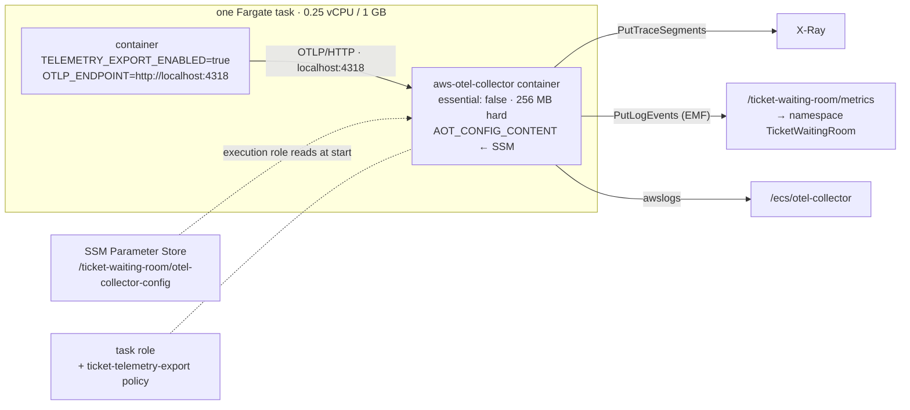

# Runbook — Observability: ADOT Sidecar, X-Ray, CloudWatch

Slice 7, the AWS half. The code half — `observability-starter`, one `XxxMetrics` per
service, the JWT warm-up — landed in `4262e76` and its five images are in ECR under that
tag. This runbook makes the telemetry those images emit *land somewhere*: an ADOT
collector beside every service, the permissions it needs, and the log groups it writes.
Sections for X-Ray on the edge and the dashboard follow once the sidecar has run.

Prerequisites: `runbook-ecs-fargate.md` (cluster, execution role, the task-role pattern),
`runbook-ecr-packaging.md` (the images), and every service's own runbook for the task
definition it currently has. Standing cost of everything here: **$0** — task definition
revisions, IAM, SSM parameters and log groups are free; the only change to a running
session is +0.5 GB of Fargate memory per task (≈ $0.002/hour each).

## Design Decisions Made Before Touching the Console

**One collector per task, as a sidecar, not one per cluster.** The service exports to
`http://localhost:4318` and nothing else; the collector inherits the task role, so the
service's own role gains nothing it did not need. A shared collector service would mean a
service discovery name, a security group rule, and a network hop for telemetry — three
things that can fail and none that teaches anything a sidecar does not. (In the EKS phase
the same sidecar becomes a DaemonSet; the service does not change.)

**Our own collector config, shipped through SSM, not the image's default.** The ADOT image
ships `/etc/ecs/ecs-default-config.yaml` — OTLP in, `awsxray` and `awsemf` out, checked
against the repository on 2026-09-14 — and it is nearly right. Nearly: its EMF exporter
writes to namespace `ECS/AWSOTel/Application` and log group `/aws/ecs/application/metrics`
with dimension roll-ups **on**, which turns a metric with six attributes into eight
CloudWatch metrics. Ours is the same pipeline with a project namespace, a project log
group, roll-ups off, and the gRPC/X-Ray-UDP/StatsD receivers the services do not use
removed. The collector reads it from the `AOT_CONFIG_CONTENT` environment variable, which
ECS fills from a Parameter Store value at task start — the documented pattern, and the same
`valueFrom` mechanism the checkout task already uses for its database secret.

**Metrics travel as EMF logs, not `PutMetricData`.** The `awsemf` exporter writes CloudWatch
Embedded Metric Format events to a log group and CloudWatch derives the metrics from them.
So the task role needs `logs:*` on that group, not `cloudwatch:PutMetricData`; the plan
line said the latter, and the runbook corrects the plan. EMF also means every data point is
queryable in Logs Insights, which is a bonus the dashboard will use.

**The service name is a metric dimension because the code puts it there.** OTLP carries
`service.name` as a *resource* attribute, and the EMF exporter does not make resource
attributes dimensions unless told to convert all of them — which would also make
`telemetry.sdk.version` a dimension. So each service tags every meter with
`service=<spring.application.name>` (`management.metrics.tags.service`), one line of YAML,
and five services' `http.server.requests` stay five metrics. That line was added after
the `4262e76` images were pushed; **the images must be rebuilt** (see *What To Bring Up First*).

**Collector failure never stops the service.** `essential: false` on the sidecar and a
`START` (not `HEALTHY`) dependency from the app container: if the collector dies the task
keeps serving and the exporters log a failed POST a minute — the same posture as the code,
where tracing is never why a ticket is not issued.

**0.25 vCPU / 1 GB, up from 0.5 GB.** The JVM sizes its heap from the container's cgroup
limit, which in a Fargate task with no container-level limit is the *task's* memory; at
512 MB the collector's ~100 MB and the JVM's 75 % would overlap. 1 GB with a 256 MB hard
limit on the collector leaves the JVM its 384 MB heap and 300 MB of headroom for both.

## Target Topology



## What To Bring Up First

Nothing billable. Everything in this runbook is done against torn-down services: the
task definition revisions wait for the next stack-up, which creates the five services from
them. Before the console work, **rebuild and push the images once more**, because the
`service` metric tag was added after `4262e76`:

```bash
git commit -am "Tag every meter with the service name"   # or whatever the commit is
JAVA_HOME=… ./gradlew bootJar
export DOCKER_HOST=unix:///var/run/docker.sock
REG=<account-id>.dkr.ecr.eu-central-1.amazonaws.com; SHA=$(git rev-parse --short HEAD)
aws ecr get-login-password --region eu-central-1 | docker login --username AWS --password-stdin $REG
for s in seat-inventory-service waiting-room-service checkout-payment-service ticket-issuance-service notification-service; do
  docker build --platform linux/amd64 --no-cache -t "${s}:local" "$s"        # braces: see the ECR runbook's zsh trap
  docker tag "${s}:local" "${REG}/${s}:${SHA}"; docker tag "${s}:local" "${REG}/${s}:latest"
  docker push "${REG}/${s}:${SHA}"; docker push "${REG}/${s}:latest"
done
# then compare imagePushedAt, not just tags:
aws ecr describe-images --repository-name seat-inventory-service --region eu-central-1 \
  --query 'sort_by(imageDetails,&imagePushedAt)[].[imageTags,imagePushedAt]' --output text
```

Write the SHA down; the task definitions below pin it.

## Console Steps

All in **eu-central-1**. The order matters: the parameter, the policy and the log groups
must exist before a task definition references them, and a role must exist before it can
be picked from a dropdown.

### 1. The collector configuration (Systems Manager → Parameter Store → Create parameter)

| Field | Value |
|---|---|
| Name | `/ticket-waiting-room/otel-collector-config` |
| Description | `ADOT collector config for every Fargate service sidecar - slice 7` |
| Tier | Standard |
| Type | **String** (not SecureString — nothing secret, and SecureString would need KMS on the execution role) |
| Data type | text |
| Value | the YAML below, verbatim |
| Tags | `project` = `ticket-waiting-room` |

```yaml
extensions:
  health_check:

receivers:
  otlp:
    protocols:
      http:
        endpoint: 0.0.0.0:4318

processors:
  batch/traces:
    timeout: 1s
    send_batch_size: 50
  batch/metrics:
    timeout: 60s

exporters:
  awsxray:
  awsemf:
    namespace: TicketWaitingRoom
    log_group_name: /ticket-waiting-room/metrics
    log_stream_name: otel-collector
    dimension_rollup_option: NoDimensionRollup

service:
  extensions: [health_check]
  pipelines:
    traces:
      receivers: [otlp]
      processors: [batch/traces]
      exporters: [awsxray]
    metrics:
      receivers: [otlp]
      processors: [batch/metrics]
      exporters: [awsemf]
```

The differences from the image's default, each on purpose: only the OTLP/HTTP receiver
(the services speak nothing else); a project namespace and log group; `NoDimensionRollup`
so a series is one CloudWatch metric rather than one per attribute subset; a fixed
`log_stream_name` because the default derives one per task and a log group full of
one-shot streams from torn-down tasks is noise. `health_check` stays because the
container health check below calls it.

**CLI equivalent:**

```bash
aws ssm put-parameter --region eu-central-1 --name /ticket-waiting-room/otel-collector-config \
  --type String --tier Standard --value "file://$(pwd)/docs/otel-collector-config.yaml" \
  --tags Key=project,Value=ticket-waiting-room
```

(Keep the YAML in the repo as `docs/otel-collector-config.yaml` too — it is the one
artefact of this slice that Terraform will `file()` in Phase 2.)

### 2. Log groups (CloudWatch → Log groups → Create log group)

Two, both with **retention 1 day**, both tagged `project=ticket-waiting-room`:

| Name | Who writes it |
|---|---|
| `/ecs/otel-collector` | the sidecar's own stdout, via `awslogs` — "Everything is ready" and every export error |
| `/ticket-waiting-room/metrics` | the `awsemf` exporter — one JSON event per metric batch, which CloudWatch turns into the `TicketWaitingRoom` namespace |

Pre-creating the second one matters: the exporter would create it itself, with
**Never expire** retention, and EMF at one event per minute per service is exactly the
kind of log that quietly accrues.

```bash
for g in /ecs/otel-collector /ticket-waiting-room/metrics; do
  aws logs create-log-group --region eu-central-1 --log-group-name $g --tags project=ticket-waiting-room
  aws logs put-retention-policy --region eu-central-1 --log-group-name $g --retention-in-days 1
done
```

### 3. One managed policy for the collector's permissions (IAM → Policies → Create policy)

**JSON** tab, paste:

```json
{
  "Version": "2012-10-17",
  "Statement": [
    {
      "Sid": "Traces",
      "Effect": "Allow",
      "Action": ["xray:PutTraceSegments", "xray:PutTelemetryRecords"],
      "Resource": "*"
    },
    {
      "Sid": "MetricsAsEmfLogs",
      "Effect": "Allow",
      "Action": [
        "logs:CreateLogStream",
        "logs:PutLogEvents",
        "logs:DescribeLogStreams",
        "logs:DescribeLogGroups",
        "logs:PutRetentionPolicy"
      ],
      "Resource": [
        "arn:aws:logs:eu-central-1:<account-id>:log-group:/ticket-waiting-room/metrics",
        "arn:aws:logs:eu-central-1:<account-id>:log-group:/ticket-waiting-room/metrics:*"
      ]
    }
  ]
}
```

**Next** → Policy name `ticket-telemetry-export`, description `What the ADOT sidecar needs:
X-Ray segments and EMF log events. Attached to every Fargate task role.`, tag
`project=ticket-waiting-room` → **Create policy**.

X-Ray has no resource-level permissions, hence `*`. No `logs:CreateLogGroup`: the group
exists from step 2, and a role that cannot create groups cannot create one with the wrong
retention. No `cloudwatch:PutMetricData`: EMF does not use it.

**Attach it to the four existing task roles** — IAM → Roles → *role* → **Add permissions ▾
→ Attach policies** → tick `ticket-telemetry-export` → **Add permissions**:

- `seat-inventory-task-role`
- `ticket-waiting-room-task-role`
- `ticket-issuance-task-role`
- `notification-task-role`

### 4. A task role for checkout, which never had one (IAM → Roles → Create role)

`checkout-payment-service` makes no AWS API calls, so it has run without a task role since
slice 4. Its sidecar does. Same recipe as `runbook-ecs-fargate.md`:

| Step | Value |
|---|---|
| Trusted entity type | AWS service |
| Use case | **Elastic Container Service → Elastic Container Service Task** |
| Permissions | tick `ticket-telemetry-export` only |
| Role name | `ticket-checkout-task-role` |
| Description | `checkout-payment-service task role: nothing for the service itself, telemetry export for its sidecar` |
| Tags | `project` = `ticket-waiting-room` |

```bash
aws iam create-role --role-name ticket-checkout-task-role \
  --assume-role-policy-document '{"Version":"2012-10-17","Statement":[{"Effect":"Allow","Principal":{"Service":"ecs-tasks.amazonaws.com"},"Action":"sts:AssumeRole"}]}' \
  --tags Key=project,Value=ticket-waiting-room
for r in ticket-checkout-task-role seat-inventory-task-role ticket-waiting-room-task-role ticket-issuance-task-role notification-task-role; do
  aws iam attach-role-policy --role-name $r --policy-arn arn:aws:iam::<account-id>:policy/ticket-telemetry-export
done
```

### 5. Let the execution role read the parameter (IAM → Roles → `ticket-ecs-execution-role`)

The **execution** role, not the task role: it is ECS itself that resolves `valueFrom` before
the container starts, the same way it already resolves the RDS secret for checkout and
issuance. **Add permissions ▾ → Create inline policy → JSON**:

```json
{
  "Version": "2012-10-17",
  "Statement": [{
    "Effect": "Allow",
    "Action": "ssm:GetParameters",
    "Resource": "arn:aws:ssm:eu-central-1:<account-id>:parameter/ticket-waiting-room/otel-collector-config"
  }]
}
```

Name `ReadCollectorConfig` → **Create policy**. It sits beside the existing
`ReadDatabaseSecrets`. (`AmazonECSTaskExecutionRolePolicy`, already attached, covers the
`awslogs` writes to `/ecs/otel-collector`.)

### 6. Five task definition revisions (ECS → Task definitions)

The same edit five times. For each family — `seat-inventory-service`,
`waiting-room-service`, `checkout-payment-service`, `ticket-issuance-service`,
`notification-service` — open the family, tick the **latest revision**, **Create new
revision ▾ → Create new revision**. The form opens pre-filled from that revision; change
only what is listed.

**Infrastructure requirements**

| Field | Value |
|---|---|
| Task size → Memory | **1 GB** (CPU stays .25 vCPU) |
| Task role | unchanged, except **checkout-payment-service → `ticket-checkout-task-role`** |
| Task execution role | `ticket-ecs-execution-role` (unchanged) |

**Container 1 — the service** (expand it; it is already there)

| Field | Value |
|---|---|
| Image URI | the SHA tag of the freshly pushed image, e.g. `<account-id>.dkr.ecr.eu-central-1.amazonaws.com/seat-inventory-service:<SHA>` — the previous revision pinned a digest, and that digest is the image *without* the starter |
| Environment variables → Add | `TELEMETRY_EXPORT_ENABLED` = `true` (Value) |
| | `OTLP_ENDPOINT` = `http://localhost:4318` (Value) |
| Startup dependency ordering → Add | container `aws-otel-collector`, condition **Start** — the collector is up before the first export; the service does not wait for it to be *healthy* and does not die with it |

Everything else — the `COGNITO_ISSUER_URI`, queue URLs, `DB_URL`, the `valueFrom` secrets,
the `awslogs` block — stays as the previous revision had it.

**Container 2 — the sidecar** → **Add container**

| Field | Value |
|---|---|
| Name | `aws-otel-collector` |
| Image URI | `public.ecr.aws/aws-observability/aws-otel-collector:v0.50.0` (latest tag on 2026-09-14; pin it, never `latest`) |
| Essential container | **No** |
| Port mappings | none — the service reaches it over the task's loopback, nothing reaches it from outside |
| Resource allocation limits | CPU `0` (share), Memory hard limit **256**, Memory soft limit **128** |
| Environment variables → Add | `AOT_CONFIG_CONTENT`, **ValueFrom**, `arn:aws:ssm:eu-central-1:<account-id>:parameter/ticket-waiting-room/otel-collector-config` |
| Logging → Use log collection | awslogs · group `/ecs/otel-collector` · region `eu-central-1` · stream prefix **the service's name** (e.g. `seat-inventory-service`) — five sidecars share one group, the prefix is how they stay apart |
| HealthCheck → Command | `CMD,/healthcheck` · interval 10 · timeout 5 · start period 10 · retries 3 |

The `/healthcheck` binary ships in the image and calls the `health_check` extension the
config enables. `ValueFrom` on a plain environment variable is what the console offers for
"SSM parameter or secret"; in the JSON it lands under `secrets`, not `environment`, which
is why the *execution* role needed the permission in step 5.

**Create.** The new revision number appears; note it — the next stack-up's service
create/update points at it. Repeat for the other four families.

**JSON alternative.** *Create new revision with JSON* takes the previous revision's JSON
with these edits. The sidecar block to paste into `containerDefinitions`, and the fields to
change on the service container:

```json
{
  "name": "aws-otel-collector",
  "image": "public.ecr.aws/aws-observability/aws-otel-collector:v0.50.0",
  "essential": false,
  "cpu": 0,
  "memory": 256,
  "memoryReservation": 128,
  "secrets": [
    { "name": "AOT_CONFIG_CONTENT",
      "valueFrom": "arn:aws:ssm:eu-central-1:<account-id>:parameter/ticket-waiting-room/otel-collector-config" }
  ],
  "healthCheck": {
    "command": ["CMD", "/healthcheck"],
    "interval": 10, "timeout": 5, "startPeriod": 10, "retries": 3
  },
  "logConfiguration": {
    "logDriver": "awslogs",
    "options": {
      "awslogs-group": "/ecs/otel-collector",
      "awslogs-region": "eu-central-1",
      "awslogs-stream-prefix": "<service-name>"
    }
  }
}
```

```jsonc
// on the service container:
"image": "<account-id>.dkr.ecr.eu-central-1.amazonaws.com/<service>:<SHA>",
"environment": [ /* existing… */,
  { "name": "TELEMETRY_EXPORT_ENABLED", "value": "true" },
  { "name": "OTLP_ENDPOINT", "value": "http://localhost:4318" } ],
"dependsOn": [ { "containerName": "aws-otel-collector", "condition": "START" } ]
// at the top level:
"memory": "1024",
"taskRoleArn": "arn:aws:iam::<account-id>:role/ticket-checkout-task-role"   // checkout only
```

**CLI equivalent** — derive each new revision from the current one with `jq`, so nothing
the previous runbooks set is retyped:

```bash
SHA=<the pushed sha>; REG=<account-id>.dkr.ecr.eu-central-1.amazonaws.com
PARAM=arn:aws:ssm:eu-central-1:<account-id>:parameter/ticket-waiting-room/otel-collector-config
for s in seat-inventory-service waiting-room-service checkout-payment-service ticket-issuance-service notification-service; do
  aws ecs describe-task-definition --region eu-central-1 --task-definition $s --query taskDefinition \
  | jq --arg img "$REG/$s:$SHA" --arg s "$s" --arg param "$PARAM" '
      del(.taskDefinitionArn,.revision,.status,.requiresAttributes,.compatibilities,.registeredAt,.registeredBy)
      | .memory = "1024"
      | (if $s == "checkout-payment-service" then .taskRoleArn = "arn:aws:iam::<account-id>:role/ticket-checkout-task-role" else . end)
      | .containerDefinitions[0].image = $img
      | .containerDefinitions[0].environment += [{name:"TELEMETRY_EXPORT_ENABLED",value:"true"},{name:"OTLP_ENDPOINT",value:"http://localhost:4318"}]
      | .containerDefinitions[0].dependsOn = [{containerName:"aws-otel-collector",condition:"START"}]
      | .containerDefinitions += [{
          name:"aws-otel-collector", image:"public.ecr.aws/aws-observability/aws-otel-collector:v0.50.0",
          essential:false, cpu:0, memory:256, memoryReservation:128,
          secrets:[{name:"AOT_CONFIG_CONTENT",valueFrom:$param}],
          healthCheck:{command:["CMD","/healthcheck"],interval:10,timeout:5,startPeriod:10,retries:3},
          logConfiguration:{logDriver:"awslogs",options:{"awslogs-group":"/ecs/otel-collector","awslogs-region":"eu-central-1","awslogs-stream-prefix":$s}}
        }]' > /tmp/td-$s.json
  aws ecs register-task-definition --region eu-central-1 --cli-input-json file:///tmp/td-$s.json \
    --query 'taskDefinition.[family,revision]' --output text
done
```

### 7. Bring one task up and read the three log groups

The next stack-up follows each service's own runbook with the new revision number. Bring
**seat-inventory-service** up first — it needs only DynamoDB — and before anything else:

```bash
# 1. the sidecar started, read its config, and is ready
aws logs tail /ecs/otel-collector --region eu-central-1 --since 5m | grep -E "Everything is ready|error|invalid"

# 2. the service booted, warmed the decoder, and is exporting (no failed-export lines)
aws logs tail /ecs/seat-inventory-service --region eu-central-1 --since 5m \
  | grep -E "JWT decoder warm|JWT warm-up|Started|Failed to export|Connection refused"
#    → "JWT decoder warm: issuer metadata and keys fetched in N ms" — N is the number
#      slice 6 measured at 12.8 s when a customer paid it

# 3. EMF is arriving (allow two export steps, ~2 min)
aws logs tail /ticket-waiting-room/metrics --region eu-central-1 --since 3m | head -c 600
#    → JSON with "_aws":{"CloudWatchMetrics":[{"Namespace":"TicketWaitingRoom", ...

# 4. and CloudWatch has turned it into a namespace with our dimensions
aws cloudwatch list-metrics --region eu-central-1 --namespace TicketWaitingRoom \
  --query 'Metrics[].[MetricName, join(`,`, Dimensions[].Name)]' --output text | sort -u | head -20
#    → http.server.requests  service,uri,method,status,outcome,exception,error …

# 5. one seeded event, one hold, and the first trace
curl … POST /admin/events/evt-o/seats (ops token) ; curl … POST hold (ops token)   # per the seat-inventory runbook
aws xray get-trace-summaries --region eu-central-1 --start-time $(date -u -d '-10 min' +%s) --end-time $(date -u +%s) \
  --query 'TraceSummaries[].[Id, Duration, Http.HttpURL]' --output text
```

Claim 5 is where X-Ray first shows a segment named `seat-inventory-service` with a
`DynamoDB` subsegment under it — the SDK interceptor's client span — and, from the
scheduled refresh, a `seats.remaining` gauge for `evt-o` in the namespace within a minute.

## Traps Predicted

- **`ValueFrom` lands under `secrets`, and the execution role is the one that needs the
  permission.** A task that stops before the collector logs anything, with
  `ResourceInitializationError: unable to pull secrets or registry auth … ssm:GetParameters`,
  is step 5 missing — the same shape as slice 4's Secrets Manager failure.
- **The collector logs `Everything is ready` and nothing arrives.** Check the service's log
  for `Failed to export` — with `TELEMETRY_EXPORT_ENABLED` unset the exporters are off and
  the service is silent about it, by design.
- **X-Ray shows nothing while metrics flow.** The traces pipeline drops spans whose trace id
  timestamp is off; the starter's `XrayIdGenerator` prevents that, but a service built from
  the pre-`4262e76` image (the digest the old revisions pinned) has no such generator. The
  image tag on the new revision is the check.
- **Task memory.** If the task is OOM-killed with two containers, the sidecar's hard limit
  did its job and the JVM was the one over; `MaxRAMPercentage=75` of 1 GB is 768 MB *if the
  container has no limit of its own* — give the service container a hard limit of 768 and
  the JVM sizes from that.
- **`EMF` events but an empty namespace.** Metrics appear in CloudWatch a minute or two after
  the log event; `list-metrics` is eventually consistent for far longer. Two export steps
  before deciding it is broken.
- **Old revisions still exist and still work** — they just export nothing. A service brought
  up from the previous runbook's revision number will look healthy and be invisible.

## X-Ray on the edge, the saga and the Lambdas — pending

To be written after §7 has run: active tracing on the `ticket-edge` `dev` stage, tracing
on `checkout-saga`, the active-tracing toggle on the three Lambdas, target groups moved to
`GET /actuator/health` with a `200` matcher, and whether Step Functions' `http:invoke`
forwards `X-Amzn-Trace-Id` (if it does not, the saga's calls are separate traces sharing an
order id — recorded, not fixed).

## Dashboard — pending

To be written after the namespace exists: queue depth and admitted per event, seats
remaining, hold contention (`held` vs `unavailable` stacked), conversion as
`captured / admissions` metric math, `http.server.requests` p99 per service, WAF blocked
requests. Exported as JSON into the repo for Phase 2.

## Teardown

Nothing in this runbook bills while idle. Task definition revisions, the managed policy,
the checkout task role, the SSM parameter and the two log groups all stay; the log groups
expire their own contents after a day. The session-only resources are the same five
services, ALB, RDS and ElastiCache as before, torn down per their runbooks. The one thing
to remember at teardown is the same as every session: the services, not the revisions.

## Notes for Phase 2 (Terraform)

- The collector YAML becomes `aws_ssm_parameter` with `value = file("otel-collector-config.yaml")`;
  the sidecar block becomes a `locals` template merged into each `aws_ecs_task_definition`'s
  `container_definitions`, so five families share one definition of it.
- `ticket-telemetry-export` is one `aws_iam_policy` and five `aws_iam_role_policy_attachment`s.
- The `service` metric tag is in each service's `application.yml`; nothing in Terraform
  needs to know it exists, which is the point of putting it there.
