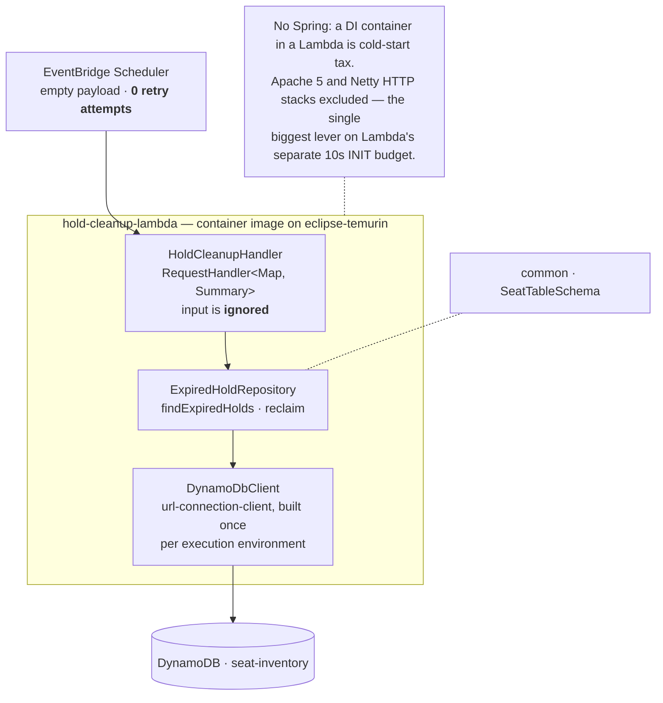
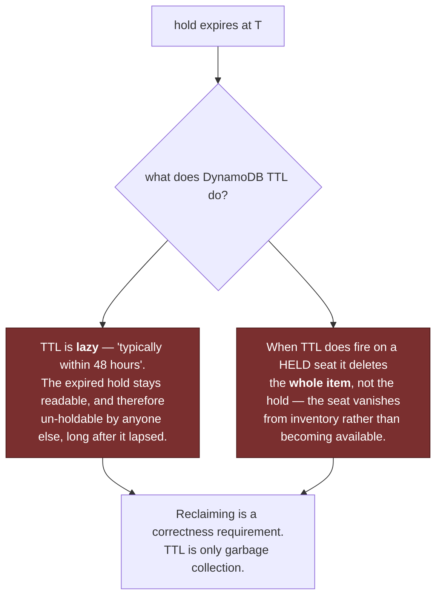
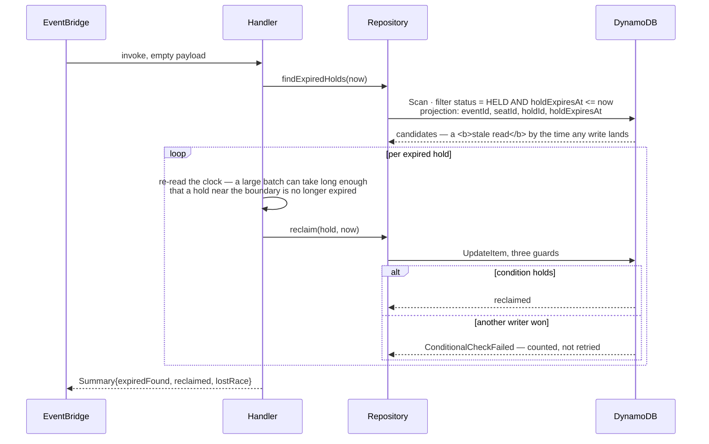
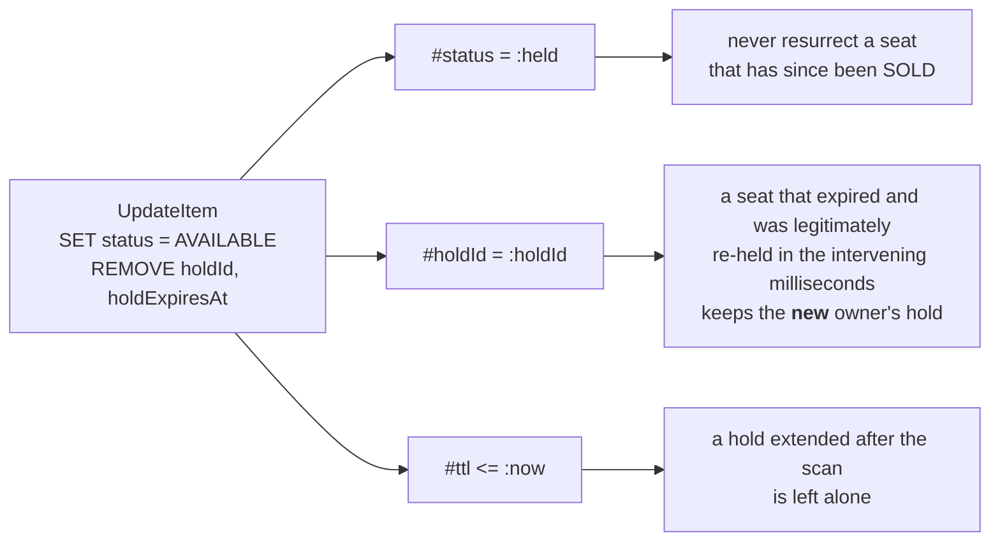

# hold-cleanup-lambda

Scheduled reclamation of expired seat holds. The second writer of the seat table, and the
reason TTL alone is not a correctness mechanism.

System context: [`docs/architecture.md`](../docs/architecture.md) ·
AWS setup: [`docs/runbook-hold-cleanup.md`](../docs/runbook-hold-cleanup.md)

## Shape

**The input is ignored on purpose.** The function's work is defined entirely by what the
table looks like at invocation time, which makes it idempotent and safe to invoke at any
cadence, from any source, including twice concurrently.

## Why TTL is not enough

## One invocation

## The three guards on `reclaim`

The scan is stale, so nothing from it is trusted at write time:

Losing this race is normal operation, not an error: a purchase landing in the same instant
is exactly the contention this design expects, and DynamoDB serializes the two conditional
writes so precisely one takes effect. A lost race is counted and left for the next tick —
which is why the schedule is configured with **zero** retry attempts.

## Known scale limit, stated rather than hidden

A `Scan` is the honest choice at this table's size: seats are stored one partition per
event with no index on status, so there is nothing to `Query`. It reads the whole table,
which is fine for a learning-scale event and would not be for a real one. The scale answer
is a **sparse GSI** carrying `holdExpiresAt` only while a seat is held, turning this into a
bounded range `Query`. Deliberately deferred.

## Proven

An abandoned hold was reclaimed by the schedule alone in **~53s**, no manual invoke; live
holds and SOLD-with-stale-TTL seats untouched (2026-08-22). `HoldCleanupIT` covers the
same against DynamoDB-local.
