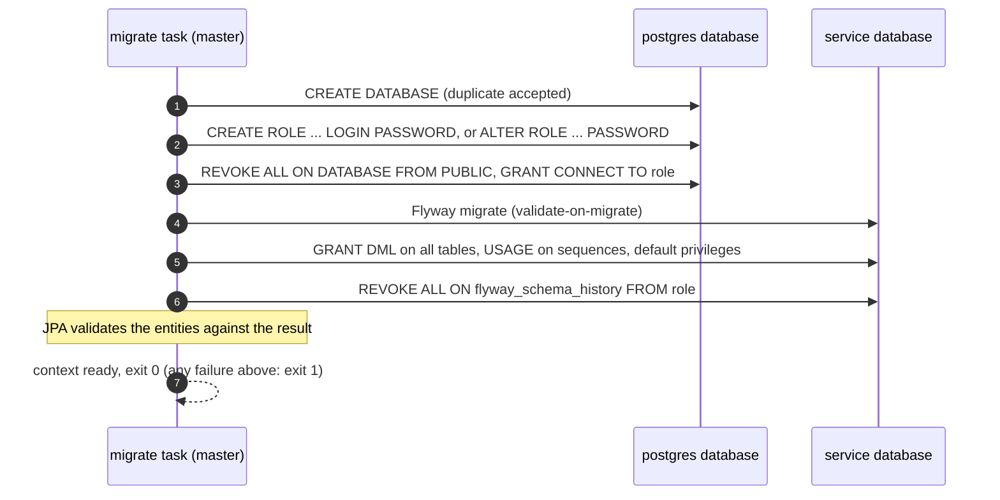

# migration-starter

The `migrate` profile (D9, D10, D13 in [`docs/phase2-plan.md`](../docs/phase2-plan.md)).
The service's own image, started with `SPRING_PROFILES_ACTIVE=migrate` as a one-off ECS task
before the service is updated, does four things as the RDS master user:
1. creates the service's database and login role, and sets the role's password from its secret;
2. runs Flyway;
3. grants the role DML and nothing else;
4. exits 0 or 1.

It is a Spring Boot starter in the Boot sense, like `security-starter` and
`observability-starter`. `checkout-payment-service` (database `checkout`, role `checkout_app`)
and `ticket-issuance-service` (`ticketing`, `ticketing_app`) depend on it.

System context: [`docs/architecture.md`](../docs/architecture.md)

## Why a deploy step, not startup

In Phase 1 every task ran Flyway as it started, and every service logged in as the master
user (`docs/phase1-retro.md` §6.6). That failed in two ways:
- **Racing migrations.** N tasks started together raced the same migration.
- **No real boundary.** `checkout-payment-service` could read or drop the tickets table. The
  "separate bounded context, no foreign key" claim held only by convention.

In Phase 2:
- **The master user is migration-only.** It owns every table.
- **A service logs in as its own role.** That role has DML on its own database and can
  connect to no other. Postgres itself refuses anything beyond that, not code in the service.
- **A failed migration stops the deploy.** The task exits 1, CI's `run-task --wait` fails, and
  no service task ever starts on a schema it does not match.

## The run

- **Inside Boot's Flyway initializer.** Steps 1–6 replace Boot's plain `flyway.migrate()` as
  its `FlywayMigrationStrategy`, so they run where Flyway would have: after the DataSource
  exists, before JPA. Hibernate's `ddl-auto: validate` then checks this image's entities
  against the schema just migrated, and a mismatch fails the migration task instead of the
  service tasks.
- **Idempotent, and run every time.** A second run applies no migrations and still resets the
  role's password. That is what makes a rotation work: bump `db_secret_version` in the session
  stack, migrate, redeploy (D13).
- **Postgres does the quoting.** A role name and a password cannot be bind parameters in DDL,
  so every statement is built by the server with `format('%I', '%L')`. No statement text is
  logged, since one of them carries the password.
- **Settings at the highest precedence.** `MigrateProfile` sets web off, Flyway on and
  validate-on-migrate. The service task definition turns Flyway off (D10), and a migration
  task copied from it must still migrate.

## Configuration

| Property | ECS source | Meaning |
|---|---|---|
| `spring.datasource.url` (`DB_URL`) | task environment | the service's database; the maintenance connection reuses its host and parameters |
| `spring.datasource.username` / `password` (`DB_USERNAME`, `DB_PASSWORD`) | the RDS-managed master secret, `username` / `password` keys | who runs the migration |
| `migrate.app-role` (`MIGRATE_APP_ROLE`) | the service's secret, `username` key | the role to create |
| `migrate.app-password` (`MIGRATE_APP_PASSWORD`) | the service's secret, `password` key | its password; 16 characters at least, so a local default cannot slip through |
| `migrate.maintenance-database` | default `postgres` | where the database and role are created from |
| `migrate.exit` | default `true` | `false` only in tests, which run the profile inside the test JVM |

Local `bootRun` does not use the profile and is unchanged: Flyway migrates at startup as the
local user, as before.

## Proof

`MigrateProfileIT` runs against `postgres:18-alpine`, with the container's superuser standing
in for the RDS master. Each guarantee was checked by deleting the statement behind it and
watching its test fail:

| Statement removed | Test that fails |
|---|---|
| `REVOKE ALL ON DATABASE … FROM PUBLIC` | `roleIsRefusedTheOtherServicesDatabase` |
| `GRANT CONNECT` | every test that logs in as the role |
| `GRANT … ON ALL SEQUENCES` | `roleWorksItsOwnRows` (the `bigserial` insert) |
| `REVOKE ALL ON TABLE flyway_schema_history` | `roleCannotReadOrEditTheMigrationHistory` |
| `ALTER ROLE … PASSWORD` | `rerunAppliesARotatedPassword` |
| `addFirst` → `addLast` in `MigrateProfile` | `profileMigratesEvenWithFlywayDisabledOnTheCommandLine` |

Each service also has its own `MigrateProfileIT`. It runs the service's real context in the
profile twice, with no web server, Cognito issuer or queue. The role can then read every
table and is refused `DROP`. In ticket-issuance the issuance consumer stays stopped
(`application-migrate.yml`).

Checked once on the real boot jar against a local Postgres 18:
- the first run exits 0 (database and role created, 2 migrations);
- the second exits 0 (0 migrations, password reset);
- a wrong master password exits 1;
- Tomcat never starts.
