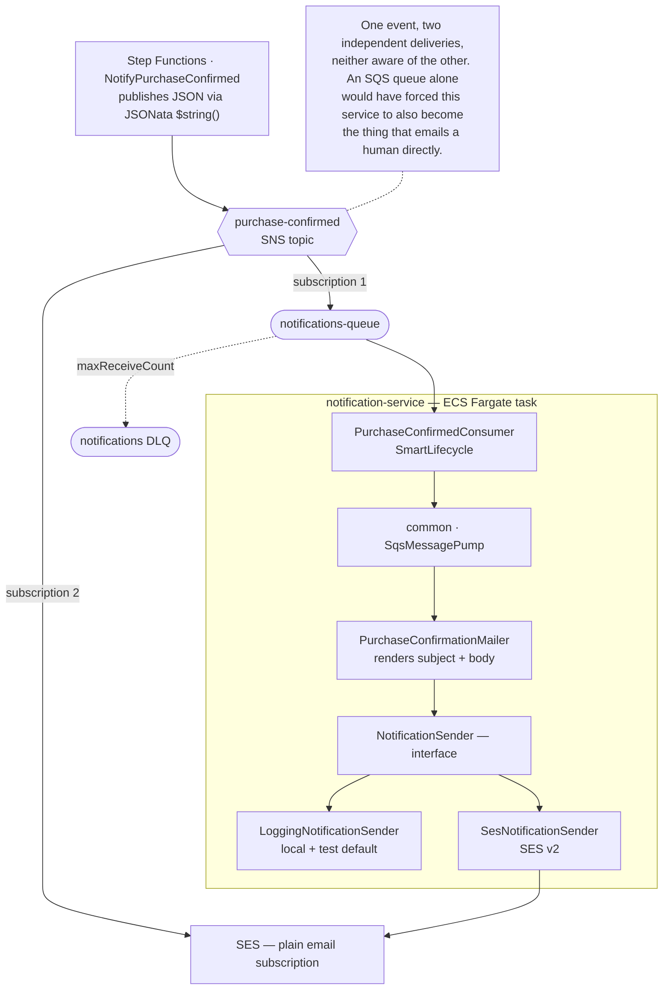
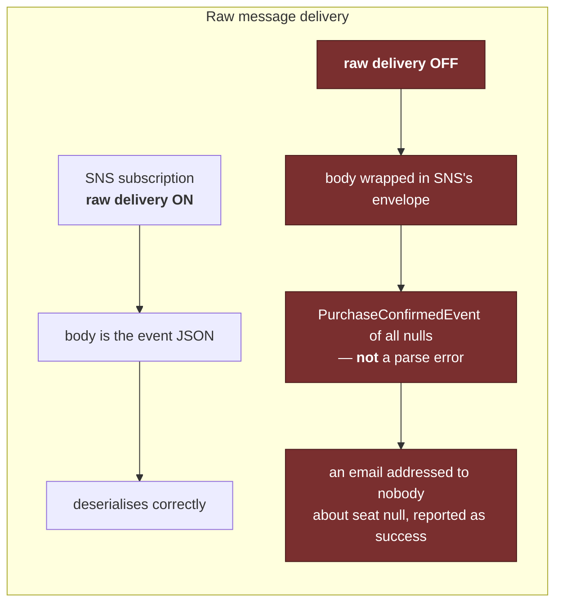
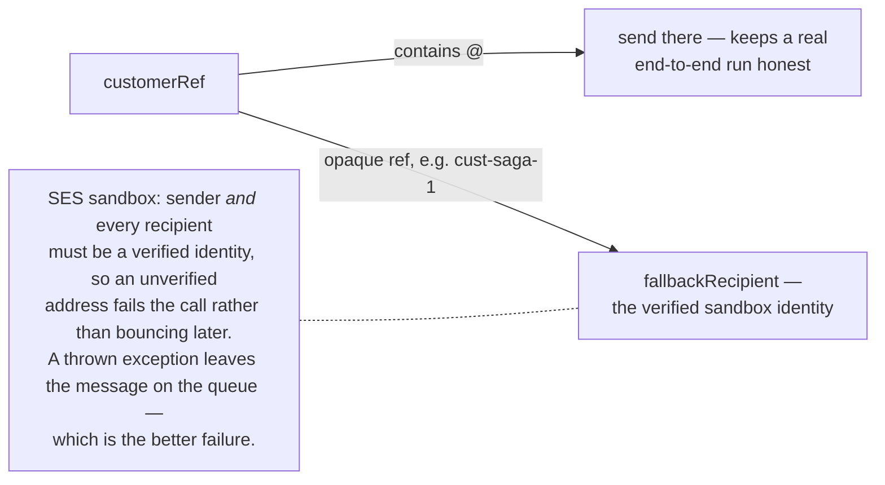
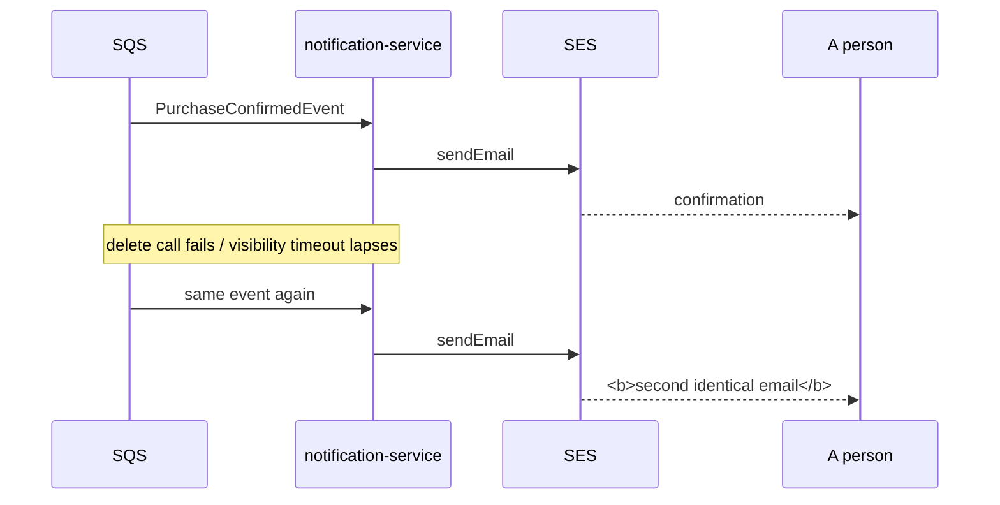
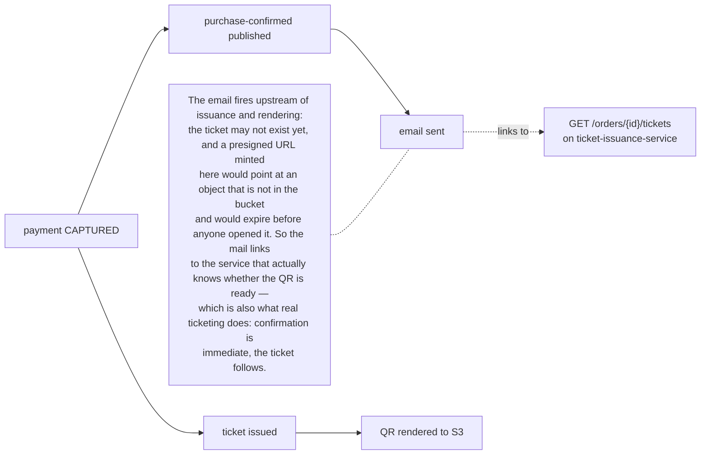

# notification-service

Sends the purchase-confirmation email. The smallest service, and the one place in the
project where at-least-once delivery is visible to a person.

System context: [`docs/architecture.md`](../docs/architecture.md) ·
AWS setup: [`docs/runbook-notifications.md`](../docs/runbook-notifications.md)

## Components and the fan-out that justifies SNS

The `NotificationSender` split mirrors `PaymentGateway`/`MockPaymentGateway` in
checkout — same reasoning, so neither local runs nor tests need the real provider.

## Two configuration traps, drawn

## The accepted duplicate

SES has no idempotency key. This is **not** papered over with an in-memory guard, which
would be a dedupe that lasts exactly as long as one task and lies about the rest. The
honest fix is a `notifications_sent` table with a unique key on `orderId`, written before
the send — deliberately deferred, because it means giving this service a database, and a
duplicate confirmation email is a far cheaper defect than a duplicate ticket or a
duplicate charge.

## What the mail deliberately does not contain

