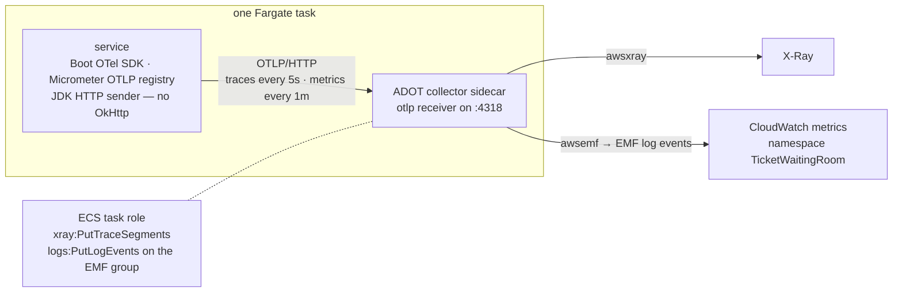
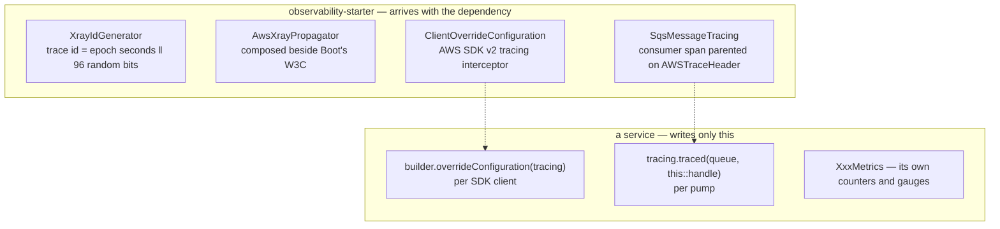

# observability-starter

Makes a service observable in the AWS sense: a health endpoint the ALB can probe, and
traces and metrics that leave over OTLP and arrive in X-Ray and CloudWatch as one story per
request. A Spring Boot starter in the Boot sense, like `security-starter`: a dependency you
add, and an auto-configuration that arrives with it.

System context: [`docs/architecture.md`](../docs/architecture.md) ·
AWS setup: [`docs/runbook-observability.md`](../docs/runbook-observability.md) — the
collector sidecar, task-role permissions, the dashboard, and what the first runs found

## Why a module and not five copies

Every Fargate service needs the same four things and none of them is a fact about its
bounded context: X-Ray-shaped trace ids, the X-Ray trace header understood beside W3C, a
span around every AWS SDK call, and a health door. Five copies would drift the way five
`SecurityConfig`s did. It is deliberately **not** in `common`, for the reason
`security-starter` is not: the Lambda images share `common`, and the OpenTelemetry SDK on a
Lambda classpath is exactly the cold-start tax slice 2 removed.

## Why OTLP into a sidecar, not the AWS SDKs

Boot 4 dropped its CloudWatch metrics auto-configuration (the Micrometer registry moved to
Spring Cloud AWS) and gained `spring-boot-starter-opentelemetry`. So the choice was between
two AWS-specific pipelines in every service — a CloudWatch client for metrics, an X-Ray
client or daemon for traces — and one vendor-neutral one: OTLP over HTTP to a collector on
the task's loopback, which forwards to X-Ray and CloudWatch. The second is chosen. Nothing
in the service knows the backend; the same image, the same properties and the same
`OTLP_ENDPOINT` work under the ADOT collector in ECS, under a vanilla collector in Docker
(which is what the integration test uses), and under whatever the EKS phase runs.

One switch, `TELEMETRY_EXPORT_ENABLED`, turns both exporters on; off is the local default,
so a service with no collector beside it does not log a failed export every minute.

## What X-Ray needs that Boot does not know

- **Trace ids carry a timestamp.** The X-Ray exporter reads the leading four bytes as the
  trace's start second and drops anything more than thirty days off — which a random
  prefix nearly always is. OTel's default generator would have every span exported and
  none accepted. The generator is twenty lines written here; the contrib artifact that
  ships one also ships a remote sampler, and with it OkHttp, Jackson 2 and Caffeine.
- **The trace arrives as `X-Amzn-Trace-Id`.** API Gateway with tracing on, and the ALB
  always, stamp it on the request; the saga's `http:invoke` and SQS's `AWSTraceHeader`
  carry the same format. The propagator is added *beside* W3C, not instead of it, so a
  caller speaking either is joined.
- **Every SDK call is a subsegment**, with the service and operation on it. A lost
  conditional write shows in X-Ray as a 400 `DynamoDB.UpdateItem` under the request that
  lost the race. On `SendMessage` the same interceptor writes the trace into the message.
- **A queue is not a trace boundary.** `SqsMessagePump` now asks for `AWSTraceHeader`;
  `SqsMessageTracing` reads it and opens a `CONSUMER` span under it around the handler. A
  message without the header starts a fresh trace — tracing is never why a ticket is not
  issued — and a handler's exception is recorded and rethrown untouched, so the pump's
  delete-only-after-return contract is not this module's to change.

## What each service exports

Every exported series is a billable CloudWatch metric, so Boot's JVM, Tomcat, logging and
process meters are switched off (`management.metrics.enable.all: false`) and each service
enables `http.server.requests` plus its own prefix. The meters are chosen by the question
the load test will ask:

| Service | Meter | Question |
|---|---|---|
| seat-inventory | `seat.hold.attempts{outcome=held\|unavailable}` | contention — N racers, one winner |
| | `seat.hold.releases{…}`, `seat.purchase.confirmations{…}` | compensations, sales, stale-hold refusals |
| | `seats.remaining{event}` | inventory, from a scheduled `COUNT` query |
| waiting-room | `waiting_room.queue.depth{event}`, `waiting_room.admitted{event}` | the line, from `ZCARD` on a schedule |
| | `waiting_room.joins{status}`, `waiting_room.admissions` | funnel top |
| | `waiting_room.admission.publish.failures` | clients back to polling |
| checkout-payment | `checkout.charges{outcome=captured\|declined\|failed\|replayed\|in_flight\|not_payable}` | conversion, and the partial unique index refusing rivals |
| | `checkout.orders{outcome}`, `checkout.gateway.latency` | saga retries; the network the transaction is not held across |
| ticket-issuance | `tickets.issued{outcome=issued\|duplicate}` | the queue's redelivery rate |
| notification | `notifications.sent{outcome=sent\|failed}` | mail stopped |

Conversion rate is `checkout.charges{captured}` over `waiting_room.admissions`, computed
on the dashboard, not in code.

## What is deliberately not observed

Two things Boot observes by default were, on the first full-stack run, most of what X-Ray
and the request timer contained: the ALB's health probe (two nodes, every 10 s, per
service — about two-thirds of all requests) and the `@Scheduled` gauge refreshes (a trace
every 30 s per service). `noHousekeepingObservations` is one `ObservationPredicate` bean
that drops both: anything named `tasks.scheduled.execution…`, and any server request whose
URI starts with `/actuator`. Dropping the observation drops the span *and* the meter
series, so `/actuator/health` is neither traced nor in `http.server.requests` — the ALB
reads the status code and needs nothing else. Proven in `OtlpExportIT`: a health request
and a running scheduled task leave nothing at the collector while the probe request beside
them does.

## Timers leave as histograms

Each service sets SLO bucket boundaries for `http.server.requests` (and checkout for
`checkout.gateway.latency`): ten fixed buckets from 10 ms to 10 s. The OTLP registry then
exports an explicit-bucket histogram rather than a count/sum pair, the collector's EMF
exporter carries the buckets through, and CloudWatch can answer p50/p95/p99 — which the
first session's dashboard could not, having only avg and max. Ten buckets rather than
Micrometer's ~70-bucket percentile histogram, because every bucket is a value in every EMF
event and the load test's percentiles do not need finer than this.

## The health door

`GET /actuator/health` answers `{"status":"UP"}` anonymously; `security-starter` opens
that one path (GET only, status word only). All four ALB target groups probe it with a
`200` matcher since 2026-09-14, replacing slice 6's `GET /` → `200-499` matcher, which
accepted a 401 as "alive" and so proved that Tomcat was up and nothing more.

## Proven

`OtlpExportIT` — a throwaway web app exporting to a real OpenTelemetry collector in
Docker: a request wearing API Gateway's `X-Amzn-Trace-Id` is printed by the collector as
that trace, with that parent, under `service.name: probe-service`, over the JDK sender;
the one enabled metric arrives with its tag and an exemplar pointing at the trace, and no
JVM series does. `SqsMessageTracingTest` — a delivery carrying `AWSTraceHeader` is
processed under that trace with that parent; one without starts its own; a throwing
handler marks the span and still throws. `TicketingObservabilityAutoConfigurationTest` —
ids are X-Ray-shaped, both headers are written, the SDK beans back off with no SDK on the
classpath. `XrayIdGeneratorTest` — the leading eight hex digits are the epoch second.
