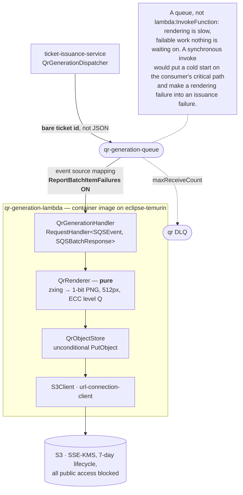
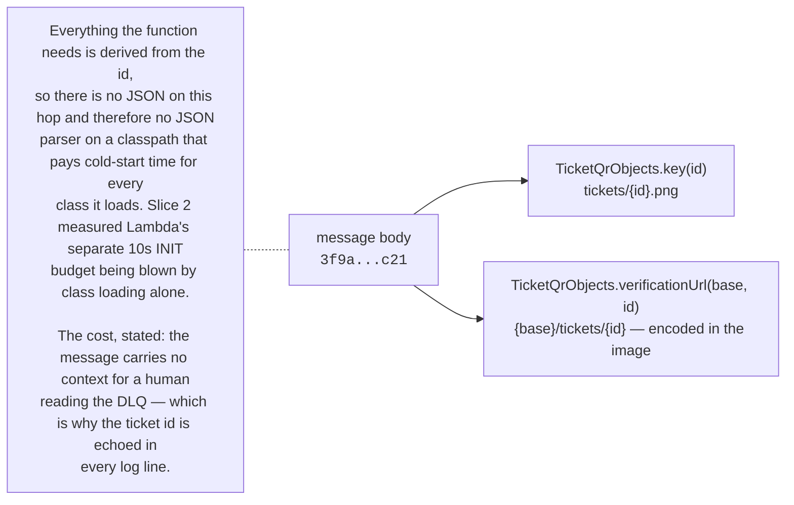
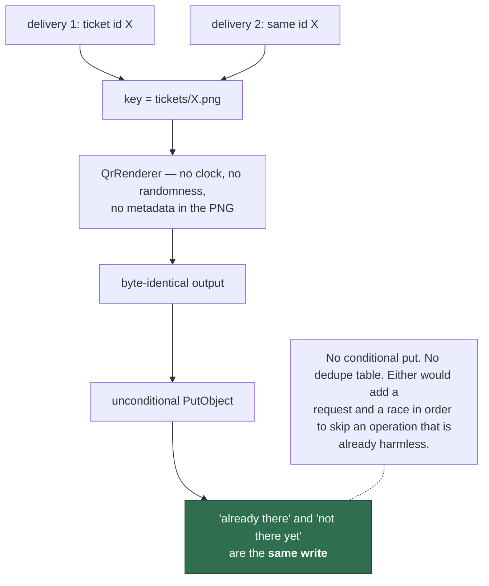
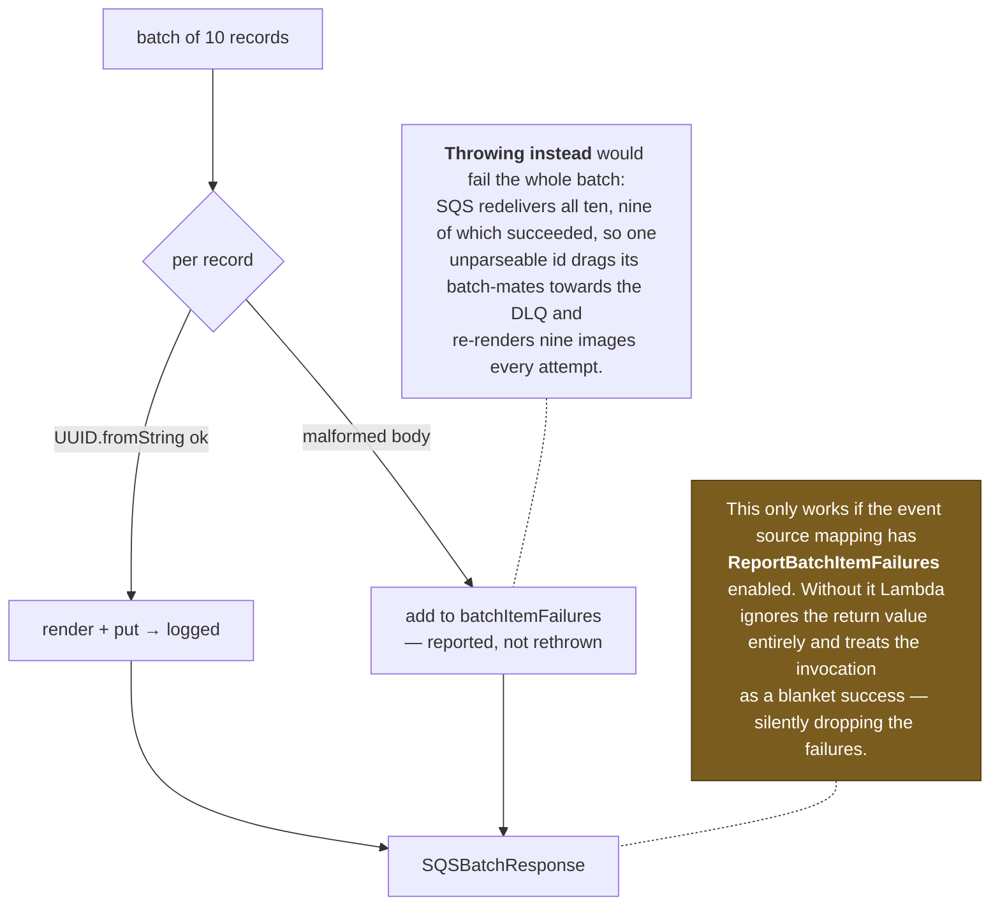

# qr-generation-lambda

Renders ticket QR codes onto S3. The clearest example in the project of **idempotency by
construction** rather than by guard.

System context: [`docs/architecture.md`](../docs/architecture.md) ·
AWS setup: [`docs/runbook-qr-generation.md`](../docs/runbook-qr-generation.md)

## Shape

## The message body is a bare ticket id

## Idempotency without a mechanism

The S3 key contract lives in `common` as `TicketQrObjects`, shared with the reader in
`ticket-issuance-service`. A divergent key between writer and reader is not a compile
error and not a runtime error — it is a download endpoint reporting PENDING forever while
the object sits happily in the bucket under another name.

## Partial batch failure

The `UUID.fromString` parse is not validation for its own sake: a malformed record must
fail **before** it can write an object under an attacker-chosen key.
