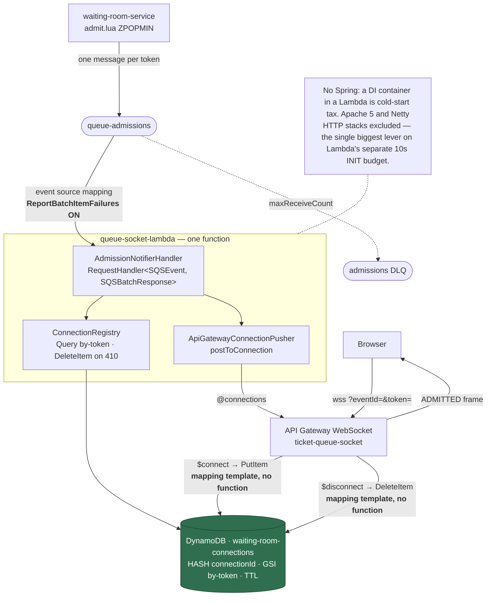
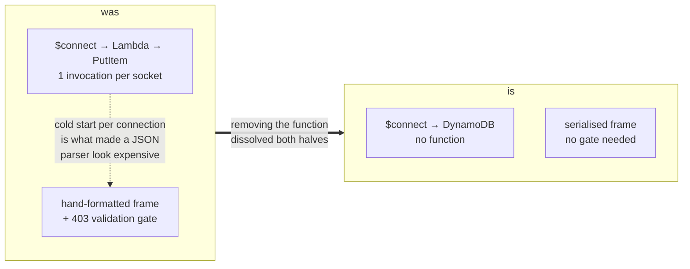
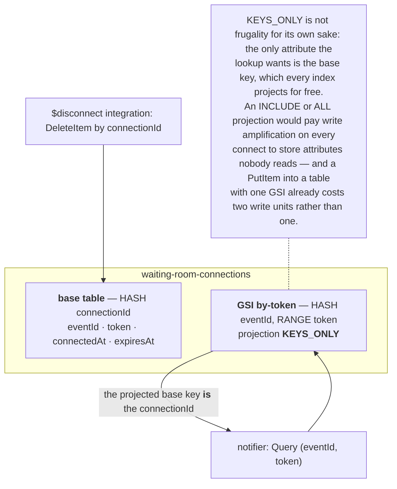
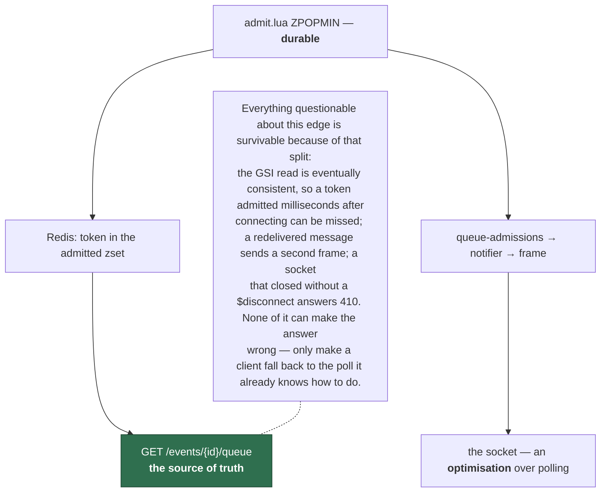

# queue-socket-lambda

The push half of the waiting room: an SQS-driven notifier that turns an admission into a
frame on every socket holding the admitted token.

`$connect` and `$disconnect` are **not here**. They are API Gateway service integrations
writing DynamoDB directly, so this module is the read side of a registry it does not write.

System context: [`docs/architecture.md`](../docs/architecture.md) ·
AWS setup: [`docs/runbook-websocket-queue.md`](../docs/runbook-websocket-queue.md)

## Shape



## Why the connection routes have no code

Each route does one unconditional write against a key API Gateway already holds. Nothing is
computed, nothing is decided, the result is ignored — a mapping template's job description,
not a function's.

The cost of getting this wrong is not the invoice, which is about $0.15 per 50k-user event.
It is that fifty thousand sockets opening in ten seconds needs ~1,000 concurrent executions
of a JVM container image with a ~500 ms cold start, **container images cannot use SnapStart**,
and a throttled `$connect` drops the client back to polling — the stampede this whole slice
exists to prevent. The design would have been weakest at the only moment it mattered.



The two decisions were propping each other up: formatting by hand was cheap only because a
per-connection Lambda validated its inputs, and validating was justified only by the
formatting. The notifier is invoked once per **batch of ten** admissions rather than once per
socket, so its INIT is amortised and it can simply serialise — see below.

What it cost: the write path left the test suite. That is defensible precisely because
nothing on it decides anything, and it would not be defensible for a path that did.

## The registry, and the KEYS_ONLY trick

`$disconnect` is given a `connectionId` and nothing else, so that has to be the base key.
The notifier has the opposite problem: it holds a token and needs the sockets.



Two tabs on one token are two rows, and both get the frame. That fan-out is what
`QueueSocketIT.everyTabOpenedAtOnceStillGetsTheFrame` races: fifty sockets registered at
once, one admission, fifty frames.

**Nothing in this repo writes a row.** `ConnectionTableSchema` names the attributes for the
reader, but the authoritative writer is VTL in the runbook, so a rename is no longer a
compile error. `QueueSocketIT.theRowShapeTheMappingTemplateWritesIsTheOneTheLookupReads`
replaces that compiler: it seeds a row with the attribute names written out as *literals*, so
the test disagrees with the reader the moment either side drifts.

## Why the push is allowed to be best-effort



A `GoneException` is therefore treated as **news rather than failure**: the row is pruned
and the record still succeeds. Retrying it would only rediscover the same dead socket, and
counting it as a failure would eventually dead-letter a message that had nothing wrong
with it.

## No JSON inbound, real JSON outbound

The SQS body is the bare token and the other two values ride as message attributes, which
the SDK types on both ends — the same argument as `qr-generation-lambda`'s bare ticket id,
and for the same reason: a parser on this classpath is cold-start time spent on three values.

Outbound the frame is **serialised**:

```
{"type":"ADMITTED","eventId":"evt-1","token":"<uuid>","admissionExpiresAt":1757088000}
```

This is where the removed 403 gate would otherwise be missed. The query string now reaches
DynamoDB through a mapping template that escapes for JSON but does not *validate*, so an
event id containing a quote is a row this function will read; formatting the frame by hand
would emit that quote raw and hand the client broken or forged structure.

Serialising costs nothing to reach for. `JsonWriter` lives in `software.amazon.awssdk:json-utils`,
which the DynamoDB and API Gateway clients already pull in and already load to parse their own
responses — the staged package is **37 jars either way**. The INIT budget that made
hand-formatting look thrifty was never going to be charged twice.
`QueueSocketIT.aTokenThatWouldHaveBrokenAHandBuiltFrameIsEscapedInstead` pushes exactly the
injection the old gate existed to refuse and asserts the frame parses back with the quote
intact as data.

This is confirmed against real AWS rather than assumed: connecting with
`eventId=evt", "injected":"yes` stores the quote as **data** in the row, creating no extra
attribute — so a hostile event id genuinely does reach this function, and formatting the frame
by hand would genuinely have emitted it as structure. See the runbook's Results.

## Nothing here touches Redis

Deliberate, and it is what keeps this function out of the VPC — no ENI attachment on cold
start, no NAT. The consequence is that connecting cannot answer "what is my position", and in
any case a socket does not exist until `$connect` returns 200, so there would be nothing to
post to. The client takes its opening snapshot from the REST endpoint it already calls, and
the socket carries only the transition.
