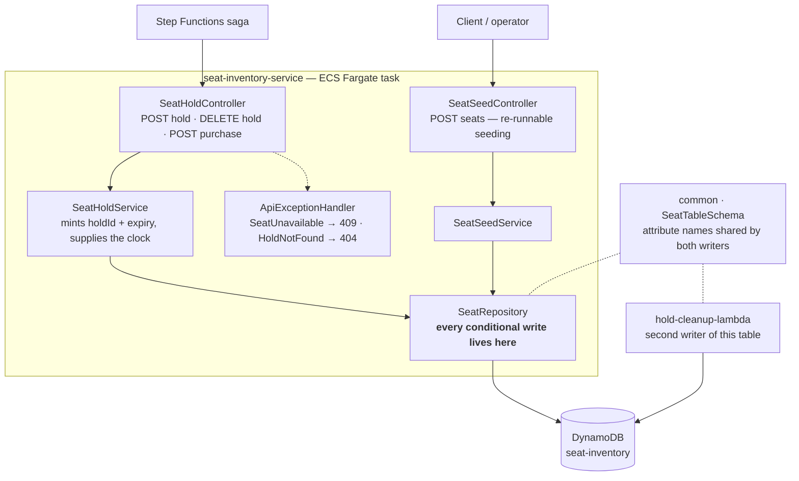
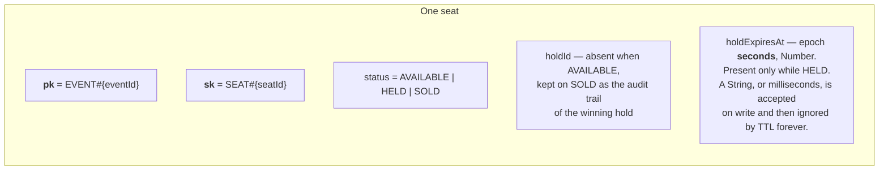
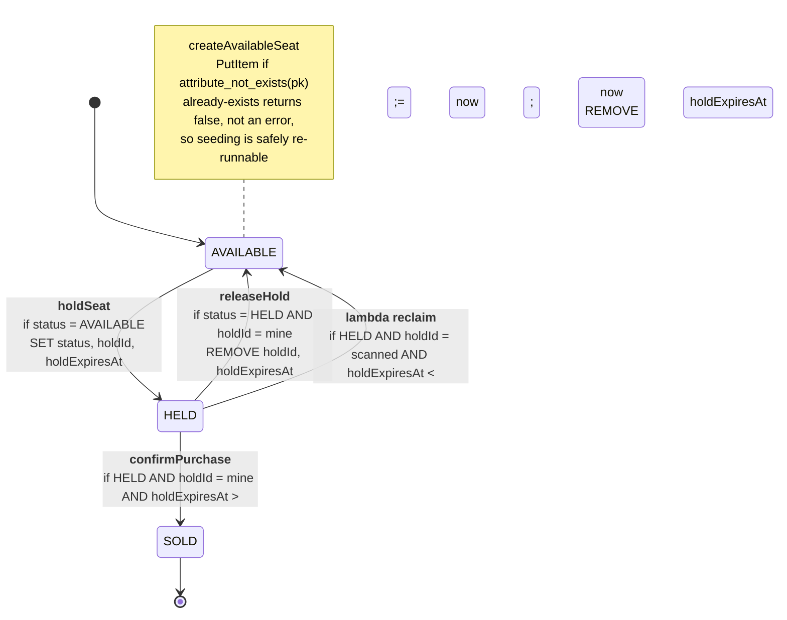
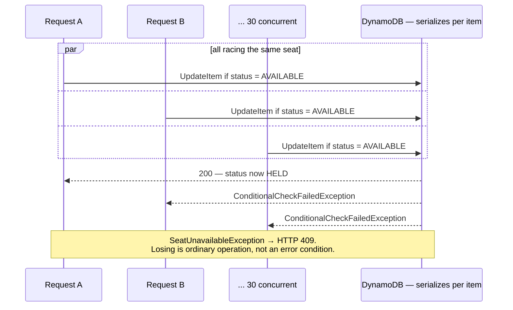

# seat-inventory-service

The centerpiece. One DynamoDB item per seat, and every state transition is a single
conditional write — no application lock, no `SELECT ... FOR UPDATE`, no read-modify-write
window.

System context: [`docs/architecture.md`](../docs/architecture.md) ·
AWS setup: [`docs/runbook-seat-inventory.md`](../docs/runbook-seat-inventory.md)

## Components

`SeatTableSchema` lives in `common` precisely because there are two writers. A divergent
attribute name is not a compile error and not a runtime error — DynamoDB accepts any
attribute name. It is a condition that silently never matches.

## The item

## Transitions

Every arrow is one `UpdateItem`. The guard is written on the arrow, because the guard *is*
the concurrency control.

Three guards worth spelling out:

- **`holdId` on release** — without it a stale caller, whose hold already expired and was
  re-acquired by someone else, would tear up the *current* owner's hold.
- **`holdExpiresAt > now` on confirm** — the expiry check must live in the write itself.
  DynamoDB TTL deletes lazily, possibly much later, so an expired-but-not-yet-deleted hold
  would otherwise still be confirmable.
- **`REMOVE holdExpiresAt` on confirm** — otherwise TTL eventually deletes a SOLD seat,
  and the seat vanishes from inventory rather than staying sold.

## The race

## Proven

`SeatHoldConcurrencyIT` locally, and on real Fargate + DynamoDB:
**30 concurrent holds on one seat → 1×201, 29×409** (2026-08-22).
`SeatStatusSchemaContractTest` pins the enum to `SeatTableSchema`'s string constants so
the two writers cannot drift apart silently.
