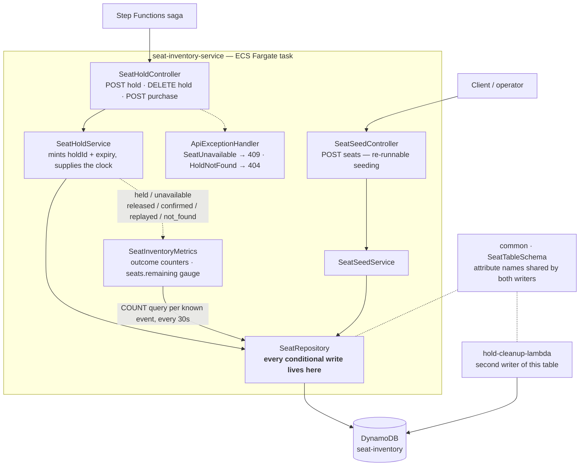
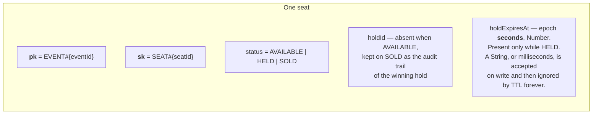
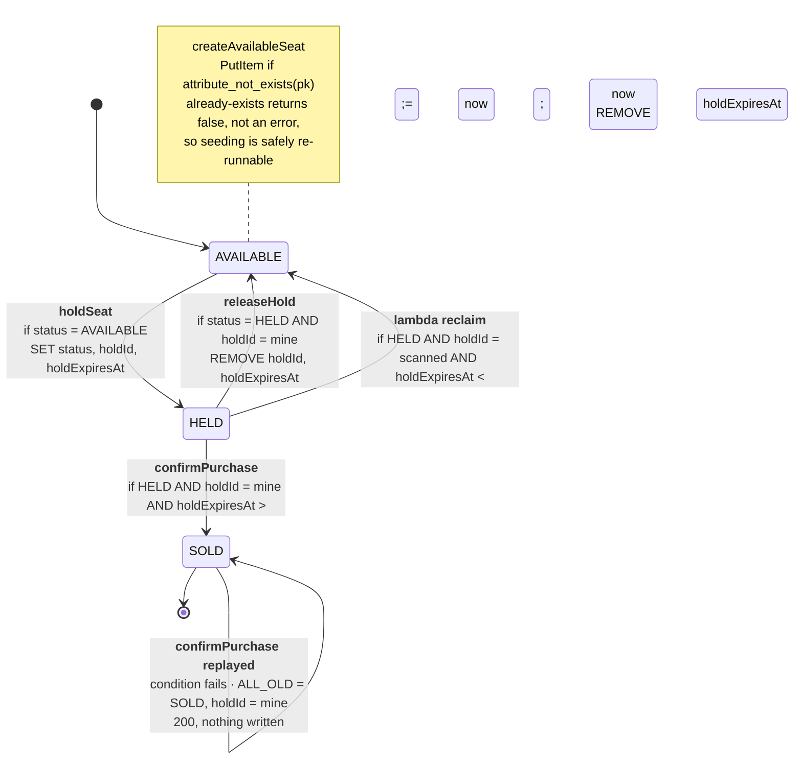
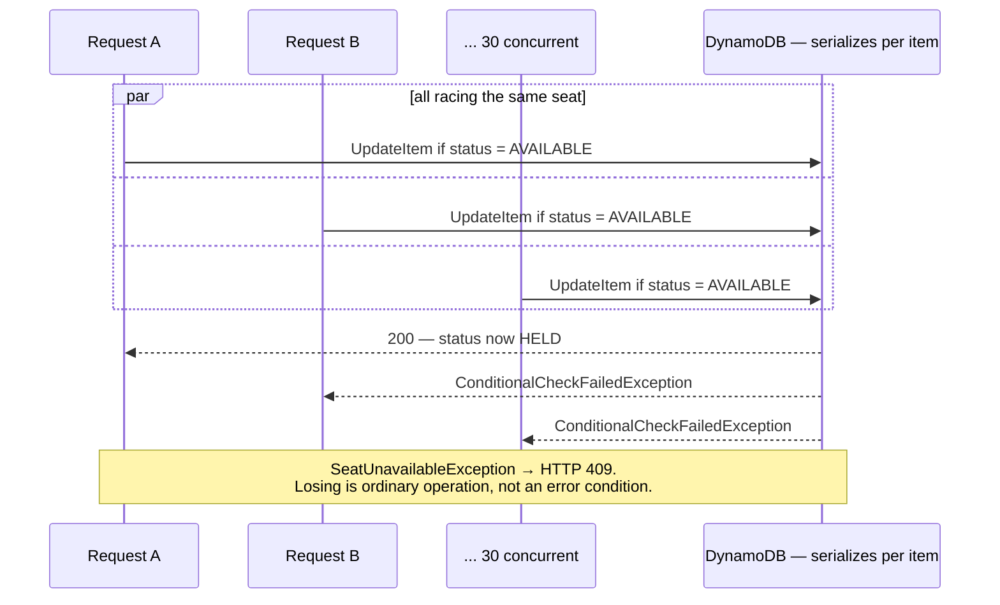

# seat-inventory-service

The centerpiece. One DynamoDB item per seat, and every state transition is a single
conditional write — no application lock, no `SELECT ... FOR UPDATE`, no read-modify-write
window.

System context: [`docs/architecture.md`](../docs/architecture.md) ·
AWS setup: [`docs/runbook-seat-inventory.md`](../docs/runbook-seat-inventory.md)

## Components

`SeatTableSchema` lives in `common` precisely because there are two writers. A divergent
attribute name is not a compile error and not a runtime error — DynamoDB accepts any
attribute name. It is a condition that silently never matches.

## What the dashboard reads

`SeatHoldService` counts each transition by its outcome — the repository knows it lost a
conditional write, the service knows what that meant — into `seat.hold.attempts`,
`seat.hold.releases` and `seat.purchase.confirmations`, each tagged `outcome` (a
confirmation can also be `replayed`, a retried confirm for a hold that already won). Under the
load test `held` : `unavailable` on one seat is the headline ratio. `seats.remaining{event}`
is a gauge refreshed on a schedule from `SeatRepository.countAvailable` — a `Select.COUNT`
query with a server-side status filter, paged because DynamoDB pages on bytes read rather
than rows matched — for the events this task has seen since it started; it is never on the
request path, where a query per hold would cost more than the hold. How the numbers leave
the task is `observability-starter`'s business.

## The item

## Transitions

Every arrow is one `UpdateItem`. The guard is written on the arrow, because the guard *is*
the concurrency control.

Four guards worth spelling out:

- **`holdId` on release** — without it a stale caller, whose hold already expired and was
  re-acquired by someone else, would tear up the *current* owner's hold.
- **`holdExpiresAt > now` on confirm** — the expiry check must live in the write itself.
  DynamoDB TTL deletes lazily, possibly much later, so an expired-but-not-yet-deleted hold
  would otherwise still be confirmable.
- **`REMOVE holdExpiresAt` on confirm** — otherwise TTL eventually deletes a SOLD seat,
  and the seat vanishes from inventory rather than staying sold.
- **Confirm is idempotent on the winning hold.** The saga retries the confirm, and before
  2026-10-07 a retry whose predecessor had committed but lost its response found the seat
  SOLD and got a 404. The saga now *refunds* on a 404, so that answer would have handed
  the buyer both the seat and their money. The write asks for
  `ReturnValuesOnConditionCheckFailure = ALL_OLD`. A failed condition then returns the item
  as it stood, in the same round trip, and SOLD under the caller's own `holdId` is answered
  200 without writing. SOLD is terminal and a hold id is never reused, so the answer
  cannot go stale. Every other failed condition stays a 404, and that is what makes the
  404 safe to refund on.

## The race

## Proven

`SeatHoldConcurrencyIT` locally, and on real Fargate + DynamoDB:
**30 concurrent holds on one seat → 1×201, 29×409** (2026-08-22). Idempotent confirm
(2026-10-07, LocalStack; not yet on AWS): **100 concurrent confirms of one hold → one
write, 99 replays, 0 refusals**. A confirm under a different hold on a SOLD seat, and one
after the hold was released, are both still refused.
`SeatStatusSchemaContractTest` pins the enum to `SeatTableSchema`'s string constants so
the two writers cannot drift apart silently.
