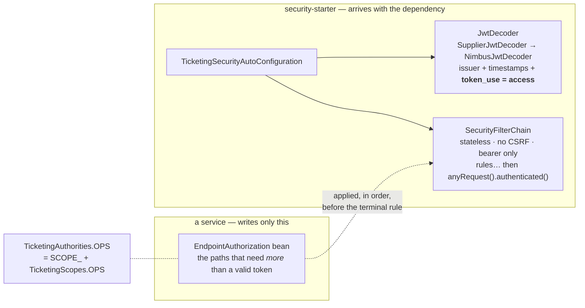
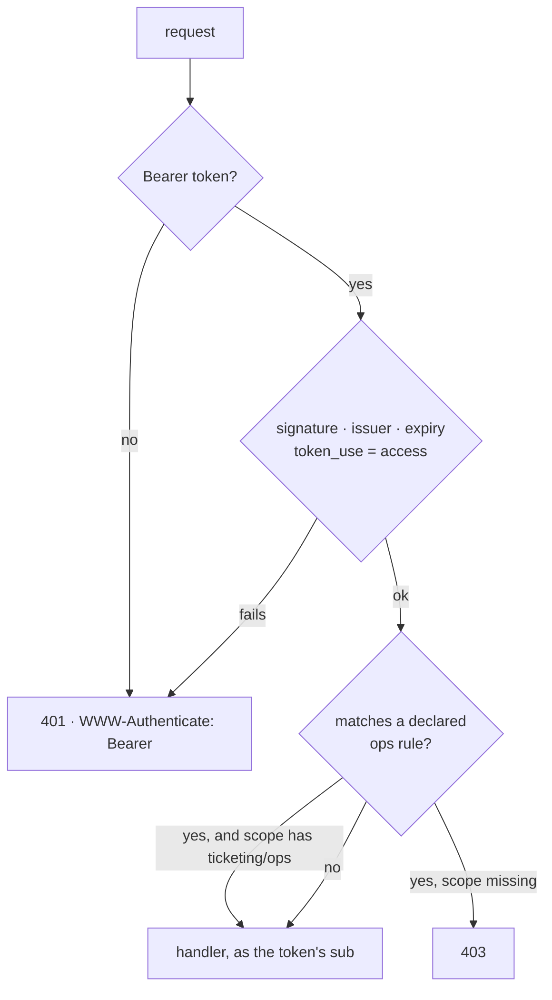

# security-starter

Makes a service an OAuth2 resource server for the Cognito user pool. A Spring Boot starter
in the Boot sense: a dependency you add, and an auto-configuration that arrives with it.

System context: [`docs/architecture.md`](../docs/architecture.md) ·
AWS setup: [`docs/runbook-cognito-auth.md`](../docs/runbook-cognito-auth.md)

## Why a module and not four copies

The four HTTP services each carried an identical `SecurityConfig` — decoder, validators,
stateless/CSRF shape, ~60 lines — differing only in three lines of path rules. This module
owns the mechanism once; a service keeps only its rules. It is the same split Boot makes
for itself, and the same one a platform team makes at any company with a
`<company>-spring-boot-starter-security`.

It is deliberately **not** folded into `common`. That module is framework-free because the
three Lambda images share it, and Spring Security on a Lambda classpath is the regression
slice 2 spent its time removing. The rule for `common` is *contracts*; the rule for this
module is *mechanism*.

## What a service writes

| Service | Its `EndpointAuthorization` |
|---|---|
| waiting-room | `POST /events/{id}/queue/admit` → ops |
| checkout-payment | `POST /orders`, `POST /orders/{id}/payment` → ops |
| seat-inventory | `/**` → ops — there is no fan door; the saga acts for the customer |
| ticket-issuance | none — every endpoint needs a valid token and nothing more |

A service with nothing to add declares nothing and ships no security code at all.

## What the chain decides

Two things in that diagram are the reason this module exists rather than Boot's default:

- **`token_use = access`.** A user pool signs ID tokens and access tokens with the same
  key; signature, issuer and expiry are identical between them. Boot's default decoder
  would accept an ID token — a credential meant only for the browser that logged in —
  as an API bearer token. `AccessTokenValidator` is the one place Cognito's discriminator
  is read.
- **`SupplierJwtDecoder`.** `NimbusJwtDecoder.withIssuerLocation(…).build()` fetches the
  issuer's discovery document *at construction*. Without the supplier a service could not
  start with the pool unreachable, and no test context could load against a placeholder.
  A test found this; the javadoc had claimed the opposite.

## The one anonymous path, and the first token's cost

`GET /actuator/health` is permitted before any rule a service declares — the ALB cannot
present a token, and a probe that needed one would mark every task unhealthy the moment
the pool hiccupped. GET only, health only, a status word only. Everything else under
`/actuator` is not exposed by the services in the first place (see `observability-starter`).

`JwtDecoderWarmUp` is an `ApplicationRunner`. It runs after the port opens and liveness is
up, but before Boot publishes `ReadinessState.ACCEPTING_TRAFFIC`, which Boot does only once
every runner has returned. So the ALB's readiness probe (`/actuator/health/readiness`,
D7) answers 503 until the decoder is warm. The work runs on a virtual thread that the runner
waits on for at most 30 s, because Nimbus's default client has no read timeout. Past that,
the task reports ready and the fetch finishes in the background. The warm-up hands the
decoder a well-formed RS256 token for the issuer whose `kid` no real key has. Verifying it
forces every deferred step — discovery document, JWKS, two TLS handshakes, the JIT meeting
Nimbus — and then fails, which is the expected outcome; a token that *passed* would be the
alarm. Slice 6 measured the first real token at **12.8 s** on 0.25 vCPU against 0.1 s for
every one after; this moves that cost to startup without giving up the laziness that lets
the service boot with the pool unreachable (an unreachable pool is logged, and the first
real request pays as before). `ticketing.security.warm-up=false` disables it; the root
build does so for every test JVM.

## What a 401 does not say

Behind API Gateway's private integration every request arrives with the **internal ALB's DNS
name** as its `Host`. Spring Security 7 builds two things from that host, and this module
removes both (found on the first live session, 2026-11-18).

- **The challenge.** Spring adds `resource_metadata="http://<host>/.well-known/oauth-protected-resource"`
  (RFC 9728) to every 401. That handed every unauthenticated caller on the internet the
  internal load balancer's name. A resolver can change the value but not leave it out, so
  `BearerChallengeEntryPoint` wraps Spring's own entry point and removes only that one
  parameter from the header. The error code, description, scope and status (401, or 403
  for `insufficient_scope`) stay Spring's.
- **The metadata endpoint.** Spring installs an anonymous `GET /.well-known/oauth-protected-resource`
  that cannot be switched off (the filter is final, its path fixed). It would answer with that
  host as `resource`, and claim certificate-bound tokens, which Cognito's are not.
  `ProtectedResourceMetadataRefusal` answers the path with a plain 404 before Spring's filter
  runs. It sets the status rather than calling `sendError`, so the error dispatch cannot run
  the chain again and turn the 404 into the anonymous 401. The edge routes no `/.well-known`
  path to any service anyway; this closes it from inside the VPC too.

## Conditions

Both beans are `@ConditionalOnMissingBean`, so a service (or a test) that defines its own
`JwtDecoder` or `SecurityFilterChain` wins and the starter contributes nothing. The
auto-configuration is ordered **before** Boot's resource-server support, so Boot sees both
beans already present and stays out of the way.

No issuer, no start: `spring.security.oauth2.resourceserver.jwt.issuer-uri` is required,
and the failure names the property. A service that checks identity with no identity
provider is misconfigured, not degraded.

## In tests

The module registers itself in `META-INF/spring/…WebMvcTest.imports` — the same file Boot
uses for its own resource-server support — so a `@WebMvcTest` slice in any service gets the
real chain without naming this module. Slice tests authenticate with spring-security-test's
`jwt()` post-processor, which sets the authentication directly: no key material, no
network, no decoder. The placeholder issuer every test context boots with comes from the
root build (`COGNITO_ISSUER_URI`), the same way production gets the real one, and is never
contacted.

## Proven

`TicketingSecurityFilterChainTest` — a throwaway application with one open endpoint and
one declared ops-only, driven through the real filters: anonymous → 401 with a Bearer
challenge; any valid token → the open endpoint, as its own `sub`; a customer's token on the
ops endpoint → 403; the ops scope → 200. `GET /actuator/health` → 200
anonymously, `POST` to it → 401, and the old probe path `GET /` still 401 rather than 404
or 500. A request sent with the internal ALB's host gets exactly `WWW-Authenticate: Bearer`, and
the metadata path answers 404 without the host. Both fail with the two classes taken out.
`BearerChallengeEntryPointTest` — an invalid token keeps its RFC 6750 error, description and
URI and loses only `resource_metadata`; `insufficient_scope` keeps its 403 and its scope.
`TicketingSecurityAutoConfigurationTest` — the back-off and refuse-to-start
conditions, and the warm-up present by default and absent when switched off.
`JwtDecoderWarmUpTest` — the probe token parses as RS256 for the issuer with `kid`
`warm-up` and an all-zero signature; a rejected probe is not an error; an unreachable issuer
is swallowed. The runner returns only once the decoder is warm. A hung issuer holds it for
the bounded wait and no longer. Through a real `SpringApplication`, `ACCEPTING_TRAFFIC` is
published only after the warm-up finished. All three fail if the runner stops waiting. `AccessTokenValidatorTest` — an ID token is refused on `token_use` alone.
