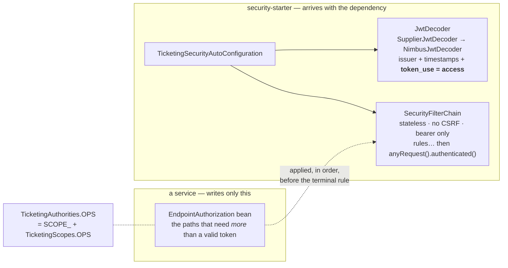
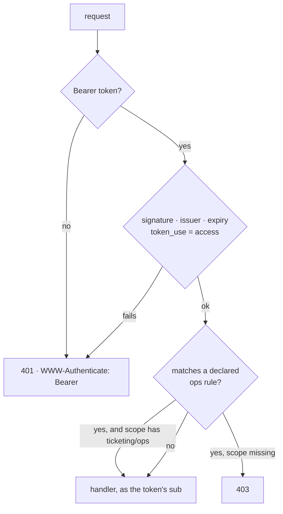

# security-starter

Makes a service an OAuth2 resource server for the Cognito user pool. A Spring Boot starter
in the Boot sense: a dependency you add, and an auto-configuration that arrives with it.

System context: [`docs/architecture.md`](../docs/architecture.md) ·
AWS setup: [`docs/runbook-cognito-auth.md`](../docs/runbook-cognito-auth.md)

## Why a module and not four copies

The four HTTP services each carried an identical `SecurityConfig` — decoder, validators,
stateless/CSRF shape, ~60 lines — differing only in three lines of path rules. This module
owns the mechanism once; a service keeps only its rules. It is the same split Boot makes
for itself, and the same one a platform team makes at any company with a
`<company>-spring-boot-starter-security`.

It is deliberately **not** folded into `common`. That module is framework-free because the
three Lambda images share it, and Spring Security on a Lambda classpath is the regression
slice 2 spent its time removing. The rule for `common` is *contracts*; the rule for this
module is *mechanism*.

## What a service writes

| Service | Its `EndpointAuthorization` |
|---|---|
| waiting-room | `POST /events/{id}/queue/admit` → ops |
| checkout-payment | `POST /orders`, `POST /orders/{id}/payment` → ops |
| seat-inventory | `/**` → ops — there is no fan door; the saga acts for the customer |
| ticket-issuance | none — every endpoint needs a valid token and nothing more |

A service with nothing to add declares nothing and ships no security code at all.

## What the chain decides

Two things in that diagram are the reason this module exists rather than Boot's default:

- **`token_use = access`.** A user pool signs ID tokens and access tokens with the same
  key; signature, issuer and expiry are identical between them. Boot's default decoder
  would accept an ID token — a credential meant only for the browser that logged in —
  as an API bearer token. `AccessTokenValidator` is the one place Cognito's discriminator
  is read.
- **`SupplierJwtDecoder`.** `NimbusJwtDecoder.withIssuerLocation(…).build()` fetches the
  issuer's discovery document *at construction*. Without the supplier a service could not
  start with the pool unreachable, and no test context could load against a placeholder.
  A test found this; the javadoc had claimed the opposite.

## Conditions

Both beans are `@ConditionalOnMissingBean`, so a service (or a test) that defines its own
`JwtDecoder` or `SecurityFilterChain` wins and the starter contributes nothing. The
auto-configuration is ordered **before** Boot's resource-server support, so Boot sees both
beans already present and stays out of the way.

No issuer, no start: `spring.security.oauth2.resourceserver.jwt.issuer-uri` is required,
and the failure names the property. A service that checks identity with no identity
provider is misconfigured, not degraded.

## In tests

The module registers itself in `META-INF/spring/…WebMvcTest.imports` — the same file Boot
uses for its own resource-server support — so a `@WebMvcTest` slice in any service gets the
real chain without naming this module. Slice tests authenticate with spring-security-test's
`jwt()` post-processor, which sets the authentication directly: no key material, no
network, no decoder. The placeholder issuer every test context boots with comes from the
root build (`COGNITO_ISSUER_URI`), the same way production gets the real one, and is never
contacted.

## Proven

`TicketingSecurityFilterChainTest` — a throwaway application with one open endpoint and
one declared ops-only, driven through the real filters: anonymous → 401 with a Bearer
challenge; any valid token → the open endpoint, as its own `sub`; a customer's token on the
ops endpoint → 403; the ops scope → 200. `TicketingSecurityAutoConfigurationTest` — the
back-off and refuse-to-start conditions. `AccessTokenValidatorTest` — an ID token is
refused on `token_use` alone.
