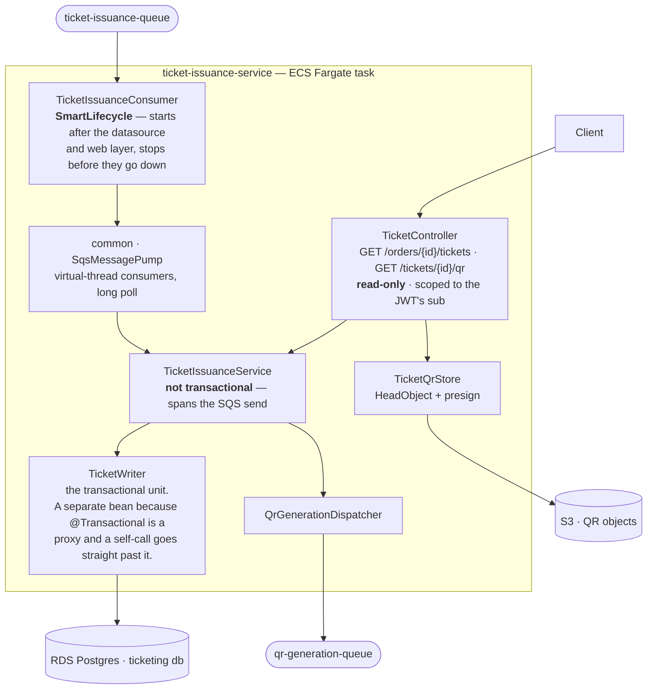
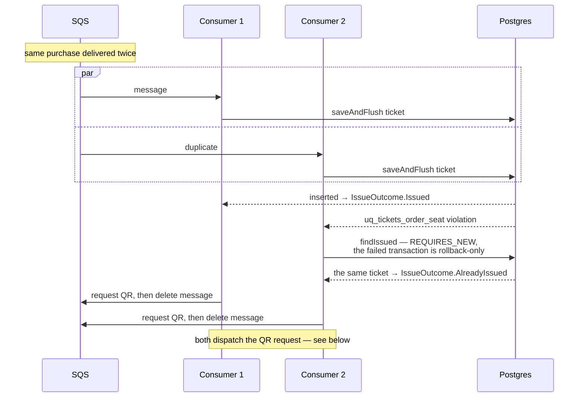
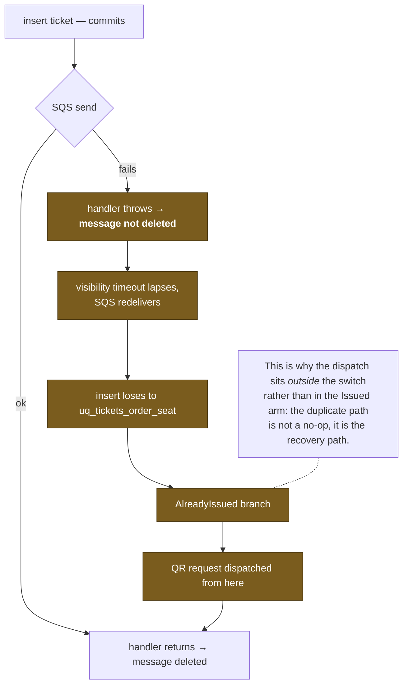
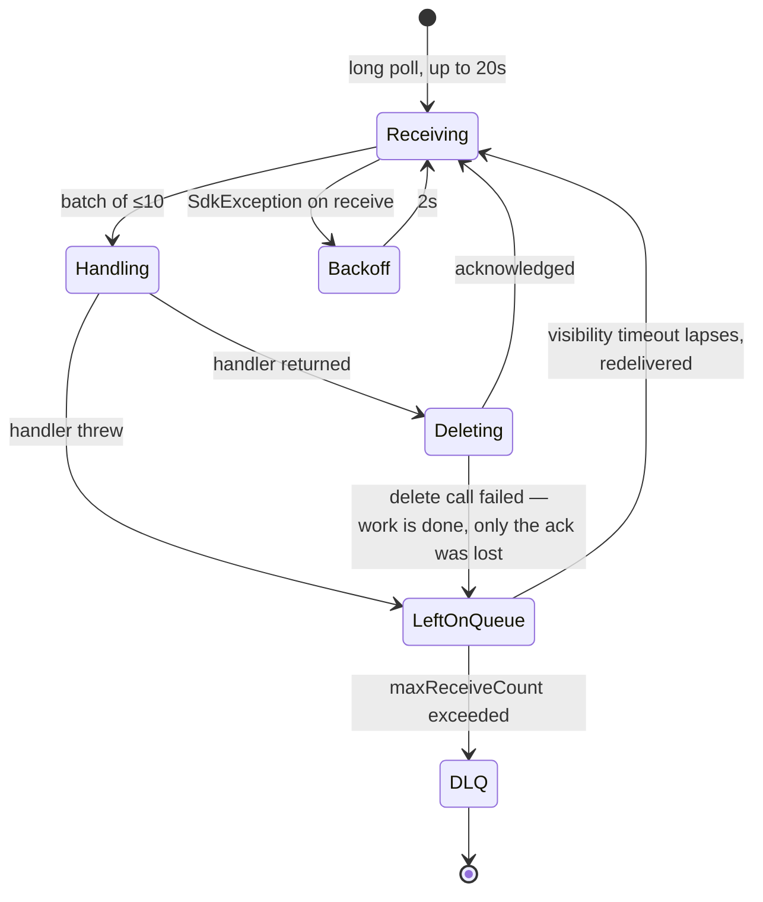
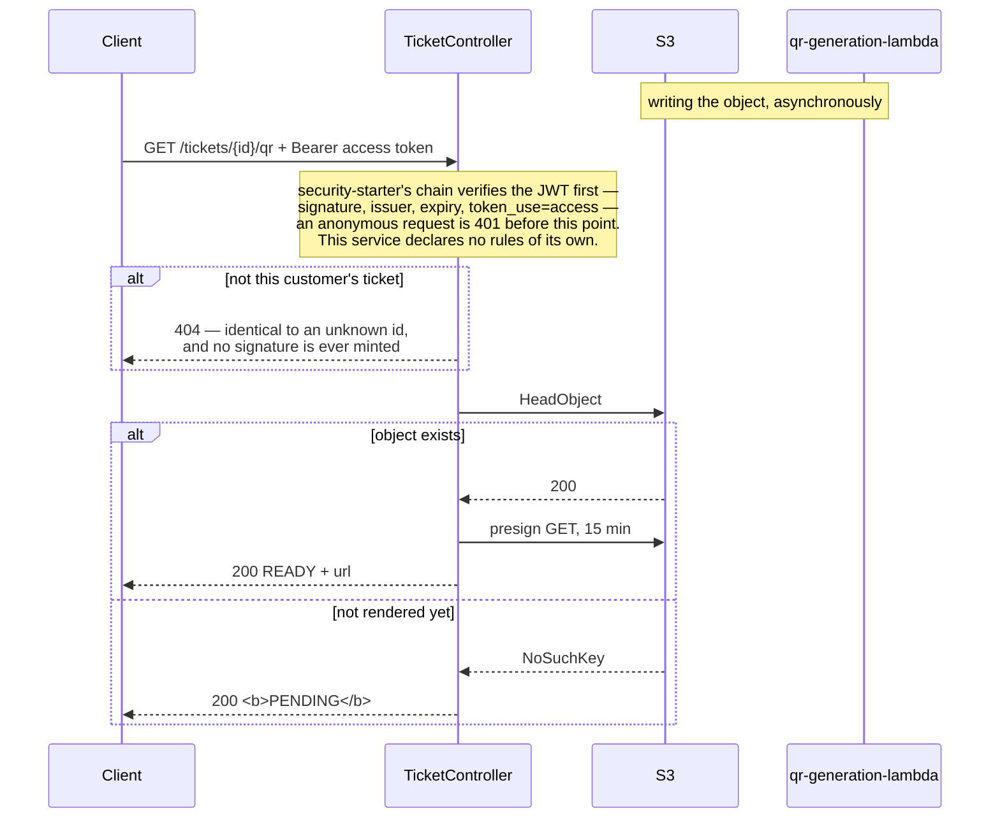

# ticket-issuance-service

Turns a captured payment into a ticket, then asks for its QR code. Tickets are created by
the SQS consumer and **never** by a request — there is deliberately no POST on the
controller, because an endpoint that issues a ticket would be a second path to the same
row that bypasses the saga entirely.

System context: [`docs/architecture.md`](../docs/architecture.md) ·
AWS setup: [`docs/runbook-ticket-issuance.md`](../docs/runbook-ticket-issuance.md)

## Components



## Idempotency is one line of SQL

```sql
CONSTRAINT uq_tickets_order_seat UNIQUE (order_id, seat_id)
```

SQS Standard is at-least-once and the saga retries `EnqueueTicketIssuance` up to four
times, so duplicate delivery is **ordinary operation**, not an edge case. A
`findByOrderIdAndSeatId` guard would be two statements with a race between them, and would
only protect against writers that remember to call it.



## The insert-then-enqueue gap, and why redelivery is the repair

`issue()` is not transactional: it spans an SQS send, the same mistake `CheckoutService`
avoids around the payment gateway. That leaves an obvious gap — the insert commits, the
send fails, and a ticket exists with no QR code.



## SqsMessagePump delivery semantics

Handwritten rather than an annotation, because these semantics are the point of the slice.



Three properties, in the order they matter:

1. **Delete only after the handler returns.** Deleting on receipt makes the queue an
   at-most-once channel and a crash mid-handler loses the work outright.
2. **A failed handler leaves the message alone.** No delete, no explicit nack — the queue
   owns the retry budget and the redrive policy.
3. **Redelivery is expected.** The pump adds two sources of duplication beyond SQS's own:
   a successful handler whose delete failed, and a shutdown mid-batch. Every handler wired
   to this class must be idempotent; that is a requirement of the transport.

## QR download



Three decisions in that diagram:

- **Ownership is settled before S3 is touched.** A presigned URL is a bearer token for the
  object, so the check guards the credential rather than the response: a caller who does
  not own the ticket never causes a signature to exist. It answers 404 rather than 403 for
  the same reason the listing returns an empty array — a 403 confirms the id is real, which
  is all anyone needs to walk the id space and learn who bought what.
- **`HeadObject`, not a flag on the ticket row.** Issuance and rendering are separate
  deployables writing to separate stores; a column here claiming the image exists would be
  a guess about someone else's state, and the presigned URL it produced would 404 in the
  customer's browser.
- **200 PENDING, not 404 or 202.** The ticket exists and is valid; only its rendering is
  in flight. A 404 would tell the client the ticket is wrong, and a 202 would imply this
  request started the work.

The bucket blocks all public access. A presigned URL scoped to one key for a few minutes
is what grants a customer their own ticket and nothing else — streaming the image through
a 0.25-vCPU Fargate task would buy nothing.

`GET /tickets/{ticketId}` — the URL the QR image itself encodes — is **not implemented**,
and that is now a deliberate deferral rather than the oversight slice 5 recorded. It is a
gate-scan endpoint: presented *to* a venue, not read *by* the buyer. What it needs is
exactly-once redemption, a conditional write in the same family as the seat hold, plus a
staff population with its own scope and its own devices. That is its own slice, and half of it
folded into the auth slice would have wasted the good one.

## Proven

`TicketIssuanceIT` (Testcontainers Postgres + LocalStack):
**20 concurrent deliveries of one purchase → 1 ticket, 19 duplicates all resolving to the
same ticket id; 4 queued copies → 1 ticket, queue drained** (2026-08-29).
`TicketIssuanceContractTest` pins `TicketIssuanceMessage`'s field names to
`docs/checkout-saga.asl.json`, which no compiler checks.
