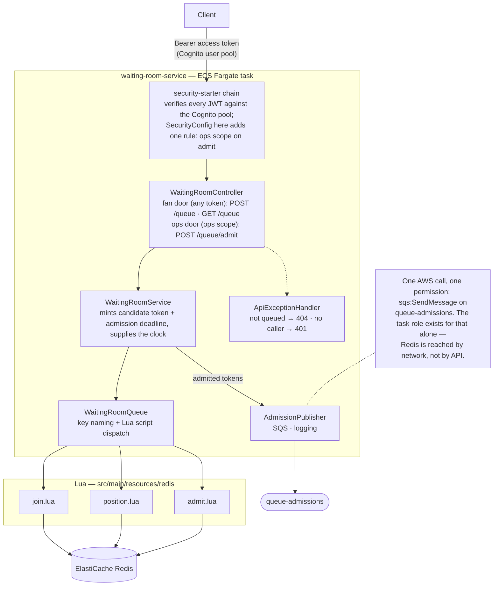
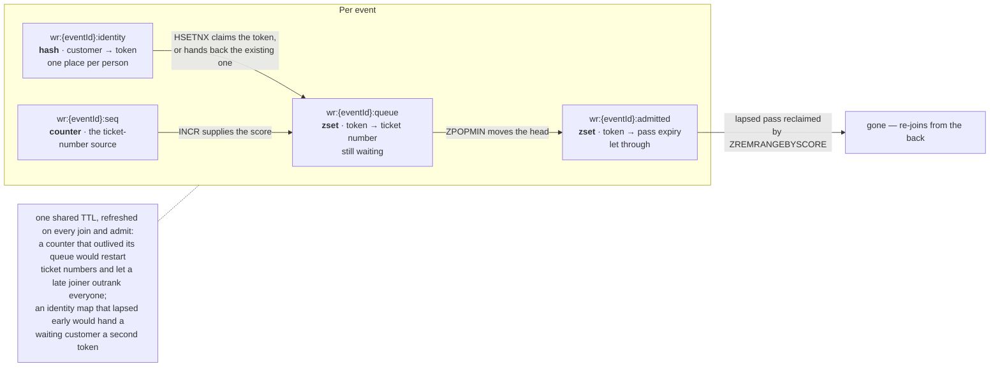
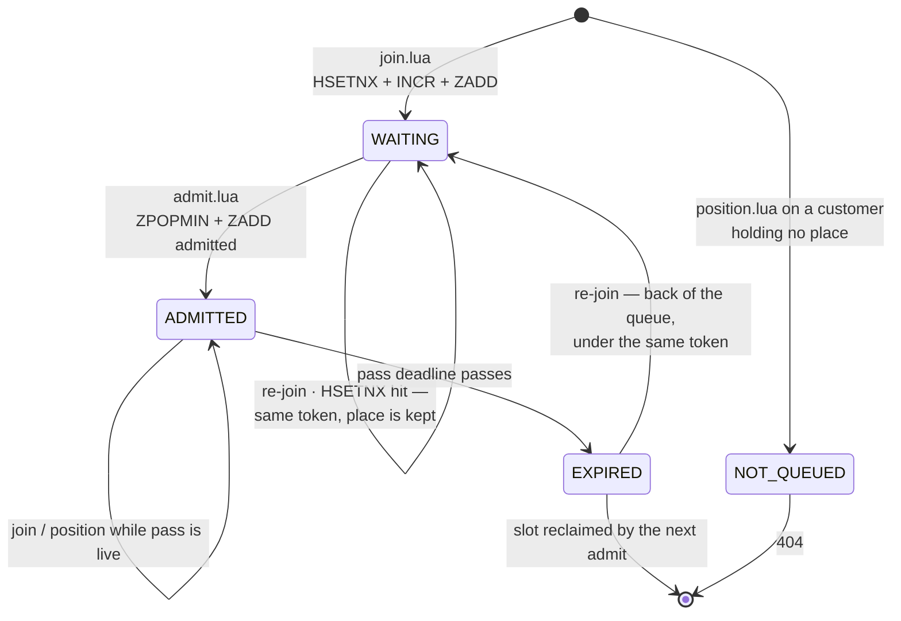
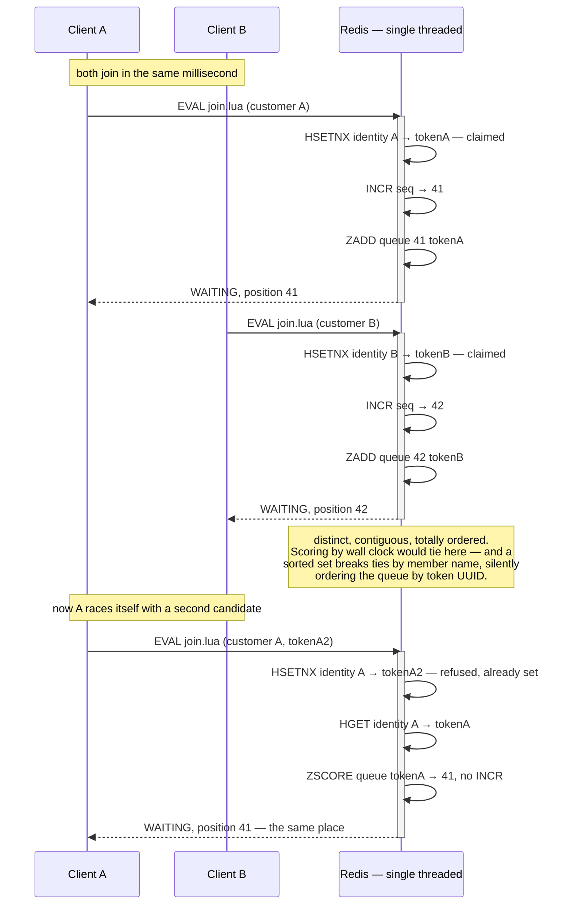

# waiting-room-service

Holds the line in front of the sale. One FIFO queue per event, in Redis sorted sets, with
the fairness guarantee coming from the data structure rather than from request arrival
order at the API layer — and **one place per person**, so that guarantee is about people
rather than about tokens.

System context: [`docs/architecture.md`](../docs/architecture.md) ·
AWS setup: [`docs/runbook-waiting-room-redis.md`](../docs/runbook-waiting-room-redis.md)

## Components

The service layer holds **no locking of its own** — it only mints candidate tokens and
deadlines. Every ordering, atomicity and uniqueness guarantee lives in the three scripts.

Every request carries a JWT from the Cognito user pool, and the chain `security-starter`
installs verifies it here — signature, issuer, expiry, and that it is an *access* token
rather than an ID token — before any controller runs. Nothing is trusted because of where it came from. The two
fan-door endpoints then act as the token's `sub`; neither takes a queue token in the URL,
which removes an entire class of request rather than rejecting it — there is no token for
one client to poll on another's behalf. `POST /queue/admit` pops real people off the head
of a real queue, so it requires the `ticketing/ops` scope, which only the
machine-to-machine app client can mint: a customer's token, valid and from the same pool,
is refused with 403 at the filter.

Publishing is the one thing here that may fail without failing the request. `ZPOPMIN` does
not roll back, so by the time `AdmissionPublisher` runs the tokens are already out of the
queue; reporting failure would make the caller retry the admit and pop a *second* batch of
people who were never told either. The exception stops at
`WaitingRoomService.admitNext` and the client's next `GET /queue` is the fallback —
the socket removes the need to poll, it is not what makes the answer true. With no
`admission-queue-url` configured the publisher logs instead, which is what lets the service
run locally with no AWS at all.

## What the dashboard reads

`WaitingRoomMetrics`: `waiting_room.joins{status}` and `waiting_room.admissions` are the
top of the funnel; `waiting_room.admission.publish.failures` is the only signal that
clients are back to polling. `waiting_room.queue.depth{event}` and
`waiting_room.admitted{event}` are `ZCARD` of the two sorted sets (`WaitingRoomQueue.sizes`,
two plain reads, nothing to be atomic with), refreshed every 30 s for the events this task
has seen. Depth is the number the slice exists to show falling under admission and rising
under a door-open. `admitted` counts lapsed passes until an admit reclaims them, so it is
an upper bound between admissions.

## Redis keys

All four share the `{eventId}` hashtag so a future clustered ElastiCache keeps them on
one slot; a script spanning slots is rejected outright.

The identity map is deliberately **not** pruned on admission. An admitted customer must
keep resolving to the token that carries their pass, or a re-join would mint a second one
and put them back in line while their admission was still valid.

## Place lifecycle

`position.lua` **reports** a lapsed pass as `EXPIRED` but never deletes it — reclaiming is
`admit.lua`'s job, which keeps the polling path free of writes and therefore safe to hit
hard.

## Why one Lua script per operation

Each operation must be a single atomic round trip. The scripts are where the reasoning
lives because that is where the commands are.

The second half is the guarantee that makes the first half worth anything. `HSETNX` is one
command with no read-then-write gap, so ten thousand simultaneous joins from one actor
produce one place — declared in Redis exactly as the seat hold is declared in a DynamoDB
conditional write and one-live-payment-per-order in a partial unique index. Without it the
ordering is impeccable and protects nobody: one person can be first ten thousand times.

The same argument for `admit.lua`: `ZPOPMIN` alone is already atomic, so two admitters can
never pop the same token. The reason it is a *script* is the **move** — pop and record are
two commands, and a token dropped between them would leave the queue without ever being
admitted.

## Proven

`WaitingRoomFairnessIT`, and the same run against real Fargate + ElastiCache:
**100 concurrent joins → 100 distinct contiguous places, admission order matched the
places handed out exactly, 0 duplicates** (2026-08-23).

The identity claim is proven by the pair of tests that say opposite things, and either
alone is a half-truth: **200 concurrent joins from 200 identities → 200 distinct places**,
and **200 concurrent joins from one identity → 1 place**, every attempt told the same
token. A scalper racing 200 joins against nine ordinary people leaves a room of ten.
