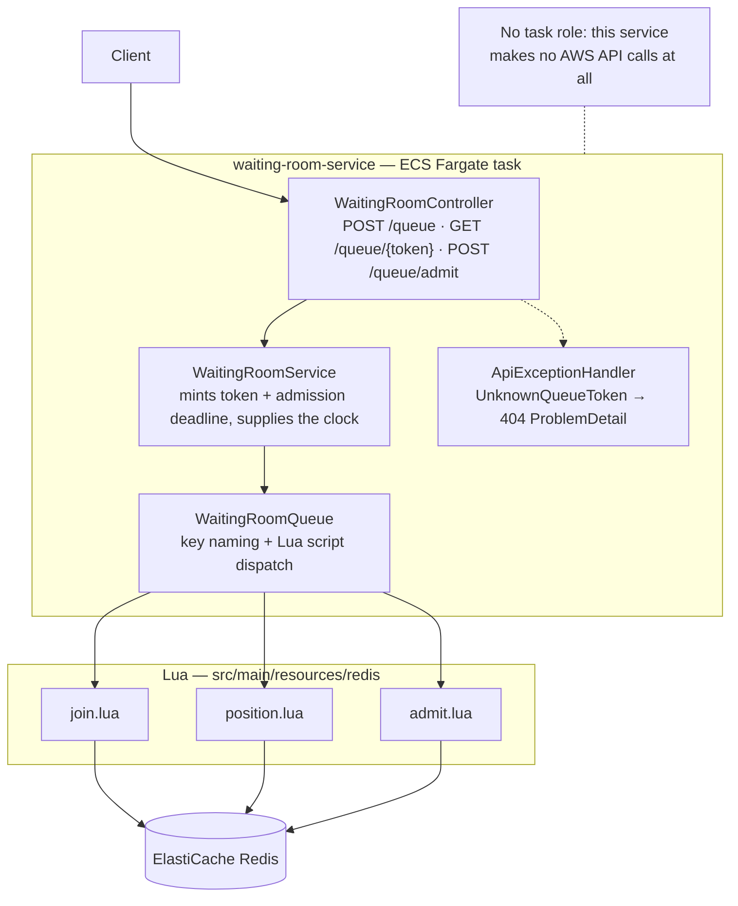
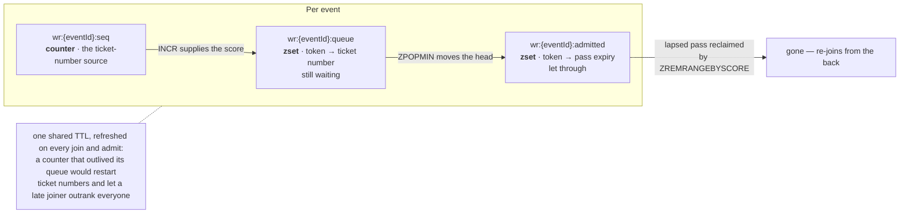
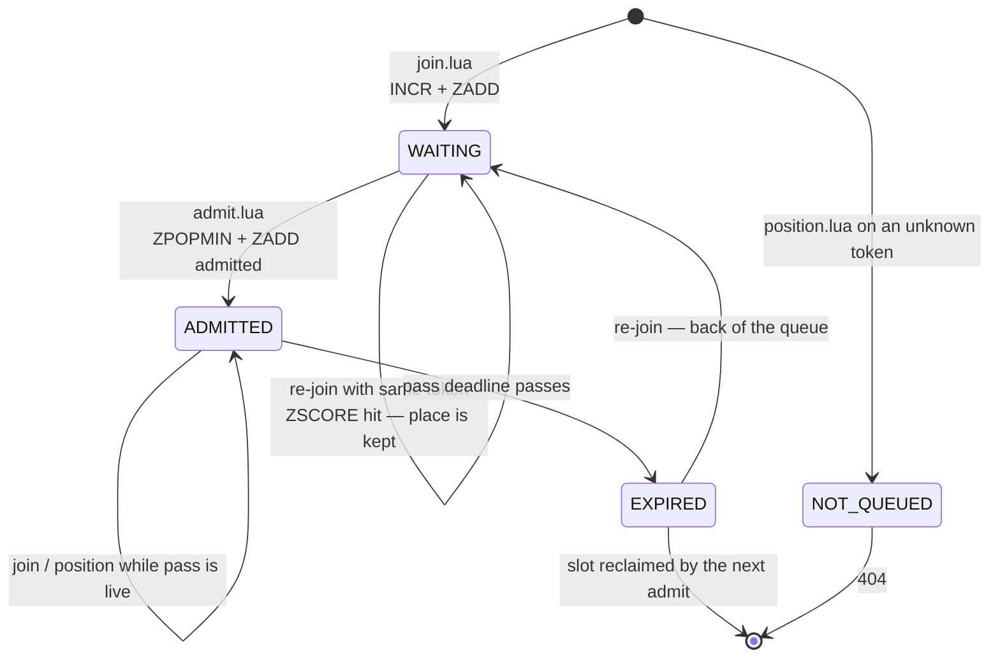
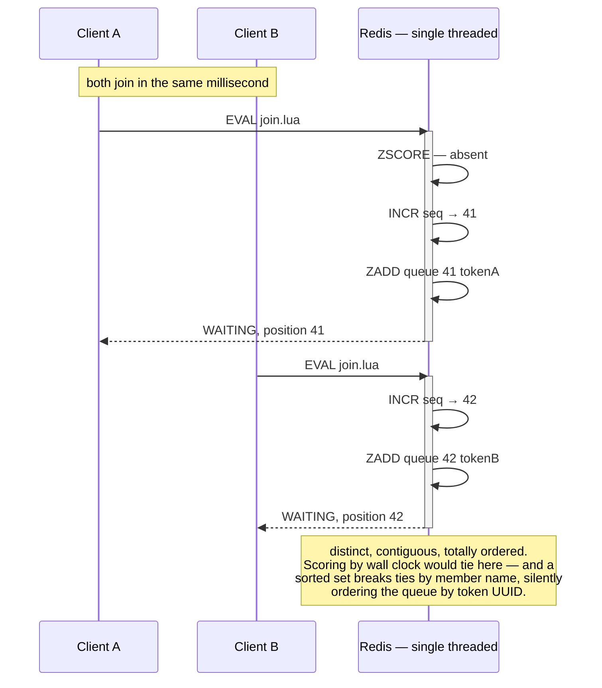

# waiting-room-service

Holds the line in front of the sale. One FIFO queue per event, in Redis sorted sets, with
the fairness guarantee coming from the data structure rather than from request arrival
order at the API layer.

System context: [`docs/architecture.md`](../docs/architecture.md) ·
AWS setup: [`docs/runbook-waiting-room-redis.md`](../docs/runbook-waiting-room-redis.md)

## Components

The service layer holds **no locking of its own** — it only creates identity and
deadlines. Every ordering and atomicity guarantee lives in the three scripts.

## Redis keys

All three share the `{eventId}` hashtag so a future clustered ElastiCache keeps them on
one slot; a script spanning slots is rejected outright.

## Token lifecycle

`position.lua` **reports** a lapsed pass as `EXPIRED` but never deletes it — reclaiming is
`admit.lua`'s job, which keeps the polling path free of writes and therefore safe to hit
hard.

## Why one Lua script per operation

Each operation must be a single atomic round trip. The scripts are where the reasoning
lives because that is where the commands are.

The same argument for `admit.lua`: `ZPOPMIN` alone is already atomic, so two admitters can
never pop the same token. The reason it is a *script* is the **move** — pop and record are
two commands, and a token dropped between them would leave the queue without ever being
admitted.

## Proven

`WaitingRoomFairnessIT`, and the same run against real Fargate + ElastiCache:
**100 concurrent joins → 100 distinct contiguous places, admission order matched the
places handed out exactly, 0 duplicates** (2026-08-23).
